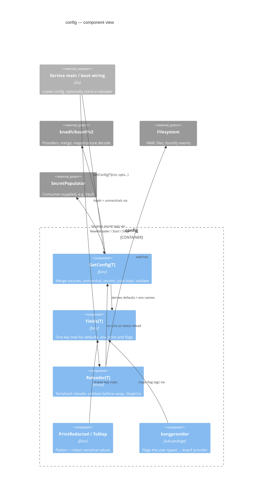

# config

Typed configuration loading for Go services on top of [koanf](https://github.com/knadh/koanf): struct-tag defaults, YAML files, environment variables and CLI flags merged in a fixed precedence, then secrets, post-load hooks and validation in one pipeline. `Reloader[T]` re-runs that pipeline on file change, poll or signal and swaps only a config that passed it; `PrintRedacted` and `ToMap` print a config with its secrets masked.

## Architecture



```txt
caller ──GetConfig[T]──▶ GetConfig ──▶ koanf (files, env, providers) ──▶ unmarshal
                              │                                          │
                              └─ Fields[T]: defaults + env names         ▼
                                                     secrets ─▶ post-load ─▶ validate
caller ──NewReloader/Start/Stop──▶ Reloader ──re-runs──▶ GetConfig pipeline ──swap on success
```

**Entry points**
- `GetConfig[T](ctx, opts...)` — one-shot load for boot.
- `NewReloader[T](ctx, reloadOpts, configOpts...)`, then `Start(ctx)` / `Stop(ctx)` / `Reload(ctx)` / `Config()` — hot reload.
- `PrintRedacted(cfg, opts...)`, `ToMap(cfg, redact)` — diagnostics; `Reloader.ReloadHandler()` — operator endpoint.
- `kongprovider.WithOverridesFromTags[T](kongCtx)` — CLI flags as the highest-precedence source.

**Exit points**
- A populated `*T`, or for a `Reloader` an atomically swapped pointer plus `WithOnChange` callbacks.
- Reads of YAML files and `PREFIX_*` environment variables; calls into the consumer's `SecretPopulator`, post-load hooks and validator.
- Reload events on the `WithLogger` logger; failures on `WithOnReloadError`; counters on `Stats()`.

**Failure modes**
- Required or previously loaded file missing / unreadable → `ErrFileRead` (E7003), cause `*fs.PathError`.
- File not valid YAML → `ErrFileParse` (E7004), cause the parser error with its line.
- Secret backend error → `ErrSecretProvider` (E7005); hook error → `ErrPostLoad` (E7007); validation → `ErrValidation` (E7002).
- Any of those during a reload → `ErrReload` (E7006) wrapping it; the previous config stays live.
- Manual reload while one runs → `ErrReloadInProgress` (E7008, 409); after `Stop` → `ErrReloaderStopped` (E7009, 503). Neither is a failure.
- Reload whose context ended → error carrying `ctx.Err()`; not counted, not reported as a failure.

**Dependencies**
- *Imports*: `knadh/koanf/v2` (+ yaml, env, file, confmap), `go-viper/mapstructure/v2`, `go-playground/validator/v10`, `fsnotify/fsnotify`; `kongprovider` adds `alecthomas/kong`.

## Quick Start

```go
package main

import (
	"context"
	"log"
	"os"
	"time"

	"github.com/ashtonian/pkg/config"
)

type DBConfig struct {
	Host     string `koanf:"host" default:"localhost"`
	MaxConns int    `koanf:"max_conns" default:"25" validate:"min=1"`
	Password string `koanf:"password" default:"hunter2"`
}

type AppConfig struct {
	Port    int           `koanf:"port" default:"8080" validate:"min=1,max=65535"`
	Timeout time.Duration `koanf:"timeout" default:"30s"`
	DB      DBConfig      `koanf:"db"`
}

func main() {
	ctx := context.Background()
	cfg, err := config.GetConfig[AppConfig](ctx,
		config.WithConfigFile("config.yaml"), // optional: skipped when absent
		config.WithEnvPrefix("APP"),          // APP_PORT, APP_DB_MAX_CONNS, ...
	)
	if err != nil {
		log.Fatal(err)
	}
	if err := config.PrintRedacted(cfg, config.WithWriter(os.Stdout)); err != nil {
		log.Fatal(err)
	}
}
```

Mirrored by `Example` in `example_test.go`, which prints:

```txt
FIELD         VALUE       TYPE
------------------------------------------
port          8080        int
timeout       30s         time.Duration
db.host       localhost   string
db.max_conns  25          int
db.password   [REDACTED]  string
```

Environment names come from the key tree, so an underscore inside a key survives: `APP_DB_MAX_CONNS` sets `db.max_conns`.

### Hot reload

```go
reloader, err := config.NewReloader[AppConfig](ctx,
	[]config.ReloadOption[AppConfig]{
		config.WithFileWatch[AppConfig](0), // 0 = DefaultFileWatchDebounce (500ms)
		config.WithSignalReload[AppConfig](syscall.SIGHUP),
		config.WithOnChange(func(old, new *AppConfig) { limiter.SetRate(new.Rate) }),
		config.WithOnReloadError[AppConfig](func(trigger string, err error) { reloadFailures.Inc() }),
	},
	config.WithLogger(logger),
	config.WithConfigFile("config.yaml"),
	config.WithEnvPrefix("APP"),
)
if err != nil {
	return err
}
go func() { _ = reloader.Start(ctx) }()
defer func() { _ = reloader.Stop(shutdownCtx) }() // returns once no reload can run

cfg := reloader.Config() // lock-free on the hot path
```

Reloads are serialized. A watcher-driven reload waits for one already running and then re-reads the sources, so no change is lost; a manual `Reload` that finds one running returns `ErrReloadInProgress` instead. `Stop(ctx)` cancels an automatic reload in flight, waits for a manual one, and after it returns no reload runs and no callback fires. Callbacks must not call `Stop`.

For a source the reloader cannot watch — a `WithProvider` store, a replicated log, an admin API — call `reloader.SourceChanged()` from the code that learns of the change. It never blocks, coalesces a burst into one reload, and that reload starts after the call, so it reads the change. Do not call `Reload` from an event handler and treat `ErrReloadInProgress` as "coalesced": the reload in flight may have read the source before the change landed. `Start` serves `SourceChanged` requests, so run it even with no watchers configured.

## Configuration

### Load options (`Option`)

Source precedence, highest first: `WithProvider` (incl. `kongprovider`) > environment > files (left-to-right) > `WithDefaults` > `default` tags.

| Option | Type | Default | Description |
|--------|------|---------|-------------|
| `WithEnvPrefix(prefix)` | `string` | none (env not read) | Read `PREFIX_*` variables, named from the key tree. |
| `WithConfigFile(path)` | `string` | none | Optional YAML file: skipped when missing; unreadable → `ErrFileRead`; invalid YAML → `ErrFileParse`. Under a `Reloader`, required once loaded. |
| `WithConfigFiles(paths...)` | `...string` | none | Several optional files, merged left-to-right. |
| `WithMustConfigFile(path)` | `string` | none | Required YAML file: missing or unreadable → `ErrFileRead`; invalid YAML → `ErrFileParse`. |
| `WithMustConfigFiles(paths...)` | `...string` | none | Several required files, merged left-to-right. |
| `WithDefaults(m)` | `map[string]any` | none | Programmatic defaults keyed by dot-path; override `default` tags. Repeated calls merge (later wins per key); the map is copied. |
| `WithProvider(p)` | `koanf.Provider` | none | Extra source at the highest precedence, loaded in the order added. |
| `WithSecretPopulator(fn)` | `SecretPopulator` | nil (no secrets) | Fills `secret`-tagged fields after unmarshal; errors wrap `ErrSecretProvider`. |
| `WithPostLoad[T](fn)` | `func(context.Context, *T) error` | none | Normalize/derive after secrets, before validation; errors wrap `ErrPostLoad`. |
| `WithValidator(v)` | `Validator` | `validator.New()` | Any `Struct(any) error`, e.g. a ModelValidator; one that also has `StructCtx(ctx, v)` gets the load's ctx. |
| `WithSkipValidation()` | — | validation on | Skip validation, including `validate:"required"`. |
| `WithLogger(l)` | `*slog.Logger` | `slog.Default()` | Loader diagnostics and, via `NewReloader`, every reload event. |

### Reload options (`ReloadOption[T]`)

| Option | Type | Default | Description |
|--------|------|---------|-------------|
| `WithFileWatch[T](debounce)` | `time.Duration` | off; `0` → 500ms | fsnotify watch of every configured file, including symlink / ConfigMap swaps. A continuous stream of events delays a reload by at most ten debounce windows. |
| `WithPollInterval[T](d)` | `time.Duration` | off | Reload every `d`; for env vars, providers and unreliable filesystems. |
| `WithSignalReload[T](sigs...)` | `...os.Signal` | off | Reload on each signal, typically `SIGHUP`. |
| `WithOnChange[T](fn)` | `func(old, new *T)` | none | After each successful reload. Panics recovered. |
| `WithOnReloadError[T](fn)` | `func(trigger string, err error)` | none | After each failed reload from any trigger. Panics recovered. |

`DefaultFileWatchDebounce` is 500ms. `WithFileWatch` cannot see `subPath` ConfigMap mounts, env or provider changes, or (on macOS/BSD) a relink through a renamed-away temp name — use `WithPollInterval` for those.

### Print options (`PrintOption`)

| Option | Type | Default | Description |
|--------|------|---------|-------------|
| `WithFormat(f)` | `string` | `FormatTable` | `FormatTable`, `FormatJSON` or `FormatEnv`; anything else is an error. |
| `WithWriter(w)` | `io.Writer` | `os.Stdout` | Output destination; write errors are returned. |
| `WithShowSensitive(b)` | `bool` | `false` | Print sensitive values instead of `[REDACTED]`. |
| `WithSortByName()` | — | declaration order | Sort entries by key. |
| `WithIncludeDescriptions()` | — | off | Add `desc` tag text to each entry. |

### Struct tags

| Tag | Description | Example |
|-----|-------------|---------|
| `koanf` | Key segment; `-` skips, `,squash` merges into the parent, `,remain` is a catch-all map. | `koanf:"max_conns"` |
| `default` | Lowest-precedence default; comma-separated for slices. | `default:"localhost"` |
| `validate` | [go-playground/validator](https://pkg.go.dev/github.com/go-playground/validator/v10) rules. | `validate:"required,min=1"` |
| `sensitive` | Redact in printed output — on a struct, slice or map, everything inside it. | `sensitive:"true"` |
| `secret` | Key for the `SecretPopulator` to resolve. | `secret:"db/password"` |
| `desc` | Description for `WithIncludeDescriptions`. | `desc:"Server hostname"` |
| `flag` | Kong flag name for `kongprovider.WithOverridesFromTags`. | `flag:"port"` |

Field names — and map keys, since printing expands maps and dynamic `any` values entry by entry (`settings[password]`) — containing `password`, `secret`, `token`, `key`, `credential`, `auth`, `private`, `apikey` or `api_key` are redacted without a tag. A struct implementing `encoding.TextUnmarshaler` (`time.Time`, `netip.Addr`) is one key, not a subtree. A recursive type stops at the recursion: its nested part decodes from files but gets no default, env or flag key.

## API Reference

### Loading

- `GetConfig[T](ctx, opts...) (*T, error)` — load, secrets, post-load, validate.
- `Fields[T]() []Field` — every leaf key of `T`: `Path`, `Tag`, `Type`.
- `DefaultsFromTags[T]() map[string]any` — `default` tags keyed by path.

### Reloading

- `NewReloader[T](ctx, reloadOpts, configOpts...) (*Reloader[T], error)` — initial load + reloader.
- `(*Reloader[T]).Config() *T` — current config, atomic load.
- `(*Reloader[T]).Reload(ctx) (*T, error)` — manual reload; `ErrReloadInProgress` if one is running.
- `(*Reloader[T]).Start(ctx) error` — run the reload loop (watchers + `SourceChanged` requests) until `Stop` or ctx.
- `(*Reloader[T]).SourceChanged()` — non-blocking, coalescing request to reload after a change the reloader does not watch.
- `(*Reloader[T]).Stop(ctx) error` — stop and wait until no reload can run.
- `(*Reloader[T]).Stats() ReloadStats` — attempts, successes, failures, last trigger/success/failure/error.
- `(*Reloader[T]).ReloadHandler() http.Handler` — POST → reload; 200 / 409 / 503 / 500.
- `TriggerManual`, `TriggerFileChange`, `TriggerPoll`, `TriggerSignal`, `TriggerSourceChanged` — bounded trigger labels.

### Printing

- `PrintRedacted(cfg, opts...) error` — table / JSON / env output with redaction.
- `ToMap(cfg, redact) map[string]any` — flattened key → value map.

### Errors

- `Codes() []errcontract.CodeDef`, `RegisterTo(errcontract.Store)` — the E-code catalog.

## Error Codes

| Code | HTTP | Sentinel | Retryable | Description |
|------|------|----------|-----------|-------------|
| E7002 | 422 | `ErrValidation` | No | Validation failed; `errors.As` yields `validator.ValidationErrors`. |
| E7003 | 500 | `ErrFileRead` | Unknown | Config file missing (required or previously loaded) or unreadable; `*fs.PathError` in the chain. |
| E7004 | 500 | `ErrFileParse` | No | Config file is not valid YAML; parser error with line in the chain. |
| E7005 | 500 | `ErrSecretProvider` | Yes | `SecretPopulator` failed; its error in the chain. |
| E7006 | 500 | `ErrReload` | Yes | Reload failed and the previous config is live; wraps the load error. |
| E7007 | 500 | `ErrPostLoad` | No | A `WithPostLoad` hook failed; its error in the chain. |
| E7008 | 409 | `ErrReloadInProgress` | Yes | Manual reload found one running. Does not match `ErrReload`. |
| E7009 | 503 | `ErrReloaderStopped` | No | Reload requested after `Stop`. Does not match `ErrReload`. |

Every error carries its category and its cause: `errors.Is(err, config.ErrReload) && errors.Is(err, config.ErrFileParse)` both hold for a reload that hit a YAML syntax error.

## Key Files

| File | Responsibility |
|------|----------------|
| `config.go` | `GetConfig[T]`, `Option` and every load option, the load pipeline, file-error classification |
| `fields.go` | `Fields[T]` key-tree walker, `DefaultsFromTags[T]`, environment-variable mapping |
| `reloader.go` | `Reloader[T]`, reload options, single-flight slot, `Start` loop, `Stop`, file watch + debounce |
| `handler.go` | `Reloader.ReloadHandler` HTTP endpoint |
| `print.go` | `PrintRedacted`, `ToMap`, print options, redaction walk |
| `errors.go` | E7002–E7009 CodeDefs and sentinels, the validation error wrapper |
| `doc.go` | Package documentation |
| `kongprovider/` | Kong CLI flags → highest-precedence koanf provider |

## Dependencies

- *Imports*: `github.com/knadh/koanf/v2` and its yaml / env / file / confmap modules, `github.com/go-viper/mapstructure/v2`, `github.com/go-playground/validator/v10`, `github.com/fsnotify/fsnotify`.
- *Standard backends used*: none — sources are koanf providers and the local filesystem.

## Spec Reference

- [knadh/koanf](https://github.com/knadh/koanf) — wrapped library
