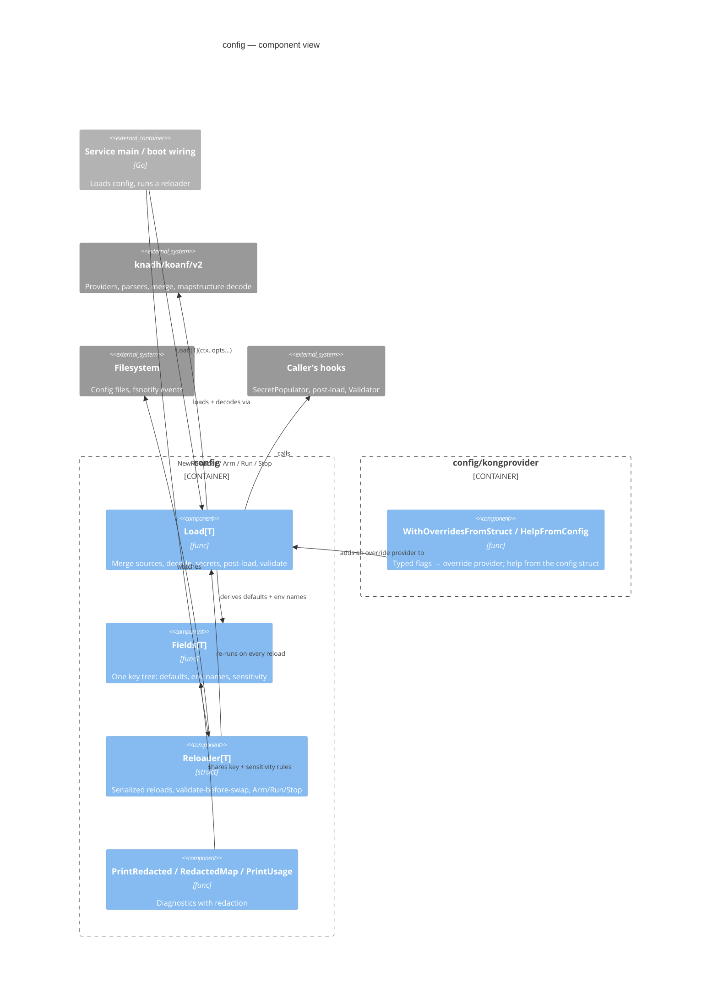

# config

Typed configuration snapshots for Go services, built on [koanf](https://github.com/knadh/koanf). `Load[T]` merges struct-tag defaults, files, environment variables and explicit CLI overrides into a `*T`, then resolves secrets, normalizes and validates it in one pipeline; `Reloader[T]` re-runs that pipeline on a file change, signal, poll tick or application notification and publishes a new config only when it passed, keeping the last valid one live otherwise. The errors it writes name the failing key and quote no value meant for a sensitive field, and the same key rules drive environment names, redacted printing, operator usage and the Kong CLI bridge.

## When to use it

Reach for it when a long-running service has a hierarchical configuration, takes it from more than one source, and needs to change it without a restart. Its value is the lifecycle around koanf: one pipeline at boot and on every reload, validate-before-swap publication, coordinated triggers, and diagnostics that cannot leak a credential.

| Situation | Better choice |
|---|---|
| Environment variables are the only source and config is read once | [`caarlos0/env`](https://github.com/caarlos0/env) or [`sethvargo/go-envconfig`](https://github.com/sethvargo/go-envconfig) |
| A CLI tool whose config file mostly supplies flag defaults | Kong alone with [`kong.Configuration`](https://github.com/alecthomas/kong#configuration-files) and a YAML/JSON resolver |
| A small program that loads once and already has a koanf loader | Plain koanf — the startup convenience alone is not worth switching |
| A service with files + env + CLI overrides, validation, and live reload | This package |

What it adds over koanf alone:

| Concern | koanf | This package |
|---|---|---|
| Defaults | Load a map or a populated struct | `default:"..."` tags as the lowest layer, then `WithDefaults` (deep-copied) |
| Environment names | A callback per variable | Names derived from the key tree: `APP_DB_MAX_CONNS` → `db.max_conns`, map entries matched by shape, ambiguous names refused |
| Pipeline | `Load` calls, then `Unmarshal` | Fixed merge → decode → secrets → post-load → validate, identical at boot and on reload |
| Validation | None | go-playground validator by default, errors named by config key (`db.max_conns(min=1)`) |
| Reload | A provider's `Watch` callback | `Reloader[T]`: validate-before-swap, serialized reloads, debounce, symlink- and ConfigMap-aware watch, poll, signals, `SourceChanged`, readiness arming, stats |
| Diagnostics | `Sprint`, `All` | `PrintRedacted`, `RedactedMap`, `PrintUsage`; decode errors withhold sensitive values |
| CLI | `posflag` / `basicflag` providers | `kongprovider`: only typed flags override; help from the config struct |

Everything koanf can read stays reachable: any `koanf.Provider` loads below the files (`WithBaseProvider`) or above the environment (`WithOverrideProvider`), with any `koanf.Parser`, and `WithDecodeHook` adds mapstructure hooks.

## Quick Start

```go
package main

import (
	"context"
	"log"
	"os"
	"time"

	"github.com/ashtonian/pkg/config"
)

type DBConfig struct {
	Host     string `koanf:"host" default:"localhost" desc:"Database host"`
	MaxConns int    `koanf:"max_conns" default:"25" validate:"min=1" desc:"Connection pool size"`
	Password string `koanf:"password" validate:"required" desc:"Database password"`
}

type AppConfig struct {
	Port    int           `koanf:"port" default:"8080" validate:"min=1,max=65535" desc:"HTTP listen port"`
	Timeout time.Duration `koanf:"timeout" default:"30s" desc:"Request timeout"`
	DB      DBConfig      `koanf:"db"`
}

func main() {
	cfg, err := config.Load[AppConfig](context.Background(),
		config.WithFile("config.yaml"), // optional: skipped when absent
		config.WithEnvPrefix("APP"),    // APP_PORT, APP_DB_MAX_CONNS, APP_DB_PASSWORD, ...
	)
	if err != nil {
		log.Fatal(err) // names the failing key, never a secret's value
	}
	if err := config.PrintRedacted(cfg, config.WithWriter(os.Stderr)); err != nil {
		log.Fatal(err)
	}
}
```

```txt
$ go run .
2026/10/13 09:00:00 validating config: configuration validation failed: db.password(required)

$ APP_DB_PASSWORD=s3cret APP_DB_MAX_CONNS=50 go run .
FIELD         VALUE       TYPE
------------------------------------------
port          8080        int
timeout       30s         time.Duration
db.host       localhost   string
db.max_conns  50          int
db.password   [REDACTED]  string
```

The program is `examples/quickstart/main.go`, and a test fails when this block drifts from it. The `Example` functions named in the sections below (`example_test.go`, `kongprovider/example_test.go`) run with their output checked on every test run.

## Architecture



```txt
caller ──Load[T]──▶ defaults ▸ base providers ▸ files ▸ env ▸ overrides ──merge──▶ decode
                                                                                     │
                     Fields[T]: defaults, env names, sensitivity        secrets ◀────┘
                                                                           │
                                                                   post-load ▸ validate ──▶ *T
caller ──NewReloader / Arm / Run / Stop──▶ Reloader ──re-runs the pipeline──▶ swap only on success
```

**Entry points**
- `Load[T](ctx, opts...)` — one load, for boot.
- `NewReloader[T](ctx, loadOpts, opts...)` or `NewReloaderFunc(ctx, load, opts...)`, then `Arm` / `Run` / `Stop` / `Reload` / `SourceChanged` / `Config` / `Stats` — hot reload.
- `PrintRedacted`, `RedactedMap`, `PrintUsage[T]` — diagnostics.
- `kongprovider.WithOverridesFromStruct[T]`, `kongprovider.HelpFromConfig[T]` — the Kong bridge.

**Exit points**
- A populated `*T`; for a `Reloader`, an atomically swapped pointer plus `WithOnReloadSuccess` callbacks.
- Reads of config files, `PREFIX_*` environment variables (or `WithEnviron`) and koanf providers; calls into the caller's secret populator, post-load hooks and validator.
- Reload events on the logger; failed reloads on `WithOnReloadError`; counters on `Stats()`.

**Failure modes**
- Required or previously loaded file missing or unreadable → `ErrFileRead`, cause `*fs.PathError`.
- File the parser rejects → `ErrFileParse`, cause a `*ParseError` naming the file and line.
- Defaults or a provider failing to load → `ErrSource`.
- Secret populator error → `ErrSecretProvider`; hook error → `ErrPostLoad`.
- Validation, a value of the wrong type, an environment variable that fits two keys, or (with `WithStrictKeys`) an unknown key → `ErrValidation`.
- Any of those during a reload → `ErrReload` wrapping it; the previous config stays live.
- Manual reload while one runs → `ErrReloadInProgress`; after `Stop` → `ErrReloaderStopped`. Neither is a failure.
- Reload whose context ended → error carrying `ctx.Err()`; not counted, not reported.

**Dependencies**
- *Imports*: `knadh/koanf/v2` (+ the yaml parser and confmap provider), `go-viper/mapstructure/v2`, `go-playground/validator/v10`, `fsnotify/fsnotify`; `kongprovider` adds `alecthomas/kong`.

## Defining the config struct

A config is a plain struct. Tags say how each field is keyed, defaulted, validated and shown:

| Tag | Description | Example |
|-----|-------------|---------|
| `koanf` | Key segment; `-` skips the field, `,squash` merges a struct into its parent, `,remain` collects unknown keys in a map. | `koanf:"max_conns"` |
| `default` | Lowest-precedence default; comma-separated for a slice. | `default:"localhost"` |
| `validate` | [go-playground/validator](https://pkg.go.dev/github.com/go-playground/validator/v10) rules. | `validate:"required,min=1"` |
| `sensitive` | Redact in every output; on a struct, slice or map, everything inside it. | `sensitive:"true"` |
| `desc` | Description for `PrintUsage`, `WithIncludeDescriptions` and Kong help. | `desc:"Server hostname"` |
| `secret` | Key for your `SecretPopulator`; not read by this package. | `secret:"db/password"` |
| `flag` | Kong flag name, for `kongprovider`. | `flag:"port"` |

Key rules (`Fields[T]` is their single implementation, shared by defaults, environment names, printing and the Kong bridge):

- A key segment is the `koanf` tag's name, or the lowercased field name when the tag has none.
- Unexported fields, `koanf:"-"` and `,remain` are not keys; `,squash` merges a struct's keys into its parent.
- Pointers are followed. A struct implementing `encoding.TextUnmarshaler` (`time.Time`, `netip.Addr`) is one key decoded from one string, not a subtree.
- Maps, slices, arrays and interfaces are keys of their own; a map's entries are addressed beneath it (`labels.team`). The `default` tags of a map's or slice's element struct apply to every entry the sources create, below what they set: an entry `features.audit` gets `limit: 50` from `Limit int default:"50"` unless a source set it. An entry or field set to `null` is explicit and stays null, so a null that turns an optional part off is not turned back on; write `{}` for an entry that should take its defaults.
- A recursive type stops at the recursion: its nested part decodes from files but has no default, environment or flag key.

## Sources and precedence

Highest wins:

| Layer | Option | Notes |
|-------|--------|-------|
| 1 | `WithOverrideProvider(p, parser)` | Explicit operator overrides, e.g. CLI flags through `kongprovider`; loaded in the order added. |
| 2 | `WithEnvPrefix(prefix)` | `PREFIX_*` variables, named from the key tree (below). |
| 3 | `WithFile` / `WithRequiredFile` | Merged in the order added. YAML by default (JSON is valid YAML); `WithFileParser` sets another koanf parser. |
| 4 | `WithBaseProvider(p, parser)` | A remote or generated base the files refine: Consul, etcd, S3, an HTTP endpoint. |
| 5 | `WithDefaults(map)` | Programmatic defaults keyed by dot-path; deep-copied when the option is created. |
| 6 | `default:"..."` tags | Always loaded. |

An optional file (`WithFile`) may be absent; one that exists but cannot be read or parsed fails the load, exactly as a required file does. Under a `Reloader`, a file that loaded once is required from then on, so a deleted file fails the reload instead of silently reverting its keys.

A provider is any `koanf.Provider`. Pass a nil parser for one that returns a map (`Read`) and a parser for one that returns bytes (`ReadBytes`):

```go
cfg, err := config.Load[AppConfig](ctx,
	config.WithBaseProvider(consulProvider, nil),                    // map-returning provider
	config.WithBaseProvider(file.Provider("base.toml"), toml.Parser()), // bytes + any koanf parser
	config.WithFile("config.yaml"),
	config.WithEnvPrefix("APP"),
)
```

A provider that also implements `ContextProvider` (`ReadContext` / `ReadBytesContext`) is read with the load's context, so a remote read stops when the load is cancelled — by its caller, or by a `Reloader`'s `Stop`.

Keys match fields regardless of letter case, as decoding does. Before sources merge, each one's keys are rewritten into the fields' own spelling, so a higher-precedence `Port: 9000` beats a default `port` whatever the case; a source that spells one field two ways (`port` and `Port`) fails with `ErrValidation`.

`ExampleLoad_layers` loads one key from each layer.

## Environment variables

With `WithEnvPrefix("APP")`, each key's variable is the prefix plus its path upper-cased with `.` → `_`. The name is looked up in the key tree rather than split, so an underscore inside a key survives:

| Variable | Key |
|----------|-----|
| `APP_DB_MAX_CONNS` | `db.max_conns` |
| `APP_LISTEN_ADDR` (a `netip.Addr`) | `listen_addr` |
| `APP_FEATURES_AUDIT_LOGS_MAX_PAGE_SIZE` (`Features map[string]Limits`) | `features.audit_logs.max_page_size` |
| `APP_LABELS_TEAM_NAME` (`Labels map[string]string`) | `labels.team_name` |
| `APP_TAGS=web,api` (`Tags []string`) | `tags` = `[web api]` |

A map of structs reads `PREFIX_<MAP>_<KEY>_<FIELD>`, where `FIELD` is one of the element's keys and `KEY` is the rest; any other map reads `PREFIX_<MAP>_<KEY>`. Map keys are lower-cased.

A variable that fits two keys is refused, and the load fails with `ErrValidation` naming every reading rather than picking one: two fields whose keys share a name (`db.port` and `db_port` are both `APP_DB_PORT`), a field and a map entry, two maps whose names prefix one another (`limits` and `limits_per`), or two element fields where one name ends the other (`size` and `max_page_size`). Rename a field or a key so only one reading fits. A variable under the prefix that fits no key is not loaded; its name is logged at debug level.

`WithEnviron(fn)` replaces `os.Environ` as the source of variables — a fixed list in tests and examples, or variables gathered elsewhere by a deployment adapter. `PrintUsage` lists every variable a config reads.

## Decoding

Values decode with mapstructure using `koanf` tags and weak typing (a string `"8080"` fills an `int`), plus three built-in hooks: string → `time.Duration`, comma-separated string → slice, and `encoding.TextUnmarshaler`. `WithDecodeHook` adds your own; they run first, so a hook can take over a conversion the built-ins would make:

```go
semicolons := func(from, to reflect.Type, data any) (any, error) {
	if from.Kind() == reflect.String && to == reflect.TypeFor[[]string]() {
		return strings.Split(data.(string), ";"), nil
	}
	return data, nil
}
cfg, err := config.Load[AppConfig](ctx, config.WithDecodeHook(mapstructure.DecodeHookFuncType(semicolons)))
```

`WithStrictKeys()` fails the load with `ErrValidation` when a file, provider or `WithDefaults` sets a key no field decodes — a typo, or a setting that was removed — naming each key (`server.prot`, `items[0].prot`, `named[primary].prot`). The decoder reports the keys it did not use as it decodes the merged sources, so the check follows decoding exactly: into slice elements and the entries of a map of structs, through squashed structs, and past input a decode hook or a self-decoding type consumes. A map's own keys (`labels.example.com`), anything beneath an interface, and keys a `,remain` field collects are accepted. The merged tree does not record which source set a key, so the error names keys only. Environment variables cannot trip it: one that fits no key is not loaded.

```txt
unmarshaling config: configuration validation failed: keys no field of main.AppConfig decodes: server.prot
```

## Secrets

The package resolves no secrets itself. `WithSecretPopulator` hands your resolver the load's context and a pointer to the decoded config, after decoding and before post-load hooks and validation; its error fails the load with `ErrSecretProvider`:

```go
cfg, err := config.Load[AppConfig](ctx,
	config.WithFile("config.yaml"),
	config.WithSecretPopulator(func(ctx context.Context, target any) error {
		c := target.(*AppConfig)
		pw, err := vault.Read(ctx, "db/password") // your backend, your timeout
		if err != nil {
			return fmt.Errorf("db password: %w", err)
		}
		c.DB.Password = pw
		return nil
	}),
)
```

Under a `Reloader` the populator runs on every reload, so a rotated secret is picked up by the next reload, and a backend outage fails that reload while the previous config stays live. Mark resolved fields `sensitive:"true"` (or give them a credential-like name) so no output shows them.

## Post-load hooks

`WithPostLoad` runs after secrets and before validation, for derivation and normalization decode hooks cannot express — collapsing a shorthand into its canonical form, expanding a profile into the knobs it stands for, deriving a default from the host:

```go
config.WithPostLoad(func(_ context.Context, c *AppConfig) error {
	if c.DB.MaxConns == 0 {
		c.DB.MaxConns = 4 * runtime.NumCPU()
	}
	return nil
})
```

Because the hook runs inside the load, a `Reloader` applies it before deciding whether to swap: normalization is covered by validate-before-swap. The same work done after `Load` returns is not — under a `Reloader` the new config is already live by the time it fails. A hook written for another config type fails the load before any source is read.

## Validation

By default a go-playground validator checks `validate` tags and names each failure by its config key: `db.max_conns(min=1), port(max=65535)`. `errors.As` reaches the `validator.ValidationErrors` for field-level detail. `WithValidator` swaps in any `Struct(any) error` — a configured `*validator.Validate` or a wrapper; one with `StructCtx(ctx, v)` gets the load's context. Register `FieldName` on your own go-playground validator to keep key naming, and use `RegisterStructValidation` for cross-field rules:

```go
v := validator.New()
v.RegisterTagNameFunc(config.FieldName)
v.RegisterStructValidation(func(sl validator.StructLevel) {
	c := sl.Current().Interface().(AppConfig)
	if c.TLS.Enabled && c.TLS.CertFile == "" {
		sl.ReportError(c.TLS.CertFile, "tls.cert_file", "CertFile", "required_with_tls", "")
	}
}, AppConfig{})
cfg, err := config.Load[AppConfig](ctx, config.WithValidator(v))
```

`WithSkipValidation()` turns validation off, `validate:"required"` included.

## Hot reload

```go
reloader, err := config.NewReloader[AppConfig](ctx,
	[]config.Option{
		config.WithFile("/etc/app/config.yaml"),
		config.WithEnvPrefix("APP"),
		config.WithLogger(logger),
	},
	config.WithFileWatch(0), // 0 = DefaultFileWatchDebounce (500ms)
	config.WithSignalReload(syscall.SIGHUP),
	config.WithOnReloadSuccess(func(old, new *AppConfig) {
		server.SetTimeout(new.Timeout) // apply what can change live
	}),
	config.WithOnReloadError(func(trigger string, err error) {
		reloadFailures.WithLabelValues(trigger).Inc()
	}),
)
if err != nil {
	return err // the initial load failed
}
if err := reloader.Arm(ctx); err != nil {
	return err // a trigger cannot be delivered, e.g. an unwatchable directory
}
go func() {
	if err := reloader.Run(ctx); err != nil {
		logger.Error("config reloader ended", "error", err)
	}
}()
defer func() {
	stopCtx, cancel := context.WithTimeout(context.WithoutCancel(ctx), 10*time.Second)
	defer cancel()
	if err := reloader.Stop(stopCtx); err != nil {
		logger.Warn("config reloader did not stop in time", "error", err) // a slow manual Reload still running
	}
}()

cfg := reloader.Config() // one atomic load; safe on every request
```

The lifecycle:

| Call | What it does |
|------|--------------|
| `NewReloader` / `NewReloaderFunc` | Runs the initial load; its error fails construction. |
| `Arm(ctx)` | Sets up the file watch and the signal registration and returns their error, so a process can refuse to report ready on a reloader that cannot deliver what it was configured for. Optional: `Run` arms itself. |
| `Run(ctx)` | Serves every trigger — file watch, poll ticks, signals, `SourceChanged` — until `Stop` (returns nil) or `ctx` ends (returns `ctx.Err()`). Run it even with no watchers if you call `SourceChanged`. |
| `Reload(ctx)` | A manual reload; returns the new config or the error. Does not wait for one in flight: returns `ErrReloadInProgress`. |
| `SourceChanged()` | Non-blocking request to reload after a change the reloader does not watch; bursts coalesce, and the reload starts after the latest request, so it reads the change. |
| `Stop(ctx)` | Stops triggers, cancels an automatic reload in flight and waits for a manual one; once it returns nil no reload runs and no callback fires. |

Guarantees:

- **Bad config never goes live.** A reload runs the whole pipeline — every source, secrets, post-load hooks, validation — before the swap. A failed reload keeps the previous config and is reported to `WithOnReloadError`, the log and `Stats()`.
- **Reloads are serialized.** An automatic trigger that arrives during a reload waits for it and then reads the sources again, so no change is lost. Do not call `Reload` from an event handler and treat `ErrReloadInProgress` as "coalesced" — the reload in flight may have read the source before the change landed; call `SourceChanged` instead.
- **Callbacks run after the swap.** `WithOnReloadSuccess` reacts to a config already live; it cannot veto it, and every successful reload calls it, a poll that changed nothing included. Callbacks run while the reload holds its slot: hand long work off, and never call `Stop` or `Arm` from one.
- **Published configs are shared.** Every reader gets the same `*T`; treat it, nested maps and slices included, as immutable.
- **A cancelled reload is no verdict.** A reload whose context ended publishes nothing, counts as no attempt and fires no callback.

`NewReloaderFunc` gives an existing loading path the same lifecycle: pass a `func(context.Context) (*T, error)` that returns a complete, validated config, and name the files it reads with `WithWatchedFiles` to watch them. `WithWatchedFiles` also adds files to a `NewReloader` — a file your secret populator reads, say.

`ExampleNewReloader` shows a valid edit swapped in and an invalid one refused; `ExampleNewReloaderFunc` a caller's loader.

### Reload over HTTP

The package mounts no endpoint; a reload route is a few lines, and authentication is yours:

```go
mux.HandleFunc("POST /admin/config/reload", func(w http.ResponseWriter, r *http.Request) {
	cfg, err := reloader.Reload(r.Context())
	switch {
	case errors.Is(err, config.ErrReloadInProgress):
		http.Error(w, err.Error(), http.StatusConflict)
		return
	case errors.Is(err, config.ErrReloaderStopped):
		http.Error(w, err.Error(), http.StatusServiceUnavailable)
		return
	case err != nil:
		http.Error(w, err.Error(), http.StatusUnprocessableEntity) // see Security for what an error may carry
		return
	}
	w.Header().Set("Content-Type", "application/json")
	_ = json.NewEncoder(w).Encode(config.RedactedMap(cfg))
})
```

This is `Example_reloadEndpoint`.

### File watching and Kubernetes

`WithFileWatch` resolves each watched path as the kernel does — a `..` after a symlink climbs from the link's target — and subscribes to the target's directory and every directory holding a symlink the resolution passes through, re-resolving after the debounce settles. Every four debounce windows, and no more often than once a second (every 2s at the default debounce), it also resolves its paths again with no event to prompt it, which catches what sends the watch no event. It detects:

- Direct writes, write-temp-then-rename saves, removals and renames of the file or its target.
- Symlink swaps of the file or of any directory on its path (`current -> releases/v2`), including Kubernetes ConfigMap and Secret volume updates, where kubelet renames `..data` over a new `..<timestamp>` directory and the key path is never written.
- A file appearing in a directory that did not exist when the watch was armed; a watched directory removed, recreated or moved away (the reload that follows fails if the file went with it); and an ancestor directory renamed away and recreated, caught by the recheck.
- On macOS and BSD, a relink whose only trace is a temporary name renamed over the link (`ln -s new link.tmp && mv -Tf link.tmp link`): kqueue sends no event because the directory's set of names is unchanged, and the recheck finds the new target.

It cannot detect sources that are not files — environment variables and providers; use `WithPollInterval` or `SourceChanged`. A ConfigMap mounted with `subPath` never updates inside the container, so neither watching nor polling sees a change: mount the volume without `subPath`.

Once the watch is armed, every watched file is compared with what the last load read, so a change made after the initial load and before the watch existed is reloaded when `Run` starts.

## Printing and usage

`PrintRedacted(cfg)` writes a config's keys and values as a table, JSON (`WithFormat(config.FormatJSON)`) or shell lines (`FormatEnv`); `RedactedMap(cfg)` returns them as a `map[string]string` for a status endpoint or a log line. Both expand maps and slices entry by entry (`pools[0].dsn`, `settings[password]`) so nothing is printed whole while something inside it is unchecked; a value graph that loops back prints `[CYCLE]`.

A value is redacted when its field, or any struct, slice or map holding it, is tagged `sensitive:"true"`; when a name it sits under contains `password`, `secret`, `token`, `key`, `credential`, `auth`, `private`, `apikey`, `api_key` or `dsn` — its own field name, the name of a map or slice holding it, or any map key above it; a struct field's name does not cover the struct it holds, so an `Auth` block's `issuer` still prints. A value the walk prints whole without looking inside — a struct decoded from text or by its own decoder, or a slice of them — is redacted when its type could hold a credential, since its `%v` text would show every field. A pointer, map or slice that leads back to one being printed prints `[CYCLE]`. The same rule withholds values from decode errors and marks `Field.Sensitive`.

`PrintUsage[T](envPrefix)` lists what an operator can set — key, environment variable, type, default, whether it is required, description — as a table, JSON, or (`FormatEnv`) a commented `export` template. A map's entries are rows with a `<key>` placeholder and a slice of structs' elements rows with `<i>`, their element defaults included, since those apply to every entry. A default that is, or could hold, a sensitive value is withheld — a sensitive field's, or a map's or interface's, whose keys only a decoded value reveals; `Field.PrintableDefault` is the rule, and `kongprovider.HelpFromConfig` applies it too:

```txt
KEY       ENV           TYPE           DEFAULT     DESCRIPTION
port      APP_PORT      int            8080        HTTP listen port
timeout   APP_TIMEOUT   time.Duration  30s         Request timeout
name      APP_NAME      string         (required)  Service name
password  APP_PASSWORD  string         [REDACTED]
```

This is `ExamplePrintUsage`; wire it to a `--help-config` flag or a `usage` subcommand.

## Kong integration

`kongprovider` (its own module, so the core does not depend on Kong) loads the flags the user typed as an override provider and describes the config struct in Kong's help. Embed the config struct in the CLI struct: Kong makes a flag of every field, nested structs become flag groups with a prefix, and the config struct's keys, defaults, descriptions and validation stay the one schema.

```go
type DBConfig struct {
	Host     string `koanf:"host" default:"localhost" desc:"Database host"`
	MaxConns int    `koanf:"max_conns" default:"25" validate:"min=1" desc:"Connection pool size"`
	Password string `koanf:"password" validate:"required" kong:"-"` // file or APP_DB_PASSWORD only
}

type AppConfig struct {
	Port     int               `koanf:"port" default:"8080" validate:"min=1,max=65535" short:"p" desc:"HTTP listen port"`
	LogLevel string            `koanf:"log_level" default:"info" validate:"oneof=debug info warn error" desc:"Log level"`
	Metrics  bool              `koanf:"metrics" default:"true" negatable:"" desc:"Serve /metrics"`
	DB       DBConfig          `koanf:"db" embed:"" prefix:"db-"`
	Limits   map[string]int    `koanf:"limits" kong:"-"` // from the file
}

type CLI struct {
	Config    string `type:"path" default:"config.yaml" help:"Config file."`
	AppConfig `embed:""`
	// ... subcommands
}

var cli CLI
kctx := kong.Parse(&cli, kongprovider.HelpFromConfig[AppConfig]("APP"))
cfg, err := config.Load[AppConfig](ctx,
	config.WithFile(cli.Config),
	config.WithEnvPrefix("APP"),
	kongprovider.WithOverridesFromStruct[AppConfig](kctx),
)
```

The complete program, with `serve`, `print` and `usage` subcommands, is the [kongprovider README](https://github.com/ashtonian/pkg/blob/main/config/kongprovider/README.md)'s Quick Start, compiled as `kongprovider/examples/cli/main.go`:

```txt
$ app --help
Usage: app <command> [flags]

Flags:
  -h, --help                    Show context-sensitive help.
      --config="config.yaml"    Config file.
  -p, --port=8080               HTTP listen port (config: port; env: APP_PORT)
      --log-level="info"        Log level (config: log_level; env:
                                APP_LOG_LEVEL)
      --[no-]metrics            Serve /metrics (config: metrics; env:
                                APP_METRICS)
      --db-host="localhost"     Database host (config: db.host; env:
                                APP_DB_HOST)
...

$ APP_PORT=9000 app --no-metrics --db-host db.internal
serving on :9000 (log level info, db db.internal, metrics false)
```

How the pieces fit:

- **Only typed flags override.** Kong records each flag it parses from argv under its canonical name, whatever spelling was used — long, short, alias, `--flag=value`, `--no-flag`. Kong's applied defaults and values from Kong's own resolvers are not forwarded, so a flag left out never masks a file or an environment variable, although Kong shows the field's default in the help.
- **Flags map by field, not by name.** `WithOverridesFromStruct[T]` maps each flag whose target is a field of the `T` the CLI holds to that field's key, by the field's address, so flag names, prefixes and aliases never have to agree with a tag. Flags outside `T` (`--config`) are the CLI's own.
- **One schema for defaults and validation.** Use `validate:"required"`, not Kong's `required`: Kong validates before the config pipeline runs, so a Kong `required` could not be satisfied by a file, the environment or a secret. Leave Kong's `env` tag off; the config package reads the environment.
- **Some fields have no flag.** Tag maps, slices of structs, interfaces and secrets `kong:"-"`; they come from files, the environment or a secret resolver, and a secret typed on a command line lands in shell history.
- **Help from the config struct.** `HelpFromConfig` gives each flag that sets a key the field's `desc` when it has no help of its own, and appends the key and the environment variable. Kong prints the default itself; a default that is, or could hold, a sensitive value is kept out of Kong's placeholder too.
- **A separate CLI struct.** To expose a few settings under names of the CLI's own, keep the structs apart, tie each field to its flag with a `flag:"name"` tag and use `WithOverridesFromTags[T]`. Kong refuses to build the CLI when a `flag` tag names no flag.
- **Subcommands.** A flag name is one key for the whole CLI. When two commands give one flag different meanings (`serve --port`, `admin --port`), build the mapping for the selected command and pass it to `WithOverrides`:

```go
mapping := map[string]string{"port": "server.port"}
if kctx.Command() == "admin" {
	mapping = map[string]string{"port": "admin.port"}
}
cfg, err := config.Load[AppConfig](ctx, config.WithFile(cli.Config), kongprovider.WithOverrides(kctx, mapping))
```

For a CLI tool whose config file only supplies flag defaults, Kong's own `kong.Configuration` with a YAML resolver is the simpler fit: one schema and one parsing pass. `kongprovider` is for a service whose configuration tree is larger than its CLI.

## Configuration

### Load options (`Option`)

| Option | Type | Default | Description |
|--------|------|---------|-------------|
| `WithFile(path)` | `string` | none | Optional config file: skipped when missing; unreadable → `ErrFileRead`; rejected by the parser → `ErrFileParse`. Under a `Reloader`, required once loaded. |
| `WithFiles(paths...)` | `...string` | none | Several optional files, merged in order. |
| `WithRequiredFile(path)` | `string` | none | Required config file: missing or unreadable → `ErrFileRead`. |
| `WithRequiredFiles(paths...)` | `...string` | none | Several required files, merged in order. |
| `WithFileParser(p)` | `koanf.Parser` | YAML (reads JSON too) | Parser for every config file, e.g. `toml.Parser()`. |
| `WithEnvPrefix(prefix)` | `string` | none (environment not read) | Read `PREFIX_*` variables named from the key tree. |
| `WithEnviron(fn)` | `func() []string` | `os.Environ` | Where variables come from, as `NAME=value` entries; called on every load. |
| `WithDefaults(m)` | `map[string]any` | none | Defaults keyed by dot-path, above `default` tags. Repeated calls merge, a later call winning per key. Deep-copied when the option is created — every map key and value, slice, array and pointer target, cycles included; unexported fields, channels and functions by value. |
| `WithBaseProvider(p, parser)` | `koanf.Provider`, `koanf.Parser` | none | Source between the defaults and the files; nil parser for a map-returning provider. Failure → `ErrSource`. |
| `WithOverrideProvider(p, parser)` | `koanf.Provider`, `koanf.Parser` | none | Source above the environment, e.g. CLI flags. Failure → `ErrSource`. |
| `WithDecodeHook(h)` | `mapstructure.DecodeHookFunc` | none | Decode hook run before the built-in duration, slice and `TextUnmarshaler` hooks. |
| `WithStrictKeys()` | — | unknown keys ignored | A key no field decodes — in slice elements and map entries of structs too — fails the load with `ErrValidation`, naming the key. |
| `WithSecretPopulator(fn)` | `SecretPopulator` | nil (no secrets) | Resolves secrets into the decoded config; error → `ErrSecretProvider`. |
| `WithPostLoad[T](fn)` | `func(context.Context, *T) error` | none | Normalize/derive after secrets, before validation; error → `ErrPostLoad`. |
| `WithValidator(v)` | `Validator` | go-playground validator naming fields by key | Any `Struct(any) error`; `StructCtx(ctx, v)` is used when present. |
| `WithSkipValidation()` | — | validation on | Skip validation, `validate:"required"` included. |
| `WithLogger(l)` | `*slog.Logger` | `slog.Default()` | Load diagnostics at debug level and, for `NewReloader`, reload events. |

### Reload options (`ReloadOption`)

| Option | Type | Default | Description |
|--------|------|---------|-------------|
| `WithFileWatch(debounce)` | `time.Duration` | off; `0` → 500ms | Watch the config files and `WithWatchedFiles`. A burst of events within `debounce` is one reload; a continuous stream delays it by at most ten windows. Every four windows (at least every second) the watched directories are re-verified without an event. With nothing to watch, construction fails. |
| `WithWatchedFiles(paths...)` | `...string` | none | Extra files to watch; for `NewReloaderFunc`, the only ones. |
| `WithPollInterval(d)` | `time.Duration` | off | Reload every `d`: for sources without filesystem events. Every tick runs the whole pipeline, secrets included. |
| `WithSignalReload(sigs...)` | `...os.Signal` | off | Reload on each signal, typically `SIGHUP`. |
| `WithOnReloadSuccess[T](fn)` | `func(old, new *T)` | none | After each successful reload, after the swap. Panics recovered. A callback for another type fails construction. |
| `WithOnReloadError(fn)` | `func(trigger string, err error)` | none | After each failed reload, from any trigger. Panics recovered. |
| `WithReloadLogger(l)` | `*slog.Logger` | `NewReloader`: its `WithLogger`; `NewReloaderFunc`: `slog.Default()` | Logger for reload events. |

`DefaultFileWatchDebounce` is 500ms.

### Print options (`PrintOption`)

| Option | Type | Default | Description |
|--------|------|---------|-------------|
| `WithFormat(f)` | `string` | `FormatTable` | `FormatTable`, `FormatJSON` or `FormatEnv`; anything else is an error. |
| `WithWriter(w)` | `io.Writer` | `os.Stdout` | Output destination; write errors are returned. |
| `WithSortByName()` | — | declaration order | Sort entries by key. |
| `WithIncludeDescriptions()` | — | off | `PrintRedacted`: add `desc` text. `PrintUsage` always includes it. |

`PrintRedacted`'s `FormatEnv` writes `export NAME='value'` lines, `NAME` the key path upper-cased with every character outside `[A-Z0-9_]` as `_` and no prefix — shell-safe diagnostics, not the loader's variable names. `PrintUsage`'s `FormatEnv` writes the loader's real variable names and needs a prefix.

## API Reference

### Loading

- `Load[T](ctx, opts...) (*T, error)` — merge, decode, secrets, post-load, validate.
- `Fields[T]() []Field` — every key of `T`: `Path`, `Tag`, `Type`, `Sensitive`; `Field.EnvVar(prefix)` names its variable, `Field.PrintableDefault()` returns its default when diagnostics may print it.
- `FieldName(reflect.StructField) string` — a field's key segment; register on a go-playground validator so errors name `db.max_conns`.
- `DefaultsFromTags[T]() map[string]any` — `default` tags keyed by path.
- `ContextProvider` — a `koanf.Provider` read with the load's context.
- `ParseError` — bytes a parser rejected: `Source`, `Line`, and the parser's `Err`, left out of the message.
- `SecretPopulator`, `Validator` — the function and interface the pipeline calls.

### Reloading

- `NewReloader[T](ctx, loadOpts, opts...) (*Reloader[T], error)` — the built-in pipeline, re-run on every reload.
- `NewReloaderFunc[T](ctx, load, opts...) (*Reloader[T], error)` — the caller's loader.
- `(*Reloader[T]).Config() *T` — the current config, one atomic load.
- `(*Reloader[T]).Reload(ctx) (*T, error)` — manual reload.
- `(*Reloader[T]).Arm(ctx) error` — set up the watch and signals; their error.
- `(*Reloader[T]).Run(ctx) error` — serve every trigger until `Stop` or `ctx`.
- `(*Reloader[T]).SourceChanged()` — non-blocking, coalescing reload request.
- `(*Reloader[T]).Stop(ctx) error` — stop and wait until no reload can run.
- `(*Reloader[T]).Stats() ReloadStats` — attempts, successes, failures, last trigger, times and error.
- `TriggerManual`, `TriggerFileChange`, `TriggerPoll`, `TriggerSignal`, `TriggerSourceChanged` — bounded trigger labels.

### Diagnostics

- `PrintRedacted(cfg, opts...) error` — table, JSON or shell output, sensitive values redacted.
- `RedactedMap(cfg) map[string]string` — key → value text, sensitive values redacted.
- `PrintUsage[T](envPrefix, opts...) error` — every settable key with its variable, type, default and description.

### kongprovider

- `kongprovider.WithOverridesFromStruct[T](kctx) config.Option` — typed flags as overrides, mapped by the field of `T` each writes.
- `kongprovider.WithOverridesFromTags[T](kctx) config.Option` — typed flags as overrides, mapped by `flag` tags, for a separate CLI struct.
- `kongprovider.WithOverrides(kctx, mapping) config.Option` — the same with an explicit flag → key mapping.
- `kongprovider.New(kctx, mapping) koanf.Provider` — the provider itself.
- `kongprovider.HelpFromConfig[T](envPrefix) kong.Option` — flag help from the config struct.

## Errors

The package defines no error codes: every error wraps one category sentinel together with its cause, and mapping a category to a code, an HTTP status or a retry class is yours.

| Sentinel | Retryable | Description |
|----------|-----------|-------------|
| `ErrValidation` | No | Validation failed, a value could not decode into its field's type, an environment variable fit two keys, a source spelled one field two ways, or a strict load met an unknown key. `errors.As` yields `validator.ValidationErrors` for tag failures and `*mapstructure.DecodeError` for a decode failure on an ordinary field. |
| `ErrFileRead` | Depends on the cause | Config file missing (required, or loaded before under a `Reloader`) or unreadable; `*fs.PathError` in the chain. |
| `ErrFileParse` | No | The file parser rejected a config file; a `*ParseError` with the file and line in the chain. |
| `ErrSource` | Depends on the cause | Struct-tag defaults, `WithDefaults` or a provider failed to load; its error, or a `*ParseError` for bytes its parser rejected, in the chain. |
| `ErrSecretProvider` | Usually | The `SecretPopulator` failed; its error in the chain. |
| `ErrPostLoad` | No | A `WithPostLoad` hook failed, or was written for another type. |
| `ErrReload` | Usually | A reload failed and the previous config is live; wraps the load error. |
| `ErrReloadInProgress` | Yes | A manual reload found one running. Does not match `ErrReload`. |
| `ErrReloaderStopped` | No | A reload was requested after `Stop`. Does not match `ErrReload`. |

`errors.Is(err, config.ErrReload) && errors.Is(err, config.ErrFileParse)` both hold for a reload that hit a syntax error.

The errors this package writes quote no value meant for a sensitive field. A value that cannot decode into a field that is, or could hold, a sensitive value — a decode hook's failure included — is reported by field and type only — `'rotation' cannot be decoded into time.Time (the value is sensitive and not shown)` — its cause dropped. A failure on an ordinary field keeps its decoder's message, which may quote the value (`time.Parse` does), so mark a field `sensitive` when its value must not appear. A file or provider whose bytes do not parse is reported as a `*ParseError` naming the source and the line, without the parser's message, which can quote the source (YAML's does for `token: !!int s3cret`); `errors.As` reaches the `ParseError` and its `Err` for a diagnostic shown only where the file may be. Errors your providers, secret populator, post-load hooks and validator return are passed through as you wrote them. `ExampleLoad_errors` shows each case. Mapping the categories to your own vocabulary:

```go
func httpStatus(err error) int {
	switch {
	case errors.Is(err, config.ErrReloadInProgress):
		return http.StatusConflict
	case errors.Is(err, config.ErrReloaderStopped):
		return http.StatusServiceUnavailable
	case errors.Is(err, config.ErrValidation), errors.Is(err, config.ErrFileParse):
		return http.StatusUnprocessableEntity
	default:
		return http.StatusInternalServerError
	}
}
```

## Operations

### Logs

| Level | Message | Meaning |
|-------|---------|---------|
| Debug | `config sources loaded` | The sources one load read, in order. |
| Debug | `environment variables under the prefix name no config key` | `PREFIX_*` variables that set nothing — usually a typo. |
| Info | `config reloader started` | `Run` is serving; attributes say which triggers. |
| Info / Debug | `config reloaded` | A reload swapped a new config (Debug for poll ticks). |
| Error | `config reload failed` | An automatic reload was refused; the previous config is live. |
| Error | `config file watcher error`, `config file watch is missing directories` | fsnotify reported an error, or a directory could not be re-watched. |
| Info | `config reloader stopped` | `Run` returned after `Stop`. |

### Metrics

The package imports no metrics library. `Stats()` is a consistent snapshot; export it with function metrics, and count failures per trigger from `WithOnReloadError`:

```go
reg.MustRegister(
	prometheus.NewCounterFunc(prometheus.CounterOpts{
		Name: "config_reload_failures_total", Help: "Reloads that left the previous config live.",
	}, func() float64 { return float64(reloader.Stats().Failures) }),
	prometheus.NewGaugeFunc(prometheus.GaugeOpts{
		Name: "config_reload_last_success_timestamp_seconds", Help: "When a reload last swapped.",
	}, func() float64 { return float64(reloader.Stats().LastSuccess.Unix()) }),
)
```

Alert on `ErrReload` (or a rising failure count): a process whose reloads keep failing is serving stale config. `ErrReloadInProgress` and `ErrReloaderStopped` are not failures.

### Troubleshooting

| Symptom | Check | Fix |
|---------|-------|-----|
| An environment variable has no effect | Debug log `environment variables under the prefix name no config key`; `PrintUsage` for the real names | Rename the variable to the listed name. |
| `ambiguous environment variables` at boot | The readings the error lists | Rename a field or map key so only one reading fits. |
| A file edit is not picked up | `Stats().LastTrigger` / `LastError`; is `Run` running; was `Arm`'s error checked | On `subPath` mounts nothing updates — mount without `subPath`; for env and providers use `WithPollInterval` or `SourceChanged`. |
| Reloads fail after a deploy | `Stats().LastError`, the `config reload failed` log | Fix the source; the previous config stays live until then. A deleted file that loaded before fails every reload with `ErrFileRead`. |
| `Stop` returns a context error | A manual `Reload` still in flight (a slow secret backend) | Give `Stop` a longer timeout, or bound the reload's own context. |
| A typo in YAML is silently ignored | — | Enable `WithStrictKeys()`. |
| A parse error names only a line | `errors.As(err, &pe)` with `pe *config.ParseError`; `pe.Err` is the parser's message | Print `pe.Err` only where the file's contents may be shown — it can quote them. |

## Security

- **The package's own output quotes no secret.** Validation reports keys and rule names, never values. A decode failure on a field that is, or could hold, a sensitive value — a decode hook's included — is reported by field and type, its cause — which a text decoder may have quoted — dropped; an ordinary field's keeps its decoder's message, which may quote the value; a parse failure by source and line, the parser's message kept only in `ParseError.Err`. `PrintRedacted`, `RedactedMap` and `PrintUsage` redact by tag, name and enclosing container, and withhold defaults that could hold a sensitive value.
- **Your hooks' errors are yours.** Errors from your providers, secret populator, post-load hooks and validator pass through unchanged; keep values out of them before returning one from a reload endpoint.
- **Mark what the heuristics cannot see.** A credential in a field named `URL`, `Endpoint` or `Conn` is not caught by name; tag it `sensitive:"true"`. No option prints a sensitive value: to read one, read the config.
- **Secrets come from your resolver.** Keep them out of files and defaults; resolve them in `WithSecretPopulator` with your backend's own authentication and timeouts.
- **A reload endpoint is an operator action.** The package mounts none; put authentication and authorization in front of the one you write.
- **Published configs are shared memory.** Treat them as immutable; mutating one races with every reader.

## Releases

Two modules are published from this tree, each tagged with its directory as the prefix (the Go convention for a module below a repository root), at the same version, under the [Apache License 2.0](LICENSE):

| Module | Tag | Dependencies |
|--------|-----|--------------|
| `github.com/ashtonian/pkg/config` | `config/v0.1.0` | koanf v2 (+ yaml parser, confmap), mapstructure v2, validator v10, fsnotify |
| `github.com/ashtonian/pkg/config/kongprovider` | `config/kongprovider/v0.1.0` | the above + Kong |

```bash
# The repository is private: fetch with an account that can read it.
go get github.com/ashtonian/pkg/config@v0.1.0
go get github.com/ashtonian/pkg/config/kongprovider@v0.1.0
```

Go 1.26 or newer. `kongprovider` requires the parent at the release version; inside the repository the `go.work` workspace resolves both from the working tree instead. `make release-check` builds each module's release zip from the working tree, serves the zips from a local proxy, and builds, vets and unit-tests them in a fresh consumer outside the repository, as a downstream build gets them; CI runs it on every change to Go code or the `Makefile`. To cut a release: set `CONFIG_VERSION` in the root `Makefile` and `kongprovider`'s requirement on the parent to the new version, run `make release-check`, merge, and tag the merged commit with both tags. The versions are `v0.x`: the API may still change between minor versions.

## Migrating from a koanf loader

A service that already loads with koanf keeps its loader and takes only the reload lifecycle: hand it to `NewReloaderFunc` and name the files it reads.

```go
load := func(ctx context.Context) (*AppConfig, error) {
	k := koanf.New(".")
	if err := k.Load(file.Provider("/etc/app/config.yaml"), yaml.Parser()); err != nil {
		return nil, err
	}
	var cfg AppConfig
	if err := k.Unmarshal("", &cfg); err != nil {
		return nil, err
	}
	return &cfg, cfg.Validate() // return only a complete, valid config
}
reloader, err := config.NewReloaderFunc(ctx, load,
	config.WithWatchedFiles("/etc/app/config.yaml"),
	config.WithFileWatch(0),
	config.WithSignalReload(syscall.SIGHUP),
)
```

Moving the loader itself to `Load` later is a matter of tags: `koanf` names already match, `default` tags replace a defaults map, and `WithEnvPrefix` replaces an `env.Provider` callback.

## Testing

Test code that loads config without touching the process environment or the working directory: pass `WithEnviron` a fixed list and write files to a temporary directory. A reloader under test needs no watcher — call `Reload` and assert on `Config()` and `Stats()`:

```go
func TestServerConfig(t *testing.T) {
	file := filepath.Join(t.TempDir(), "config.yaml")
	require.NoError(t, os.WriteFile(file, []byte("port: 9000\n"), 0o600))

	cfg, err := config.Load[AppConfig](t.Context(),
		config.WithFile(file),
		config.WithEnvPrefix("APP"),
		config.WithEnviron(func() []string { return []string{"APP_DB_PASSWORD=test"} }),
	)
	require.NoError(t, err)
	assert.Equal(t, 9000, cfg.Port)
}
```

The package's own file-watch tests use the operating system's notifications (inotify, kqueue) and run in the unit lane, on Linux in CI; run them on macOS before changing the watch.

## Key Files

| File | Responsibility |
|------|----------------|
| `config.go` | `Load[T]`, the load pipeline, `ContextProvider`, `ParseError` |
| `keys.go` | Each source's keys rewritten into the fields' spelling; unknown keys and double spellings found |
| `element_defaults.go` | Element `default` tags applied to map entries and slice elements |
| `options.go` | `Option` and every load option, `SecretPopulator`, `Validator` |
| `deepcopy.go` | The `WithDefaults` deep copy |
| `fields.go` | `Fields[T]` key-tree walker and sensitivity, `FieldName`, `DefaultsFromTags[T]` |
| `env.go` | Environment-variable naming from the key tree: static keys, map entries, ambiguity |
| `decode_errors.go` | Decode errors with sensitive values withheld |
| `reloader.go` | `Reloader[T]`, `NewReloader`, `NewReloaderFunc`, the single-flight slot, `Arm`, `Run`, `Stop`, stats |
| `reload_options.go` | `ReloadOption` and every reload option |
| `watch.go` | The file watch: directory and symlink subscriptions, debounce, settle |
| `print.go` | `PrintRedacted`, `RedactedMap`, print options, the redaction walk |
| `usage.go` | `PrintUsage[T]`, `Field.EnvVar`, `Field.PrintableDefault` |
| `errors.go` | Category sentinels, the validation error wrapper |
| `doc.go` | Package documentation |
| `examples/quickstart/main.go` | The Quick Start program |
| `go.mod`, `LICENSE` | The module and its Apache-2.0 license |
| `kongprovider/` | Kong flags → override provider; help from the config struct (its own module) |

## Dependencies

- *Imports*: `github.com/knadh/koanf/v2` with its yaml parser and confmap provider, `github.com/go-viper/mapstructure/v2`, `github.com/go-playground/validator/v10`, `github.com/fsnotify/fsnotify`.

## References

- [knadh/koanf](https://github.com/knadh/koanf), [go-viper/mapstructure](https://github.com/go-viper/mapstructure), [alecthomas/kong](https://github.com/alecthomas/kong) — wrapped libraries
