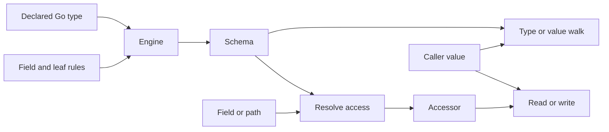

# How gowalker works

A library that uses struct tags often needs the same information in several
places: which fields exist, what names they use, and how to reach their values.
Gowalker compiles that information from a Go type and reuses it across values.

For example, a configuration library can use the same field descriptions to
read default tags, build help text and access settings. A database library can
select `db` names and keep a reader for each column. Tag interpretation and
application behavior stay in those libraries.

## The objects you work with

| Object | Contains | Lifetime |
|---|---|---|
| `Engine` | Field naming and leaf rules, resource limits, and a schema cache | Reuse for one set of rules |
| `Schema` | The compiled description of one exact root type under those rules | Reuse for values of that root type |
| `Shape` / `Field` | Type relationships and field metadata | Owned by the compiled schema |
| `Accessor` | A resolved path, such as `Database.Port` | Reuse for the same path and schema |
| `Value` | One read result: presence, types, reached path, and the borrowed Go value | Refers to the caller's value |

For example, compile `Row` once, call `AccessName("id")` once, and use that
accessor with each `*Row`. An engine does not hold the configurations you
pass to it. [Root binding](api.md#root-binding) explains the exact accepted types.

The implementation lives in two packages: `gowalker` and `gowalker/path`.
Generic methods, one-call helpers and reflected entry points share the same
compiler and access code.

## Compilation: raw types, then visible fields

Compilation first builds a graph of exact Go types. A pointer has its own node;
struct fields, collection elements and map keys link to other nodes. Registering
a node before its children lets recursive types point back to an existing node.
No instance is needed, and nil pointers do not prevent type inspection.

The engine then applies field rules to build the visible field list. By default,
this list contains exported Go fields with their original names and nesting.
A resolver can rename fields, add aliases, skip fields or inline a struct.
Inlining gives a descendant a shorter logical name while retaining the complete
Go field-index route needed to reach it. `DeclaredView` also retains the inline
owner, so a consumer can inspect tags on that owner.

Names and aliases must identify one field. Compilation rejects collisions using
the same matching rule as lookup: exact matching, or Unicode case folding when
enabled. Ordinary recursive fields are valid; recursive inline expansion is an
error because it cannot produce a finite flattened field list.

A **leaf** is a value that named paths and walkers may select but do not descend
into. `FieldRule.Atomic` makes one field a leaf; `WithAtomicType` makes every use
of an exact type a leaf. Here, “atomic” describes traversal, not synchronization
or a database transaction. Raw type relationships remain available, and still
count toward compilation limits.

Compilation checks all reachable visible fields, even if a caller later reads
only one. The `WithTaggedFields` preset marks each selected column
as a leaf because its internal fields are irrelevant to column naming. This prevents tags
inside a payload from participating in the row's column names.

## Resolution and execution

For one named field, `AccessName` combines root pointer handling, name lookup
and the cached accessor returned by `AccessField`. It treats punctuation as
part of the name. `Tags` reads the original annotation text directly; it does
not require an accessor or a value instance.

Resolving a path validates every step whose type is known. It records field
routes and checks map-key types and fixed-array bounds. Map entries need not
exist yet. Below an interface, the concrete type is only known when an actual
value is supplied; those remaining checks happen during execution.

Reads follow intermediate pointers and interfaces, check nils and bounds, and
return a `Value`. A reached terminal keeps its declared type: a `*Row` field
returns a pointer, and an `any` field returns an interface location. An explicit
`path.Deref()` selects what either holds. An absent map entry or nil ancestor
returns `Missing`; a reached nil terminal returns `Nil`.

Writes use the same routes. Some locations are directly settable; a struct held
in a map needs a copy followed by `SetMapIndex`, while a struct held in an
interface needs replacement of that interface's contents. A write:

1. Checks the entire route and prepares the assignment.
2. Prepares any explicitly requested pointer/map allocations and necessary copies.
3. Writes the terminal and attaches prepared owners after all checks pass.

An error returned by the core leaves the value and optional allocations unchanged.
When a path traverses an existing pointer, map or slice, writes update its shared
storage in place. Assigning a terminal pointer, map or slice can replace that
reference, as ordinary Go assignment does. This guarantee covers one `Set` call. User callback
side effects and concurrent modifications are outside that guarantee.

## Walking

A type walk visits the visible type graph. It reports `Reference` when a type
is already on the current ancestor route. Collection elements have a type edge,
not a fabricated key or index.

A value walk visits actual locations and returns concrete paths that can later
be resolved. It reports `Cycle` for an active ancestor reached again. Shared
values on separate branches are visited at each path. Nil values have no
fabricated descendants. Fields follow declaration order, lists follow index
order, and string-keyed maps are sorted; other map keys need an explicit order
or unordered mode.

Visitors can continue, prune children or stop. Walks have finite limits and can
include leave events. Collect paths before making structural changes to a value;
see the [walking contract](api.md#type-and-value-walking).

## Caches and ownership

An engine caches up to 256 root schemas by default. Completed schemas are
published under a lock; concurrent cold requests can build independently before
converging on the cached result. Recursive compilation never waits on an
unfinished cache entry. At capacity, existing entries remain cached and new
roots compile without being retained. The limit counts roots, not bytes.

`Schema.AccessField` caches accessors for its visible root fields. `Resolve`
and `ResolveText` return uncached accessors; callers retain those for reuse.
Engine caches do not retain caller instances or arbitrary map keys. An accessor
itself retains keys supplied in its path for as long as the caller keeps it.

Schemas, fields, shapes and accessors expose immutable metadata; slice getters
return copies. Their internal caches are synchronized. Engines and schemas must
not be copied. Rule callbacks must be deterministic and safe for concurrent
calls; create another engine to change the rules.

Live values still follow ordinary Go ownership rules. Reads borrow references,
and `Value.Reflect()` exposes the capabilities of the underlying reflected
value. Callers synchronize shared values; the engine does not lock or copy them.

## Where the implementation lives

| Files | Responsibility |
|---|---|
| `engine.go`, `shape.go` | Rules, caches, raw type graphs and visible fields |
| `schema.go`, `access.go` | Accessors, root binding and reads |
| `write.go`, `assign.go` | Write preparation, allocation and checked assignment |
| `walk*.go` | Type/value traversal, ordering and visitor controls |
| `errors.go`, `path/path.go` | Structured errors and typed paths |

[API contracts](api.md) · [Scope](scope.md) · [Performance](performance.md)
