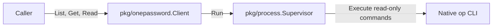

# github.com/ashtonian/pkg/onepassword

`onepassword` provides bounded, read-only observations through the native 1Password CLI. It shares complete vault metadata reads, exact selected-item batches and byte-preserving reference reads across CLI consumers. The caller owns authentication, domain policy and any durable reports.

## Architecture



**Entry points:** `New`, `Client.List`, `Client.Get` and `Client.Read` accept explicit dependencies and caller contexts.

**Exit points:** the injected runner executes native reads. Metadata and sensitive values return only to the caller; the package writes no files or logs.

**Failure modes:** incomplete, excessive or conflicting observations return an error and no partial result. Cancellation, deadline, output-limit and unsupported-platform failures preserve their error classes. Other native diagnostics are replaced with an operation-specific access/authentication error.

**Dependencies:** the runtime imports the released `pkg/process` module and the Go standard library. Consumers may provide another runner implementing the same bounded process contract.

## Quick start

Requires Go 1.27 or later. This complete example uses an immediate fixture runner, so it needs no account or vault access. For native observations, supply a configured `process.Supervisor` from `process.New` instead.

```go
package main

import (
    "context"
    "fmt"

    "github.com/ashtonian/pkg/onepassword"
    "github.com/ashtonian/pkg/process"
)

type fixtureRunner struct{}

func (fixtureRunner) Run(context.Context, process.Command) (process.Result, error) {
    return process.Result{Stdout: []byte(`[{"id":"item","title":"example","vault":{"id":"vault"}}]`)}, nil
}

func main() {
    client, err := onepassword.New(onepassword.WithRunner(fixtureRunner{}))
    if err != nil { panic(err) }
    items, err := client.List(context.Background(), "example-vault")
    if err != nil { panic(err) }
    fmt.Println(items[0].Title)
}
```

```text
example
```

## Configuration

| Option or policy field | Type | Default | Description |
|---|---|---|---|
| `WithRunner` | `Runner` | nil, required | Supervises deadlines, descendants and captured streams; the constructor rejects a missing runner. |
| `WithExecutable` | string | `op` | Native CLI executable; empty is invalid. |
| `WithAccount` | string | empty | Native account name/ID; empty retains native account selection. |
| `WithEnvironment` | `[]string` | nil | Complete child environment, cloned on configuration; nil inherits, an empty slice supplies an empty environment. |
| `WithPolicy` | `Policy` | `DefaultPolicy()` | Complete replacement of the native observation bounds below. |
| `Policy.ListTimeout` | `time.Duration` | `3m` | One complete vault metadata observation, including unlock allowance. |
| `Policy.ItemTimeout` | `time.Duration` | `30s` | One selected-item batch or reference read. |
| `Policy.MaxItems` | int | `10000` | Complete metadata and selection bound; maximum 100000. |
| `Policy.MaxFields` | int | `1000` | Independent bound for each item's fields, files and sections arrays; maximum 10000. |
| `Policy.BatchSize` | int | `32` | Selected IDs per native item batch; maximum 128. |
| `Policy.MaxNativeBytes` | int | `16777216` | Each captured stdout/stderr stream, batch input and reference byte bound; maximum 67108864. |

`Policy` carries `koanf`, `default`, `validate` and `desc` tags for `pkg/config` and Kong consumers. All deadlines and bounds must be positive. The injected runner must enforce process cleanup and stream bounds as well; validation of an already returned result cannot recover memory consumed by an unbounded runner.

## API reference

- `New(options...) (*Client, error)` validates dependencies and policy without accessing an account.
- `List(ctx, vault) ([]ItemMetadata, error)` reads complete metadata for one explicit vault; duplicate IDs or conflicting vault identities fail the observation.
- `Get(ctx, vault, selected) (map[string]Item, error)` batches exact selected IDs. It requires complete coverage with unchanged titles, vault IDs and previously observed versions, when supplied. JSON arrays and consecutive JSON objects are supported. Any failed batch discards the aggregate result.
- `Read(ctx, reference) ([]byte, error)` resolves one explicit `op://` reference using `--no-newline`. It preserves binary bytes and native reference query/format behavior. Batch ordinary item observations with `Get` when field-level reference resolution is unnecessary.
- `DefaultPolicy()` and `Policy.Validate()` support direct library consumers using the same defaults and bounds.

`Item`, `Field` and `File` retain native identity and reference metadata. Field values and returned reference bytes are sensitive. The client does not interpret field labels, select an item by title, choose a fallback vault, classify placeholders or infer domain requirements.

## Build, run and test

From the repository root:

```bash
make test-native-unit test-native-integration native-release-check
```

The integration fixture executes only an owned native-command shim through the real process supervisor. The release check downloads candidate archives into fresh consumers, runs tagged race tests and this README program, rejects replacements and checks module tidiness outside the workspace. Runtime dependencies are restricted to the canonical process module and standard library.

## Operations

This is a synchronous library with no health server, scheduler or background tasks. Callers own whole-workflow deadlines and aggregate metrics; `ListTimeout` and `ItemTimeout` bound individual native calls. Cancellation reaches the injected supervisor, which must stop and reap owned processes before returning.

If a native observation fails, verify the selected account, vault access and `op` authentication outside the consumer. The library never signs in, evaluates shell output, retries a command or treats an access failure as an empty vault. A malformed, truncated or changed batch requires a fresh domain review; callers must not consume partial results.

## Security

No values, value hashes, raw native payloads or stderr are logged or persisted. Errors suppress native diagnostics because those diagnostics can contain credentials. Metadata and references can still reveal private naming, and callers must choose appropriate report destinations. Authentication environment entries and values remain in process memory; native `op` owns its authentication/cache behavior.

Use a trusted executable and runner. References must have the `op://` prefix, fit the configured byte limit and contain no control characters; native reference interpretation remains with `op`. A successful metadata/get sequence is an observation, not an atomic vault snapshot or a fence against other writers.

## Code map

| File | Responsibility |
|---|---|
| `client.go` | `Client`, runner options, exact native metadata/item/reference protocols and sanitized failures. |
| `policy.go` | `Policy`, shared config tags, defaults and validation. |
| `client_integration_test.go` | Owned native transport acceptance with exact batch stdin and binary reference bytes. |
| `example_integration_test.go` | Compiled public API quick start. |

## External dependencies

The runtime depends on `github.com/ashtonian/pkg/process v0.1.0`; its runner supports Linux and macOS. Real native use requires an installed, authenticated 1Password CLI with `item list`, JSON stdin item selection and `read --no-newline` support. Tests use Testify and do not access a live vault.

[Native item command reference](https://www.1password.dev/cli/reference/management-commands/item) · [Secret references](https://developer.1password.com/docs/cli/secret-references/) · [Process module](../process/README.md) · [MIT license](LICENSE).
