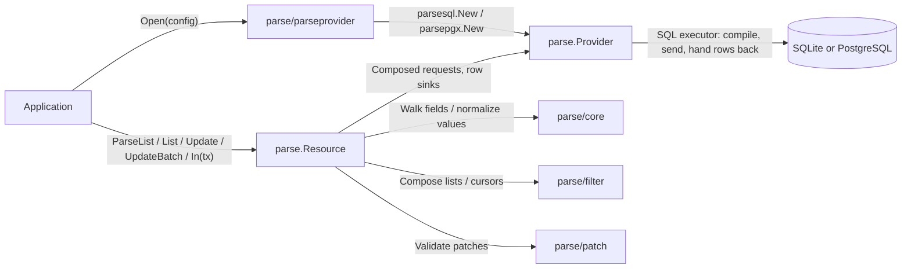

# github.com/ashtonian/pkg/parse

Parse resource API filters, sorts, pagination, search, facets, relations, and patches from Go struct tags, and run them on the database the application's configuration names: SQLite ([`parsesql`](parsesql/README.md)) or PostgreSQL ([`parsepgx`](parsepgx/README.md)), one API on either, selected at startup ([`parseprovider`](parseprovider/README.md)). Requests compile to parameterized SQL in the provider's dialect; supported patches also apply to Go values. Your application owns its schema, authorization, the scope each request runs under, and any transaction it shares with parse.

## Architecture



**Entry points:** a provider (`parseprovider.Open`, or `parsesql.New` / `parsepgx.New` on a database the application opened); `NewResource` declares a table and key on it; `ParseList`, `List`, `Facets`, `Update`, `UpdateBatch`, `Query` and the filter/patch methods serve requests; `In` runs a resource in a transaction (`Provider.Begin`, or the application's own through `parsesql.Tx` / `parsepgx.Tx`).

**Exit points:** Pages, update results and parsed values; the plans behind them (`BuildList`, `BuildUpdate`, `BuildUpdateBatch`) for an application that composes their SQL with its own.

**Failure modes:** Invalid declarations fail construction, a computed column whose expression the provider's dialect refuses included; request validation returns `core.ParseError` with its code and path (patch failures can be joined); missing tenant scope (no `Scope.Tenant`, and for a list no `Scope.Governance`) returns `ErrTenantRequired`, and a tenant a reached tenant column cannot hold `ErrTenantInvalid`; `Relate` refuses a relation that would make one request bind its tenant to a string or UUID column and an integer one, and a target on another provider (`ErrProviderMismatch`, as `In` refuses another provider's transaction); a statement the database fails is a `*StatementError` naming the table and the statement; an update whose `COMMIT` went unanswered is `ErrCommitUnknown`; an operation the provider does not support is refused before anything runs (`ErrUnsupported`, an `*UnsupportedError` naming the provider and the operation).

**Dependencies:** `Resource` composes each request through `core`, `filter` and `patch` (the floor, policy, keyset, cursor and target merged in, at one instant), hands it to the executor of the provider it was built on, and scans the rows the executor hands back into `T`. The SQL providers share one executor, which compiles the composed request to the provider's dialect and sends the statements; the public builders (`BuildList`, `BuildUpdate`, …) return the same compiled statements. The compiler packages import no application code; the application owns the database handle under the provider, its schema, authorization and scope.

## Quick start

Open a provider, declare each resource on it once, then serve each request under the server's scope. This complete program runs on an in-memory SQLite database and needs no server. Requires Go 1.27 or later. Install parse with the module of the provider it runs on: `go get github.com/ashtonian/pkg/parse@latest github.com/ashtonian/pkg/parse/parsesql@latest` (PostgreSQL: `parse/parsepgx`).

```go
package main

import (
	"context"
	"fmt"
	"net/url"
	"time"

	"github.com/ashtonian/pkg/parse"
	"github.com/ashtonian/pkg/parse/parsesql"
)

type Device struct {
	ID       string `json:"id"        db:"id"        parse:"filter,sort"`
	TenantID string `json:"tenant_id" db:"tenant_id"`
	Name     string `json:"name"      db:"name"      parse:"filter,sort,patch"`
	Status   string `json:"status"    db:"status"    parse:"filter,patch" enum:"active,offline"`
}

func main() {
	ctx := context.Background()
	db, err := parsesql.Open(ctx, parsesql.Config{
		DSN:           ":memory:",
		MaxOpenConns:  1,
		BusyTimeout:   5 * time.Second,
		SettleTimeout: parse.DefaultSettleTimeout,
	})
	if err != nil {
		fmt.Println(err)
		return
	}
	defer func() { _ = db.Close() }()
	_, err = db.DB().ExecContext(ctx, `CREATE TABLE devices (id TEXT PRIMARY KEY, tenant_id TEXT NOT NULL, name TEXT NOT NULL, status TEXT NOT NULL);
		INSERT INTO devices VALUES ('d1', 't1', 'switch', 'active'), ('d2', 't1', 'router', 'active'),
			('d3', 't1', 'spare', 'active'), ('d4', 't1', 'desk', 'offline'), ('d5', 't2', 'core', 'active')`)
	if err != nil {
		fmt.Println(err)
		return
	}

	devices := parse.MustResource[Device](db.Provider(), "devices", parse.TenantColumn("tenant_id"), parse.PageSize(25, 100))
	scope := parse.Scope{Tenant: "t1"}

	q, _ := url.ParseQuery(`status=active&filter={"name":{"$ne":"spare"}}&sort=name&page_size=10`)
	req, err := devices.ParseList(q)
	if err != nil {
		fmt.Println(err)
		return
	}
	page, err := devices.List(ctx, req, scope)
	if err != nil {
		fmt.Println(err)
		return
	}
	for _, d := range page.Items {
		fmt.Println(d.ID, d.Name)
	}

	patch, err := devices.ParseMergePatch([]byte(`{"status":"offline"}`))
	if err != nil {
		fmt.Println(err)
		return
	}
	res, err := devices.Update(ctx, patch, parse.ByID("d1"), scope)
	if err != nil {
		fmt.Println(err)
		return
	}
	fmt.Println(res.Changed[0].ID, res.Changed[0].Status)

	// d5 is another tenant's: the scope does not reach it, so it is not found.
	other, err := devices.Update(ctx, patch, parse.ByID("d5"), scope)
	fmt.Println(len(other.Changed)+len(other.Unchanged), err)
}
```

<!-- output of parsesql.Example_quickStart -->
```text
d2 router
d1 switch
d1 offline
0 <nil>
```

`parse.Scope` carries what the server decides — tenant, authorization policy, governance, deleted-row visibility — and never comes from the request: the list and the update reach the tenant's live rows alone, so another tenant's `d5` is not found. `List` reads the page with its cursors and, when the request asks, its total, facets and includes; `Update` applies a patch with its relation changes in one transaction and reports the rows it changed apart from the rows it left (`UpdateResult`; [Resource updates](docs/patches.md#resource-updates)). Write a request error with `parsehttp.WriteError`. The program is parsesql's `Example_quickStart`, checked by its unit lane.

A service loads `parsesql.Config` with [`github.com/ashtonian/pkg/config`](../config/README.md), whose tag defaults are the literal above. One that runs on either database, chosen by its configuration, links both provider modules and opens the one named: `parseprovider.Open(ctx, cfg.Provider, parsesql.Choice(cfg.SQLite), parsepgx.Choice(cfg.Postgres))`, and nothing else changes ([choosing a provider](parseprovider/README.md)). A binary carries the drivers of the providers it passes, and no other. The SQL a request compiles to is the provider's dialect's (`devices.BuildList(req, scope)` returns it without running it; `ExampleResource_BuildList`). See the [complete HTTP server](examples/server/) and the [pgx recipe](parsepgx/recipe_test.go).

## Choose the feature

| Need | Entry point | Guide |
|---|---|---|
| Open the database the configuration names | `parsesql.Open` / `parsepgx.Open` from the provider's `Config`; `parseprovider.Open` with `parsesql.Choice` / `parsepgx.Choice` to open the one the configuration names among those the binary links; or `parsesql.New` / `parsepgx.New` on a handle the application opened | [Providers](parseprovider/README.md), [PostgreSQL](docs/integrations.md#postgresql), [SQLite](docs/integrations.md#sqlite) |
| Serve a list endpoint: parse, scope, read the page | `NewResource[T](provider, …)`, `ParseList` (or `ParseListInput` off HTTP), `List` | [List queries](docs/queries.md#lists-and-keyset-pagination) |
| Run parse's statements in the application's transaction | `Provider.Begin`, `parsesql.Tx`, `parsepgx.Tx`, `Resource.In` | [Transactions](docs/integrations.md#transactions) |
| Read rows of the application's own statement through the row contract | `Resource.Query`, `Columns`, `RowScanner` | [Integrations](docs/integrations.md#row-contract) |
| Answer a request error | `parsehttp.WriteError` | [HTTP and errors](docs/http-errors.md) |
| Serve a list too large for a URL: the same request as a POST body | `ParseListBody`, `parsehttp.ParseList` (route `POST` on the collection path), `WithMaxListBodySize`, `ListParams.Body` in `parse/client`, the SDK's opt-in `maxURLLength` | [HTTP contract](docs/http-errors.md#the-same-request-as-a-post-body) |
| Parse a stored/server-policy filter with a per-call cost budget | `Resource.ParseFilterWithCost` | [Parser configuration](docs/schema-configuration.md#parser-and-generator-options) |
| Parse an HTTP filter alone, including flat parameters | `Resource.ParseRequestFilter` | [Queries](docs/queries.md) |
| Compose list fragments over a declared resource | `Resource.ListQuery()`, then `Build` (the primary key joins every keyset), or `ListPlan.Fragment` | [List queries](docs/queries.md#lists-and-keyset-pagination) |
| Compile only a predicate for existing SQL | `filter.NewSQLBuilder` | [Query composition](docs/queries.md#configuration) |
| Filter, sort and facet typed members of JSON documents | `paths` / `storage` tags, struct member tags, `Resource.WithPaths` (per request: custom fields) | [JSON paths](docs/queries.md#json-paths) |
| Filter JSON arrays by their elements, every predicate on one element | `elements` tag or a slice-of-struct document; `$some`, `$none` | [Array elements](docs/queries.md#array-elements) |
| Filter by related rows' attributes (has-many, belongs-to, many-to-many) | `Resource.Relate` with `HasMany`, `BelongsTo`, `ManyToMany`; `$some`, `$none`, `$is`, `$is_not` | [Relations](docs/relations.md#declare-relations) |
| Match related IDs or return relation memberships | Relation tags, `filter.BuildIncludeQuery` | [Pair tables](docs/pair-tables.md) |
| Serve an update endpoint: patch rows scoped to tenant, live rows and policy | `parsehttp.ParsePatch` (`ParsePatchRequest`), `ParseMergePatch` / `ParsePatch`, `Update` (`UpdateResult`) | [Resource updates](docs/patches.md#resource-updates) |
| Apply distinct column patches with per-key revision/policy fences in one transaction | `UpdateBatch`, `RowUpdate`, `UpdateBatchLimits` | [Varied update batches](docs/operations.md#varied-native-update-batches) |
| Write, stamp and count only the rows a patch changes, and tell unchanged from not found | `SkipUnchanged`, `UpdateResult.Changed` / `Unchanged` | [Skipping unchanged rows](docs/patches.md#skipping-unchanged-rows) |
| Merge fields or replace a JSON document | `ParseMergePatch`, `ParsePatch`, `patch.BuildPatchSQL` | [Patches](docs/patches.md) |
| Apply a patch to rows a store holds itself, deciding and refusing what the SQL update does | `patch.ComposePatch`, `ComposedPatch.Apply`, `core.StorageValue` | [Composed updates](docs/patches.md#composed-updates) |
| Apply a patch to an existing Go value | `ApplyValidatedPatch`, `ApplyPatch` | [Typed documents](docs/patches.md#typed-document-behavior) |
| Advertise capabilities to a UI/client | `NewSchemaRegistry`, `RegisterResource` (`Register[T]` for a type no resource serves), `parsehttp.SchemaHandler` | [HTTP and errors](docs/http-errors.md) |
| Build a patch in code instead of a JSON body | `MergePatchMap`, `ServerMergePatchMap`, `ValidateOperations`, `ValidateServerOperations` | [Patches](docs/patches.md) |
| Call the API from TypeScript | `createClient` in `sdk/ts` | [Client integration](docs/integrations.md#typescript-client) |
| Call the API from Go: typed filters, sorts, list parameters, merge and JSON patches; pages, patch answers, coded errors and schema documents decoded | `parse/client`, a standard-library module of its own | [Go client](docs/integrations.md#go-client) |
| Generate an SDK for a parse-based API: types and a thin binding per operation over the shared runtime | `createClient` and `request` in `sdk/ts`; `parse/client` | [Generated TypeScript SDKs](sdk/ts/docs/generated-sdks.md), [generated Go SDKs](client/README.md#for-generated-sdks) |

Use this package when a resource API needs validated user-controlled query/update expressions. Keep hand-written SQL for workflows that require a different query model; the lower-level AST, schemas, and SQL fragments can be composed independently.

## Providers and boundaries

A resource runs on one provider: the database an application selects at startup, with one API on either. They are alternatives for different runtime requirements, never layered, nested or run side by side: nothing moves data between them.

| Provider | Opened by | Important differences |
|---|---|---|
| SQLite (`sqlite`) | The `parsesql` module: `parsesql.Open(ctx, parsesql.Config)`, or `parsesql.New(ctx, *sql.DB)` on modernc.org/sqlite with parse's functions registered (`parsesql.Register`) | In-process, a file or `:memory:`; JSON text and JSON functions; timestamps stored as canonical UTC text ([timestamps](docs/schema-configuration.md#timestamps)); phrase search and ASCII case folding; geo predicates on JSONB points through `parsesql`'s functions, no native geometry storage; one writer at a time |
| PostgreSQL (`postgres`) | The `parsepgx` module: `parsepgx.Open(ctx, parsepgx.Config)`, or `parsepgx.New(ctx, *pgxpool.Pool)` | Native arrays/JSONB, full-text search, row locks; geo predicates require PostGIS; batches send a request's statements in one round trip |
| CockroachDB | Not supported | `parsepgx.Open` refuses `cockroach://` and `crdb://`. A `postgres://` URL to a CockroachDB cluster opens the PostgreSQL provider, whose collation check fails, and whose SQL (the `pg_c_utf8` collation, PostGIS functions, `jsonb_path_query_first`) has never run on CockroachDB |
| Go values | `ApplyValidatedPatch` | Supports allowed nested paths, `test`, `copy`, and `move`; persist the result yourself |

String ordering uses PostgreSQL's `pg_c_utf8` collation (PostgreSQL 17+; `filter.CollationC` for 14–16) and SQLite binary ordering. A flat parameter naming no filterable field is refused (E2071) on every entry point unless the endpoint accepts it, and so is a facet, include or `fields` name that names no field it can serve. The `fields` mask is validated, not applied: the query reads every column the resource reads, and the service drops the members the mask leaves out ([field mask](docs/queries.md#field-mask)). Documents filter whole or by declared typed members (`{"attrs.color": "red"}`, [JSON paths](docs/queries.md#json-paths)); related rows filter by their own attributes through declared relations (`{"commands": {"$some": {"status": "pending"}}}`, [Relations](docs/relations.md)). SQL patch compilation rejects unsupported operations rather than skipping them. [Backend details](docs/queries.md#type-capabilities) · [Patch limits](docs/patches.md)

## Configuration

Construct a resource once and share it. Its schemas are fixed when `NewResource` returns: customize them with `parse.CustomizeSchemas`; the schema accessors hand out copies.

| Option | Type | Default | Description |
|---|---|---|---|
| `parse.PrimaryKey(columns...)` | `ResourceOption` | `"id"` | Key columns, in key order and unique together among the table's rows: the final keyset columns of every list, what an update by key reaches and what relations correlate on. A key of several columns, such as `("warehouse_id", "sku")`, is a `parse.Key` of a value per column (`ByKey`, `ByKeys`, `Resource.Key`); the tenant column may be one of them. Each column is a scalar of any type, a pointer or nullable wrapper (`core.NullWrapperOf`: `sql.NullInt64`, `uuid.NullUUID`) counting as the type it holds, compared wherever a key is as a filter compares its type (a decimal by value, a timestamp at its instant). `NewResource` refuses no column, one listed twice, and one that is not T's, is no scalar (a document, array or geometry), is computed, is not read or is the soft-delete column ([keys](docs/schema-configuration.md#keys)) |
| `parse.TenantColumn(column)` | `ResourceOption` | none | Holds every list, and tenant-scoped junctions, to `Scope.Tenant`; a list with `Scope.Governance` holds each row's relations to the row's own tenant instead ([Governed lists](docs/relations.md#governed-lists)). The column's field is a string, a UUID or an integer, or a pointer to or nullable wrapper (`core.NullWrapperOf`) of one, and `Scope.Tenant` (the key's text, `"44"` for an integer) is bound as that type, checked against every tenant column the resource's relations reach ([Tenant key](docs/relations.md#tenant-key)) |
| `parse.DeletedColumn(column)` | `ResourceOption` | none | Soft-delete timestamp: a row is live while it is NULL, so its field holds NULL (`core.IsNullableType`): a pointer, slice, map or interface, or a type such as `sql.NullTime` whose zero value writes NULL and scans NULL back. Being an `sql.Scanner` is not enough: `NewResource` refuses one with no `Value` method, one whose zero value writes a value (a row written from it would be deleted), a UUID, which scans NULL as the nil UUID it writes back, and a decimal, which refuses a NULL scan. The column is neither the key nor the tenant column (`NewResource` fails otherwise); deleted rows only with `Scope.IncludeDeleted` |
| `parse.PageSize(def, max)` | `ResourceOption` | 50, 1000 | Page size without `page_size`, and its ceiling (larger requests are clamped) |
| `parse.AcceptParams(names...)` | `ResourceOption` | none | Query parameters the endpoint reads itself; any other unknown parameter is E2071. `NewResource` refuses a name that is a list parameter, the search parameter or a flat filter on a field, and `Relate` and `WithPaths` one that would be a flat filter on the field they add: `ParseList` would skip that filter |
| `parse.ReadColumns(columns...)` | `ResourceOption` | every column of T | The columns lists select and updates return; sensitive columns stay in the database, and no page, cursor or facet carries their values. Must include the key, the column of every sort key and facet, the correlation columns of a relation that includes or facets, and every filter, search and relation correlation column that `QueryOnlyColumns` does not name; a relation is held to its target's read set too ([read columns](docs/relations.md#read-columns)). `NewResource`, `Relate` and `WithPaths` refuse a declaration that needs another column |
| `parse.QueryOnlyColumns(columns...)` | `ResourceOption` | none | Columns `ReadColumns` leaves out that requests may still filter and search by, directly or through a relation correlating on them, such as a large text column searched but never listed. Which rows match discloses their values, so name only columns the caller may learn. Never a sort key, a facet, or the correlation of a relation that includes or facets |
| `parse.ReadExpr(column, expr)` | `ResourceOption` | none | Reads a column through a trusted SQL expression per dialect (`parse.ColumnExpr`; `parse.SQL(sql)` for one every dialect reads alike), such as a correlated count, a pair table's keys as an array, or `coalesce` over a nullable column. Lists and updates' `RETURNING` select it as `(sql) AS column`, and its filter, sort, facet and search tags, and server policies naming it, compile against the provider's dialect's expression; `NewResource` refuses a provider whose dialect the expression refuses (`filter.ErrUnsupportedDialect`). It can't be the key, tenant or deleted column, be patched, stamped or incremented, hold document paths or correlate a relation; a relation to the resource filters by it through the target's expression for the owner's dialect; [computed columns](docs/queries.md#computed-columns) |
| `parse.ColumnType(column, t)` | `ResourceOption` | none | Physical storage profile, including `core.SQLJSON` / `SQLJSONB`, native arrays and PostgreSQL inet/cidr/interval text projection; [storage declarations](docs/schema-configuration.md#fields-and-embedding) |
| `parse.CustomizeSchemas(fn)` | `ResourceOption` | none | Changes the generated schemas (`parse.Schemas`: filter, sort, search, patch, server patch) while the resource is built, before its read-set and column checks; calls run in order, an error fails `NewResource`, and the resource keeps copies |
| `parse.ParserOptions(opts...)` | `ResourceOption` | bounded parser defaults | Limits, codec, clock and schema generation; [complete table](docs/schema-configuration.md#parser-and-generator-options) |
| `parse.WithPatchPolicy(pc, subject)` | `parse.PatchOption` | none | Request-specific path/value restrictions |
| `parsehttp.WithErrorHandler(fn)` | `parsehttp.Option` | none (failures are not reported) | `fn(*http.Request, error)` receives what `parsehttp`'s responses cannot carry: a parse error's `Details` entries that cannot be encoded, left out of `WriteError`'s body and matching `parsehttp.ErrUnencodableDetails`; a schema document that cannot be encoded, answered 500/E2120 and matching `parse.ECodeSchemaEncodingFailed`; a `Write` that fails after the status is sent, best effort since net/http buffers small responses ([error handling](docs/http-errors.md#error-handling)) |
| `filter.QueryParamAccept(names...)` | `filter.QueryParamOption` | none | Parameters `ParseRequestFilter` / `NewQueryParamParser` leave to the endpoint; any other unknown parameter is E2071. A name that is a list parameter or a flat filter on a field (`price`, `price_gte`) is refused with an error that is not a `*core.ParseError`, as `AcceptParams` refuses it at `NewResource` (`filter.CheckAcceptedParam`) |
| `filter.QueryParamLenient()` | `filter.QueryParamOption` | off | Ignore unknown flat parameters instead of refusing them |
| `parsesql.Config` | struct | in-memory SQLite | The SQLite database's DSN, connection limits, busy timeout and settle timeout; [parsesql settings](parsesql/README.md#configuration) |
| `parsepgx.Config` | struct | none: the DSN is required | The PostgreSQL DSN, pool limits, collation, containment bound and settle timeout; [parsepgx settings](parsepgx/README.md#configuration) |
| `parsepgx.Collation(c)` | `parsepgx.Option` | `filter.CollationPgCUTF8` | Code-point collation for string sorts and ranges, checked against the database when the provider opens; `filter.CollationC` on PostgreSQL 14–16 ([parsepgx](parsepgx/README.md#configuration)) |
| `parsesql.SettleTimeout(d)`, `parsepgx.SettleTimeout(d)` | provider `Option` | `parse.DefaultSettleTimeout` (10s) | Bound on each statement that settles an update's transaction, which runs past the request's cancellation |
| `filter.List*` / builder options | functional options | bounded list defaults | [List, filter, facet, include options](docs/queries.md#configuration) |
| `Indexed`, `Includable`, `Facetable`, `Writable`, `PolicyScoped`, `References`, `Describe` | `RelationOption` | a relation that filters only | [Relation options](docs/relations.md#declare-relations) |
| `Stamp`, `StampSQL`, `Increment`, `SkipUnchanged` | `UpdateOption` | no stamp, no increment, every target row written | [Update options](docs/patches.md#resource-updates) |
| `parse.ScanJSON(columns...)` | `ScanOption` | the resource's declared JSON columns | Columns `RowScanner` decodes as stored JSON documents where the resource declares none, for a driver that learns them from the result, as the PostgreSQL provider names the columns PostgreSQL reports as json or jsonb. An `sql.Scanner` column whose type holds a member encoding/json cannot decode (promoted through an unexported embedded pointer) is refused |
| `patch.With*` | `patch.PatchSQLOption` | no timestamp column | [SQL patch options](docs/patches.md#configuration) |
| `patch.DefaultMaxOperations` | int | `50` | Operation limit of every `PatchSchema` (generated, or built with `patch.NewPatchSchema`) unless its `MaxOperations` is set; 0 is unlimited. [Patch limits](docs/patches.md#validation) |
| `patch.DefaultMaxRelationValues` | int | `1000` | Keys one operation on a relation path may name, repeats counted once, unless the schema's `MaxRelationValues` is set; 0 is unlimited; beyond it E2119. Served as `max_relation_values`. [Patch limits](docs/patches.md#validation) |
| `UpdateBatchLimits.MaxRows` | int | `500` | Total keys admitted by one `UpdateBatch` (`BuildUpdateBatch`); zero selects the default and negative refuses |
| `UpdateBatchLimits.MaxParameters` | int | SQLite `999`; PostgreSQL `65535` | Parameters per batch statement; zero selects the provider's default and negative refuses |

Tags expose capabilities explicitly: `parse:"filter,sort,patch,facet,search,include,server"`, `filter_ops`, `patch_ops`, `enum`, `minlen` / `maxlen` / `min` / `max` / `minitems` / `maxitems`, `relation`, `facet`, and search/geo metadata. Unknown capability names fail schema construction. [All tags and defaults](docs/schema-configuration.md)

## Documentation

| Guide | Covers |
|---|---|
| [Schema and configuration](docs/schema-configuration.md) | Tags, options, storage types, schema discovery |
| [Queries](docs/queries.md) | Operators, SQL examples, sort/cursors, search, facets, geography |
| [Relations](docs/relations.md) | Relations between resources: filters on related rows, includes, facets, membership writes, tenant scope |
| [Pair tables](docs/pair-tables.md) | The `relation` struct tag: pair tables compared by key, include queries, junction statements |
| [Patches and JSON](docs/patches.md) | JSON Patch/Merge Patch, typed documents, policy, SQL limits |
| [HTTP and errors](docs/http-errors.md) | Request/response contract, schema routes, E-code catalog |
| [Integrations](docs/integrations.md) | Providers, transactions, the row contract, TypeScript, custom schemas |
| [Operations](docs/operations.md) | Security, concurrency, indexing, query costs, verification |
| [Mapping from PostgREST, django-filter and ent](docs/grammar-mapping.md) | Each operator, list parameter, sort, paging, relation and patch form against its counterparts, the semantic differences and the gaps on both sides |

## API and code map

| Package / file | Responsibility |
|---|---|
| [`provider.go`](provider.go) | `Provider` (the database a resource runs on: `Name`, `Begin`, and the operations it supports, refused otherwise with `ErrUnsupported`), `Tx` (`Commit`, `Rollback`); `NewProvider` and `NewTx`, which only parse's provider packages can call, since they take the internal `backend` types; `DefaultSettleTimeout`, the bound each SQL provider sets by default on the statements that settle an update's transaction |
| [`resource.go`](resource.go) | `Resource[T]` and the `resourceCore` it embeds — everything that does not depend on `T`, so each resource type compiles only the methods that read or write its rows — `NewResource[T]` (on a provider), `MustResource`, schema generation and access (`FilterSchema`, `PatchSchema`, `ServerPatchSchema`, `SortSchema`, `SearchSchema`: deep copies), identity, system fields, projection (`Columns`, `ColumnNames`), `Resource.Key` (a row's key), `PrimaryKeyColumns`, `WithPaths` (a request's view with declared JSON paths) |
| [`options.go`](options.go) | `ResourceOption` and the resource options: `PrimaryKey`, `TenantColumn`, `DeletedColumn`, `PageSize`, `ReadColumns`, `QueryOnlyColumns`, `ColumnType`, `ParserOptions`, `AcceptParams`, `Schemas`, `CustomizeSchemas` |
| [`key.go`](key.go) | `Key` (a row's key: a value per key column, `core.Key`); how keys are checked against the key columns, normalized, compared and ordered for targets, batches and relation statements; `Resource.ParseKey`: a key read from its columns' texts, as an item route's path segments carry them (`parsehttp.ItemKey`): an integer as decimal digits, a float as a JSON number, a bool as `strconv.ParseBool` reads it, any other column its value's text, normalized as `ByKey` normalizes |
| [`list.go`](list.go) | `ListInput`, `ParseListInput`, `ListRequest` (sealed: read through methods, `WithFilter`), `ParseList`, `Scope`, `Statement`, `ListPlan`, `BuildList`, `Page`, `PagePointers`, `IncludeQueries`; the filter and sort entry points (`ParseFilter`, `ParseFilterWithCost`, `ParseRequestFilter`, `ParseFilterMap`, `ParseSort`, `ListQuery`); `ParseFacets`, a facets request, refusing the parameters that shape a page, and `BuildFacets`, its facet statement, the one a list page carries, which `Resource.Facets` runs |
| [`body.go`](body.go) | Request bodies, bounded before they are read: `ParsePatchRequest`, a patch request's body in the grammar its media type names (`MediaTypeMergePatch`, `MediaTypeJSONPatch`, `application/json`), bounded by `MaxInputSize`, or 1 MiB when it is unlimited; `ParseListBody`, a list request as one JSON document, a POST body beside the query string; `ParseListPost`, a POST's list from its query string, content type and body; `Accepts` |
| [`relate.go`](relate.go) | `Relate`, `MustRelate`, `RelationOption`, `HasMany`, `BelongsTo`, `ManyToMany` (`KeyColumns`: one column or a key of several), `Junction` / `Through`, `Indexed`, `Includable`, `Facetable`, `Writable`, `PolicyScoped`, `References`, `RelatedResource` |
| [`scan.go`](scan.go) | `RowScanner`, `ScanOption`, `ScanJSON`, and the per-column rules a scan runs by, built once per resource: the row contract every provider's rows are scanned through — each column into the field the resource compiled it from, stored documents decoded with presence and key checks, and the JSON and timestamp text a dialect stores (`filter.Dialect.StoresAsText`, SQLite's) decoded, and a dialect that reports any other type as text refused; `NewResource` refuses a read column no scan can fill, one whose field or stored document member is promoted through an unexported embedded pointer |
| [`read_expr.go`](read_expr.go) | `ReadExpr`, `ColumnExpr`, `SQL`: computed columns, declared on the filter schema (`filter.ResourceSchema.Computed`) and resolved for each statement's dialect |
| [`tenant.go`](tenant.go) | The tenant key: the one value every statement binds `Scope.Tenant` as, checked against every tenant column a resource reaches through its relations at any depth, and the relation graph `Relate` keeps it in |
| [`update.go`](update.go) | `Target` (`ByID`, `ByIDs` for a one-column key, `ByKey`, `ByKeys` for keys of any length, `ByFilter`), `BuildUpdate` and its `UpdateOption`s, `UpdatePlan` (`Owner`, `Current`, `Conflict`, `Lock`: an unguarded multi-row `UPDATE`'s targets locked in key order), `UpdateResult`, `Stamp`, `StampSQL`, `Increment`, `SkipUnchanged`; an update's and a batch's composition (the target's keys, the floor and policy filter, the options checked against the resource, a batch's keys as the database holds them, in key order); `RowUpdate`, `UpdateBatchLimits`, `BuildUpdateBatch`, `UpdateBatchPlan`, `UpdateBatchChunk`: bounded varied column updates with exact preimage checks |
| [`execute.go`](execute.go) | What a resource runs on its provider: `List`, `Facets`, `Query`, `Update`, `UpdateBatch`, `In` (a view in a transaction, joined by the provider's database), `Provider`; each composes its request, hands it to the provider's executor with a sink, and returns what the sink built |
| [`sink.go`](sink.go) | The sinks a request carries to the executor: a list's page built from its rows, count, facets and includes, and the page's keys its includes read; a query's rows; an update's targets split into changed and unchanged rows, and their keys for its relation changes; a batch's parts checked against their keys and split |
| [`patch.go`](patch.go) | The patch entry points (`ParsePatch`, `ParseMergePatch`, `ParseServerMergePatch`, `MergePatchMap`, `ServerMergePatchMap`, `ValidateOperations`, `ValidateServerOperations`, `PatchOption`, `WithPatchPolicy`) and typed patch application (`ApplyPatch`, `ApplyValidatedPatch`) through `patch.Applier` |
| [`registry.go`](registry.go) | `NewSchemaRegistry`, `RegisterResource`, `MustRegisterResource`, `Register[T]`, `MustRegister[T]`, the schema accessors; the versioned schema document (`SchemaResponse`, `SchemaVersion`) with relations, element paths and patch value metadata, its sections `FilterSchemaResponse` (`FilterFieldResponse`, `GeoFieldConfigResponse`, `RelationResponse`), `SortSchemaResponse` (`SortFieldResponse`), `PatchSchemaResponse` (`PatchPathResponse`, `RelationKeyResponse`: a membership path's target key columns) and `SearchSchemaResponse` |
| [`errors.go`](errors.go) | parse's error contract in one place: `Code`, `ParseError`, `Codes` and the `ECode*` aliases (the error catalog, one definition per code in `core`); every sentinel a caller branches on — `ErrNoSuchKey` (a key text no key column can hold, the request's), `ErrTenantRequired`, `ErrTenantInvalid`, `ErrNoTarget`, `ErrKeyInvalid` (a target key of another length than the key, or one a key column cannot hold, the server's), `ErrForeign` (a request value another resource parsed, or one built by hand), `ErrUpdateScope`, `ErrUpdateBatchTargets`, `ErrCommitUnknown` (the one update error after which its writes may have been applied), `ErrProviderMismatch`, `ErrRegistered` (one registration per name), `ErrUnsupported` (an operation the provider does not support, under an `*UnsupportedError` naming the provider and the operation); `StatementError` / `StatementFailed`, a statement's failure by table and name; `BodyReadError`, a list or patch body that could not be read |
| [`parsehttp`](parsehttp/README.md) | parse's `net/http` adapter: `WriteError`, a parse error as an HTTP response; `WriteJSON`, a handler's own answer; `SchemaHandler` and `SchemaListHandler`, the discovery routes; `ParseList`, a list from a GET query string or a POST body; one `WithErrorHandler` hook for all of them |
| [`parseprovider`](parseprovider/README.md) | `Open`, `Choice`, `Database`: the one provider the application's configuration names, opened among the choices `main` passes; it imports no provider, so a binary carries only the drivers of the providers it links |
| [`parsepgx`](parsepgx/README.md) | A module of its own (`github.com/ashtonian/pkg/parse/parsepgx`), released with parse at one version: `Config`, `Open`, `Choice`, `Database`, `New`, `Tx`, `Collation`, `ContainmentMaxValues`, `SettleTimeout`: the PostgreSQL provider on a pgx pool, which sends a request's statements in pgx batches |
| [`parsesql`](parsesql/README.md) | A module of its own (`github.com/ashtonian/pkg/parse/parsesql`), released with parse at one version: `Config`, `Open`, `Choice`, `Database`, `New`, `Tx`, `SettleTimeout`, `MinSQLiteVersion`, `CheckVersion`, `Register`, `RegisterOn`, `Functions`: the SQLite provider on a `database/sql` database, and the SQL functions plans compare decimals, bound an int or float path's number members and decide geo predicates through, registered with `modernc.org/sqlite` |
| [`core`](core/README.md) | Configuration, schema generation, the field walk every schema shares (embedded structs promoted as encoding/json promotes them; a field promoted through an unexported embedded pointer is neither scanned nor patched: [fields and embedding](docs/schema-configuration.md#fields-and-embedding)), values, pointers, `ParseError` |
| [`filter`](filter/README.md) | Filter AST, dialects, list plans, pages, facets, search, SQL and non-SQL include resolution; `filter.Page.SetInclude` owns the page projection |
| [`patch`](patch/README.md) | Patch validation, SET clauses, relation statements, patch policy |
| [`client`](client/README.md) | A module of its own (`github.com/ashtonian/pkg/parse/client`), standard library only: Go request builders (typed catalog fields, filters, sorts, list parameters, merge and JSON patches) and the answers' types (pages, patch answers, coded errors, the schema document), held to the filter and patch corpora and the recorded wire |
| [`sdk/ts`](sdk/ts/README.md) | TypeScript builders, HTTP client, schema validation |
| [`examples/server`](examples/server/README.md) | A runnable product API over SQLite serving every route the SDK calls; a module of its own, run against this working tree |
| [`filter/filtertest`](filter/filtertest/README.md) | The conformance fixture every filter backend runs: operators, paths, sets, memberships, policies |
| `internal/backend` | The contract between the root package and every provider, which assumes no SQL and imports `filter`, `patch` and `core` alone: the provider (`Provider`, with its `Dialect`, nil for one that compiles no SQL, and its `Capabilities`), the executor that runs composed requests (`Executor`: `List`, `Facets`, `Query`, `Update`, `UpdateBatch`; `DB` with `Begin` and `Join`, `Tx`, `Transaction`), the requests (`ListRequest`, `QueryRequest`, `UpdateRequest`, `UpdateBatchRequest`, each with the resource's descriptor `Resource` and, for a provider with a dialect, its `SQLResource`), the sinks the root package implements (`ListSink`, `QuerySink`, `UpdateSink`, `BatchSink`) and the rows handed to them (`Rows`); and the update checks every executor makes before it writes (`UpdateOptions.Compose`: the update's stamp and counters as `patch.ComposePatch` options; `Resource.CheckUpdate` and `CheckBatchRow`: an identity column a composed update writes, and a batch row's relation operations and stored-row preconditions, refused alike by the SQL plans and a store applying `ComposedPatch.Apply`); and the release of parse the contract is part of (`ReleaseMajor`, `ReleaseMinor`, `ReleasePatch`), which each provider module's `contract.go` requires at compile time |
| `internal/sqlplan` | Composed requests compiled to SQL for a dialect, each statement in this one place: a list's page, fragment, count, facets and includes; an update's `Current`, `Conflict`, `Lock` and `Owner`, then its relation statements and rereads for its owners' keys; an update batch's chunks, bounded by the parameters each statement binds. The root package's SQL builders and the SQL executor both call it |
| `internal/sqlexec` | The executor the SQL providers share: each request compiled through `internal/sqlplan` and its statements sent in their order and round trips (a list's page, count and facets, then its includes; an update's `Current`, `Conflict`, `Lock` and `Owner`, then its relation statements and rereads; a batch's every `Current`, then every `Owner`), their rows handed to the request's sink; what a SQL provider module implements (`Conn`, `DB`, `Tx`, `Step`), the settle bound (`Settle`), and the constructors that wrap a provider's database and transactions (`Provider`, `NewDB`, `NewTx`) |
| `internal/providertest` | What every provider's tests share without a database: a provider that compiles for a dialect alone (`Compile`), one that compiles no SQL and supports none of the operations a provider may lack (`Bare`), and a configuration struct's tag defaults (`Defaults`) |
| `internal/corpus`, `internal/parsetest`, `internal/patchtest` | The database-backed corpus every SQL provider is held to — `corpus.RunSQL(t, engine)`, which `parsesql`'s and `parsepgx`'s `TestCorpus` run on SQLite and PostgreSQL: the executor contract, lists, keysets, facets, filters, keys, values, updates, policies, relations, tenancy, reserved identifiers, SQLite's query plans, filter's builders run on the database, patch's SQL and its agreement with the applier and with `ComposedPatch.Apply` over the stored row, string literals and the geo measures against PostGIS, each case on a fresh database and asserting the rows read and stored; the fixtures the root package's tests and the corpus share (model types, the resources built on them, the calls that run them); and the patch schemas and row types patch's tests and the corpus share |
| `internal/dialect`, `internal/shapes`, `internal/jsonkeys`, `internal/jsonmerge`, `internal/cursor`, `internal/decimals`, `internal/canonical`, `internal/geo`, `internal/httpjson`, `internal/dbtest`, `internal/ordertest` | Dialect primitives and their names, SQL string literals (an escape string on PostgreSQL for text holding a backslash, so it reads as itself whatever `standard_conforming_strings` is) and SQLite JSON paths that read every label as itself, the gowalker engines and checks core and the internal packages share (encoding/json's member naming, a stored document's compiled shape, an unwritable field's refusal), so core's API names no gowalker type, a stored document's member spelling against its Go type and whether encoding/json can decode every member it writes (`CheckDecodable`), RFC 7396 merge, the bounded MessagePack cursor envelope, decimals as documents and SQLite hold them with their order-preserving key, the form a stored value is compared in when an update skips unchanged rows (SQLite's `parse_canonical` and `ComposedPatch.Apply`), the WGS 84 geodesic distance and planar point-in-polygon test geo filters use outside PostGIS, the JSON media type and response encoding, without the transport, that a list body is read and `parsehttp` answers with, a database whose connections report each statement to a hook its context carries, over whichever driver a provider's tests pass (`Hooked`, `OnStatement`), and the rows a test reads back (`QueryRows`, `Exec`), importing no driver, and the canonical order of every scalar type that comparators, canonical text, filters, keysets, keys, policies, facets and both dialects' ORDER BY are held to; the compiler has no private sibling imports |

Packages under `internal/` have no README: no code outside the module imports them, and each is documented by its package comment (`go doc ./internal/<name>`) and its row above.

Patch parsers collect independent invalid values in order. Each declared enum/bounds failure carries `*patch.ConstraintError` with `Constraint` and `Limit`; `errors.As` still finds the first `*core.ParseError`. See [the complete patch error contract](docs/patches.md#validation).

`parse.Codes() []parse.Code` exposes the application-independent error catalog, sorted, as [the error table](docs/http-errors.md#error-codes) lists it (E2067 is a malformed list parameter, E2078 an unregistered resource answered 404, E2120 a schema document that could not be encoded). `*parse.ParseError` carries the string code, path/index context, cause and HTTP status. A `Code` is an `errors.Is` target; Consumers map catalog metadata into their own error conventions. [Error handling and complete catalog](docs/http-errors.md#error-codes)

## Operations

parse is a library: it starts no goroutines and writes no logs or metrics. A provider runs on the database handle the application or the provider's `Open` opened, under the request's context, so deadlines, pool limits and tracing are the application's ([parsesql operations](parsesql/README.md#operations), [parsepgx operations](parsepgx/README.md#operations), [parseprovider operations](parseprovider/README.md#operations)). Its errors say whose fault a failure is:

- A `*core.ParseError` is the request's: answer its code's status (`ErrorHTTPStatus()`) with its body ([error catalog](docs/http-errors.md#error-codes)); `parsehttp.WriteError` does.
- A sentinel error is the server's: `ErrTenantRequired` (a tenant-scoped resource's plan built without `Scope.Tenant`), `ErrTenantInvalid` (a `Scope.Tenant` the tenant column cannot hold), `ErrNoTarget` and `ErrKeyInvalid` (an update with no target, or a key the key column cannot hold), `ErrUpdateScope` (an update built with `Governance` or `IncludeDeleted`), `ErrForeign` (a request another resource parsed), `ErrUpdateBatchTargets` (a batch whose locked rows did not match every key), `ErrCommitUnknown` (an update whose `COMMIT` went unanswered: it may have been applied, so read before retrying), `ErrProviderMismatch` (a transaction or relation target of another provider), `ErrRegistered` (a schema name registered twice), `ErrUnsupported` (an operation the provider does not support: an `*UnsupportedError` names the provider and the operation), and those of [filter](filter/README.md#operations) and [patch](patch/README.md#operations). Match them with `errors.Is`; none is the client's to fix, so a handler answers them as its own failures (500). The one sentinel that is the request's is `ErrNoSuchKey`: `ParseKey` (`parsehttp.ItemKey`) read an item route's text that no key column can hold, so no row has that key; answer it 404.
- A `*StatementError` is a statement the database failed, or whose rows did not scan: `Table` and `Statement` (`page`, `count`, `facets`, `include <field>`, `query`, `current`, `conflict`, `lock`, `owner`, `relations`, `reread`, `begin`, `savepoint`, `release savepoint`, `rollback to savepoint`, `rollback`, `commit`) name it, for a log attribute or a metric label; the driver's error is its cause.
- Every request is bounded by the [parser limits](docs/schema-configuration.md#parser-and-generator-options) and its cost by `MaxCost` ([query costs](docs/operations.md#query-costs-and-limits)).

Open the provider and build each resource on it once, at startup, and share them ([concurrency and ownership](docs/operations.md#concurrency-and-ownership)); close the database after the server has drained.

## Verification

```bash
go test -tags=unit -race ./...
go test -tags=integration -race ./...
```

Database setup, targeted examples, SDK checks, and benchmarks are in [Operations](docs/operations.md#verification). The module and its released dependencies resolve independently of the repository workspace; no local replacements are required. The [server example](examples/server/README.md) is a module outside the workspace that replaces parse with this working tree: run `make parse-example-check` from the repository root, or its own [verification](examples/server/README.md#verification).

## Dependencies and security

The module uses MIT licensing and requires Go 1.27. Runtime dependencies are the released `pkg/gowalker` and `pkg/jsonvalue` modules, `github.com/evanphx/json-patch/v5` (JSON Patch application) and `github.com/vmihailenco/msgpack/v5` (the cursor envelope); UUIDs are the standard library's. The PostgreSQL provider uses pgx, the SQLite provider and functions `modernc.org/sqlite`, and the conformance fixture `filter/filtertest` `github.com/shopspring/decimal`; a program links only the providers it imports. The runnable [server example](examples/server/README.md) is a module of its own, so its CLI and configuration requirements (Kong and the released config and Kong provider modules) are not parse's. The Go client and the published TypeScript SDK have no third-party runtime dependencies.

[`parse/client`](client/README.md) is a module of its own, `github.com/ashtonian/pkg/parse/client`, that requires nothing: a program that imports it lists that module alone in its module graph and links the standard library and that package (its release check fails on anything else). It imports no parse package, and this module does not require it, so the two version apart and the wire holds them together. The client's tests replay `testdata/sdk_wire.json`, the exchanges this module's handlers answered on every engine (the corpus's `SDKWire` case, `internal/corpus/wire.go`; regenerate with `go test -tags=integration -run 'TestCorpus/SDKWire' ./parsesql -update`): every answer decodes into the client's types and encodes back to the recorded JSON, and every request the client builds is the recorded one. They record what the client builds for the filter and patch corpora in `testdata/client_requests.json`, which `conformance_test.go` reads as the server. A change to either side that alters the wire fails the other side's tests in the same commit. Of the library packages only `parsehttp` imports `net/http`: `parse`, `core`, `filter`, `patch` and the providers link no HTTP stack, so a server on another transport carries neither `net/http` nor `crypto/tls` for them (`TestTransportFreePackages_ImportNoNetHTTP` holds the first four).

Before v1, minor releases may change the Go API or grammar; patch releases retain the published contract. Schema documents carry their own version, independent of module versions. The default PostgreSQL collation requires 17+; the test matrix targets PostgreSQL 17/18 and SQLite at the release [supported SQLite](parsesql/README.md#supported-sqlite) names, which `parsesql.New` checks when it opens a provider, and CockroachDB is not supported. `CollationC` can compile for PostgreSQL 14–16, with matching index collation, but those versions are outside the CI matrix.

Applications own authenticated scope and trusted SQL expressions. Cursors are opaque positions, not authorization credentials. Bound request size and complexity, propagate context deadlines through execution, and follow the [operations guide](docs/operations.md) and [security policy](SECURITY.md).
