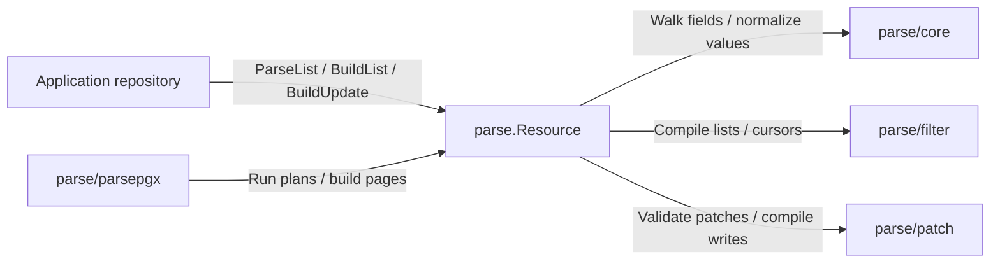

# github.com/ashtonian/pkg/parse

Parse resource API filters, sorts, pagination, search, facets, relations, and patches from Go struct tags. Compile validated requests to parameterized PostgreSQL or SQLite SQL, or apply supported patches to Go values. The core performs no database I/O; your application owns execution, authorization, and transactions, and the optional [`parsepgx`](parsepgx/README.md) runs the plans on PostgreSQL through pgx.

## Architecture



**Entry points:** `NewResource` declares a table and key; `ParseList`, `BuildList`, `BuildUpdate`, `Page` and the filter/patch methods serve requests.

**Exit points:** Parameterized statements, parsed values and pages. Repositories execute statements; `parsepgx` provides optional pgx execution.

**Failure modes:** Invalid declarations fail construction; request validation returns `core.ParseError` with its code and path; missing tenant scope returns `ErrTenantRequired`; unreadable row keys return an error while building a cursor.

**Dependencies:** `Resource` composes `core`, `filter` and `patch`. The compiler packages import no application code; callers own connections, authorization and transactions.

## Quick start

Declare the resource once; then each list request is parsed, compiled under the server's scope, and turned into a page. This complete program compiles a request without opening a database. Requires Go 1.27 or later. Install with `go get github.com/ashtonian/pkg/parse@latest`.

```go
package main

import (
	"fmt"
	"net/url"

	"github.com/ashtonian/pkg/parse"
	"github.com/ashtonian/pkg/parse/filter"
)

type Device struct {
	ID       string `json:"id"        db:"id"        parse:"filter,sort"`
	TenantID string `json:"tenant_id" db:"tenant_id"`
	Name     string `json:"name"      db:"name"      parse:"filter,sort,patch"`
	Status   string `json:"status"    db:"status"    parse:"filter,patch" enum:"active,offline"`
}

func main() {
	devices := parse.MustResource[Device]("devices", parse.TenantColumn("tenant_id"), parse.PageSize(25, 100))

	q, _ := url.ParseQuery(`status=active&filter={"name":{"$ne":"spare"}}&sort=name&page_size=10`)
	req, err := devices.ParseList(q)
	if err != nil {
		fmt.Println(err)
		return
	}
	plan, err := devices.BuildList(filter.PostgresDialect{}, req, parse.Scope{Tenant: "t1"})
	if err != nil {
		fmt.Println(err)
		return
	}
	fmt.Println(plan.Page.SQL)
	fmt.Println(plan.Page.Args)
}
```

```text
SELECT devices.id, devices.tenant_id, devices.name, devices.status FROM devices WHERE ((devices.name <> $1 AND devices.status = $2) AND devices.tenant_id = $3) ORDER BY devices.name COLLATE pg_c_utf8 ASC, devices.id COLLATE pg_c_utf8 ASC LIMIT 11
[spare active t1]
```

On PostgreSQL, `parsepgx.QueryPage(ctx, pool, devices, plan)` runs the plan and returns the page with its total, facets and includes. Elsewhere, run `plan.Page` and pass the rows to `devices.Page(rows, plan)` for the cursors and has-next flags; run `plan.Count` when the request asked for a total, `plan.Facets` for facets (`filter.ScanFacetUnion`, then `filter.FacetMap` into `page.Facets`), and `devices.IncludeQueries(plan, keys)` once the page's keys are known. `parse.Scope` carries what the server decides — tenant, authorization policy, governance, deleted-row visibility — and never comes from the request. Write a request error with `parsehttp.WriteError`. The output above is `ExampleResource_BuildList`, checked by the unit lane. Updates take the same `Scope`: `devices.BuildUpdate(dialect, patch, parse.ByID(id), scope)` returns one `UPDATE … RETURNING` scoped to the tenant, live rows and policy, which `parsepgx.Update` applies with its relation changes in one transaction ([Resource updates](docs/patches.md#resource-updates), `ExampleResource_BuildUpdate`). See the [complete SQLite HTTP server](examples/server/) and the [pgx recipe](parsepgx/recipe_test.go).

## Choose the feature

| Need | Entry point | Guide |
|---|---|---|
| Serve a list endpoint: parse, scope, compile, page | `NewResource[T]`, `ParseList` (or `ParseListInput` off HTTP), `BuildList`, `Page`, `IncludeQueries` | [List queries](docs/queries.md#lists-and-keyset-pagination) |
| Run a list or update plan on PostgreSQL | `parsepgx.QueryPage`, `parsepgx.Update` | [pgx](docs/integrations.md#pgx) |
| Answer a request error | `parsehttp.WriteError` | [HTTP and errors](docs/http-errors.md) |
| Parse a stored/server-policy filter with a per-call cost budget | `Resource.ParseFilterWithCost` | [Parser configuration](docs/schema-configuration.md#parser-and-generator-options) |
| Parse an HTTP filter alone, including flat parameters | `Resource.ParseRequestFilter` | [Queries](docs/queries.md) |
| Compose list fragments over a declared resource | `Resource.ListQuery(dialect).Build` (the primary key joins every keyset) | [List queries](docs/queries.md#lists-and-keyset-pagination) |
| Compile only a predicate for existing SQL | `filter.NewSQLBuilder` | [Query composition](docs/queries.md#configuration) |
| Filter, sort and facet typed members of JSON documents | `paths` / `storage` tags, struct member tags, `Resource.WithPaths` (per request: custom fields) | [JSON paths](docs/queries.md#json-paths) |
| Filter JSON arrays by their elements, every predicate on one element | `elements` tag or a slice-of-struct document; `$some`, `$none` | [Array elements](docs/queries.md#array-elements) |
| Filter by related rows' attributes (has-many, belongs-to, many-to-many) | `Resource.Relate` with `HasMany`, `BelongsTo`, `ManyToMany`; `$some`, `$none`, `$is`, `$is_not` | [Relations](docs/relations.md#declare-relations) |
| Match related IDs or return relation memberships | Relation tags, `filter.BuildIncludeQuery` | [Relations](docs/relations.md#pair-tables-compared-by-key) |
| Serve an update endpoint: patch rows scoped to tenant, live rows and policy | `ParseMergePatch` / `ParsePatch`, `BuildUpdate`, `RelationStatements` | [Resource updates](docs/patches.md#resource-updates) |
| Merge fields or replace a JSON document | `ParseMergePatch`, `ParsePatch`, `patch.BuildPatchSQL` | [Patches](docs/patches.md) |
| Apply a patch to an existing Go value | `ApplyValidatedPatch`, `ApplyPatch` | [Typed documents](docs/patches.md#typed-document-behavior) |
| Advertise capabilities to a UI/client | `NewSchemaRegistry`, `RegisterResource` (or `Register[T]`), `SchemaHandler` | [HTTP and errors](docs/http-errors.md) |
| Build a patch in code instead of a JSON body | `MergePatchMap`, `ServerMergePatchMap`, `ValidateOperations`, `ValidateServerOperations` | [Patches](docs/patches.md) |
| Call the API from TypeScript | `createClient` in `sdk/ts` | [Client integration](docs/integrations.md#typescript-client) |
| Build requests from Go: typed filters, sorts, list parameters, merge and JSON patches | `parse/client` | [Go client](docs/integrations.md#go-client) |

Use this package when a resource API needs validated user-controlled query/update expressions. Keep hand-written SQL for workflows that require a different query model; the lower-level AST, schemas, and SQL fragments can be composed independently.

## Backends and boundaries

Select a dialect when building SQL; connection setup and drivers belong to the caller.

| Backend | Selection | Important differences |
|---|---|---|
| PostgreSQL | `filter.PostgresDialect{}` | Native arrays/JSONB, full-text search; polygon/intersection predicates require PostGIS |
| SQLite | `filter.SQLiteDialect{}` | JSON text and JSON functions; phrase search and ASCII case folding; no polygon/intersection predicates |
| Go values | `ApplyValidatedPatch` | Supports allowed nested paths, `test`, `copy`, and `move`; persist the result yourself |

String ordering uses PostgreSQL's `pg_c_utf8` collation (PostgreSQL 17+; `filter.CollationC` for 14–16) and SQLite binary ordering. A flat parameter naming no filterable field is refused (E2071) on every entry point unless the endpoint accepts it. Documents filter whole or by declared typed members (`{"attrs.color": "red"}`, [JSON paths](docs/queries.md#json-paths)); related rows filter by their own attributes through declared relations (`{"commands": {"$some": {"status": "pending"}}}`, [Relations](docs/relations.md)). SQL patch compilation rejects unsupported operations rather than skipping them. [Backend details](docs/queries.md#type-capabilities) · [Patch limits](docs/patches.md)

## Configuration

Construct parsers once, customize schemas before serving, and treat them as read-only afterward.

| Option | Type | Default | Description |
|---|---|---|---|
| `parse.PrimaryKey(column)` | `ResourceOption` | `"id"` | Key column; the final keyset column of every list |
| `parse.TenantColumn(column)` | `ResourceOption` | none | Holds every list, and tenant-scoped junctions, to `Scope.Tenant` |
| `parse.DeletedColumn(column)` | `ResourceOption` | none | Soft-delete timestamp; deleted rows only with `Scope.IncludeDeleted` |
| `parse.PageSize(def, max)` | `ResourceOption` | 50, 1000 | Page size without `page_size`, and its ceiling (larger requests are clamped) |
| `parse.AcceptParams(names...)` | `ResourceOption` | none | Query parameters the endpoint reads itself; any other unknown parameter is E2071 |
| `parse.ReadColumns(columns...)` | `ResourceOption` | every column of T | The columns lists select and updates return; sensitive columns stay in the database. Must include the key and every sort key's column |
| `parse.ColumnType(column, t)` | `ResourceOption` | none | Physical storage profile, including `core.SQLJSON` / `SQLJSONB`, native arrays and PostgreSQL inet/cidr/interval text projection; [storage declarations](docs/schema-configuration.md#fields-and-embedding) |
| `parse.ParserOptions(opts...)` | `ResourceOption` | bounded parser defaults | Limits, codec, clock and schema generation; [complete table](docs/schema-configuration.md#parser-and-generator-options) |
| `parse.WithPatchPolicy(pc, subject)` | `parse.PatchOption` | none | Request-specific path/value restrictions |
| `filter.QueryParamAccept(names...)` | `filter.QueryParamOption` | none | Parameters `ParseRequestFilter` / `NewQueryParamParser` leave to the endpoint; any other unknown parameter is E2071 |
| `filter.QueryParamLenient()` | `filter.QueryParamOption` | off | Ignore unknown flat parameters instead of refusing them |
| `filter.PostgresDialect{Collation: c}` | `filter.PostgresCollation` | `filter.CollationPgCUTF8` | Code-point collation for string sorts and ranges; `filter.CollationC` on PostgreSQL 14–16 |
| `filter.List*` / builder options | functional options | bounded list defaults | [List, filter, facet, include options](docs/queries.md#configuration) |
| `patch.With*` | `patch.PatchSQLOption` | no timestamp column | [SQL patch options](docs/patches.md#configuration) |

Tags expose capabilities explicitly: `parse:"filter,sort,patch,facet,search,include,server"`, `filter_ops`, `patch_ops`, `enum`, `relation`, `facet`, and search/geo metadata. Unknown capability names fail schema construction. [All tags and defaults](docs/schema-configuration.md)

## Documentation

| Guide | Covers |
|---|---|
| [Schema and configuration](docs/schema-configuration.md) | Tags, options, storage types, schema discovery |
| [Queries](docs/queries.md) | Operators, SQL examples, sort/cursors, search, facets, geography |
| [Relations](docs/relations.md) | Membership filters, includes, junction writes, tenant scope |
| [Patches and JSON](docs/patches.md) | JSON Patch/Merge Patch, typed documents, policy, SQL limits |
| [HTTP and errors](docs/http-errors.md) | Request/response contract, schema routes, E-code catalog |
| [Integrations](docs/integrations.md) | pgx, database/sql, TypeScript, custom schemas |
| [Operations](docs/operations.md) | Security, concurrency, indexing, query costs, verification |

## API and code map

| Package / file | Responsibility |
|---|---|
| [`resource.go`](resource.go) | `NewResource[T]`, `MustResource`, resource options, identity, system fields, projection (`Columns`, `ColumnNames`), `ParseFilterWithCost`, `Key`, `WithPaths` (a request's view with declared JSON paths) |
| [`list.go`](list.go) | `ListInput`, `ParseListInput`, `ListRequest`, `ParseList`, `Scope`, `ListPlan` (`Dialect`), `BuildList`, `Page`, `PagePointers`, `IncludeQueries` |
| [`relate.go`](relate.go) | `Relate`, `MustRelate`, `HasMany`, `BelongsTo`, `ManyToMany`, `Junction` / `Through`, `Indexed`, `Includable`, `Facetable`, `Writable`, `PolicyScoped`, `References`, `RelatedResource` |
| [`update.go`](update.go) | `Target` (`ByID`, `ByIDs`, `ByFilter`), `BuildUpdate`, `UpdatePlan` (`Dialect`), `RelationStatements`, `Stamp`, `StampSQL`, `Dialect` |
| [`typed.go`](typed.go) | `Resource` parse entry points (`MergePatchMap`, `ValidateOperations` and server variants), schema access, typed patch application |
| [`parsehttp`](parsehttp/README.md) | `WriteError`: a parse error as an HTTP response |
| [`parsepgx`](parsepgx/README.md) | `QueryPage`, `Update`: plans run on PostgreSQL through pgx batches |
| [`registry.go`](registry.go) | `NewSchemaRegistry`, `RegisterResource`, `Register[T]`, `MustRegister[T]`, discovery handlers; the versioned schema document (`SchemaResponse`, `SchemaVersion`) with relations, element paths and patch value metadata |
| [`core`](core/README.md) | Configuration, schema generation, the field walk every schema shares (embedded structs promoted as encoding/json promotes them), values, pointers, `ParseError` |
| [`filter`](filter/README.md) | Filter AST, dialects, list plans, pages, facets, search, SQL and non-SQL include resolution; `filter.Page.SetInclude` owns the page projection |
| [`patch`](patch/README.md) | Patch validation, SET clauses, relation statements, patch policy |
| [`client`](client/README.md) | Go request builders: typed catalog fields, `Filter`, `Sort`, `ListParams`, `Nullable`, JSON Patch `Operation`; standard library only, held to the filter and patch corpora |
| [`sdk/ts`](sdk/ts/README.md) | TypeScript builders, HTTP client, schema validation |
| [`filter/filtertest`](filter/filtertest/) | Shared operator conformance fixture |
| `internal/dialect`, `internal/jsonmerge`, `internal/cursor` | Dialect primitives, RFC 7386 merge and the bounded MessagePack cursor envelope; the compiler has no private sibling imports |

`parse.Codes() []parse.Code` exposes the application-independent error catalog (E2061–E2089 and E2112–E2119, with gaps; E2067 is a malformed list parameter). `*parse.ParseError` carries the string code, path/index context, cause and HTTP status. A `Code` is an `errors.Is` target; Consumers map catalog metadata into their own error conventions. [Error handling and complete catalog](docs/http-errors.md#error-codes)

## Verification

```bash
go test -tags=unit -race ./...
go test -tags=integration -race ./...
```

Database setup, targeted examples, SDK checks, and benchmarks are in [Operations](docs/operations.md#verification). The module and its released dependencies resolve independently of the repository workspace; no local replacements are required.

## Dependencies and security

The module uses MIT licensing and requires Go 1.27. Runtime dependencies include the released `pkg/gowalker` and `pkg/jsonvalue` modules, JSON Patch, UUID, decimal and MessagePack support; the optional PostgreSQL adapter uses pgx. The runnable server example uses the released config/Kong provider and SQLite. The Go request builder and published TypeScript SDK have no third-party runtime dependencies.

Before v1, minor releases may change the Go API or grammar; patch releases retain the published contract. Schema documents carry their own version, independent of module versions. The default PostgreSQL collation requires 17+; the test matrix targets PostgreSQL 17/18 and SQLite. `CollationC` can compile for PostgreSQL 14–16, with matching index collation, but those versions are outside the CI matrix.

Applications own authenticated scope and trusted SQL expressions. Cursors are opaque positions, not authorization credentials. Bound request size and complexity, propagate context deadlines through execution, and follow the [operations guide](docs/operations.md) and [security policy](SECURITY.md).
