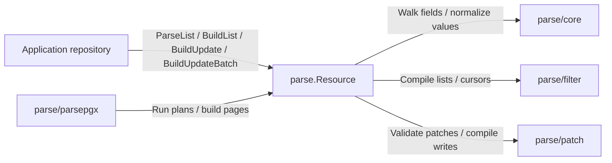

# github.com/ashtonian/pkg/parse

Parse resource API filters, sorts, pagination, search, facets, relations, and patches from Go struct tags. Compile validated requests to parameterized PostgreSQL or SQLite SQL, or apply supported patches to Go values. The core performs no database I/O; your application owns execution, authorization, and transactions, and the optional [`parsepgx`](parsepgx/README.md) runs the plans on PostgreSQL through pgx.

## Architecture



**Entry points:** `NewResource` declares a table and key; `ParseList`, `BuildList`, `BuildUpdate`, `BuildUpdateBatch`, `Page` and the filter/patch methods serve requests.

**Exit points:** Parameterized statements, parsed values and pages. Repositories execute statements; `parsepgx` provides optional pgx execution.

**Failure modes:** Invalid declarations fail construction; request validation returns `core.ParseError` with its code and path (patch failures can be joined); missing tenant scope (no `Scope.Tenant`, and for a list no `Scope.Governance`) returns `ErrTenantRequired`, and a tenant a reached tenant column cannot hold `ErrTenantInvalid`; `Relate` refuses a relation that would make one request bind its tenant to a string or UUID column and an integer one; unreadable row keys return an error while building a cursor.

**Dependencies:** `Resource` composes `core`, `filter` and `patch`. The compiler packages import no application code; callers own connections, authorization and transactions.

## Quick start

Declare the resource once; then each list request is parsed, compiled under the server's scope, and turned into a page. This complete program compiles a request without opening a database. Requires Go 1.27 or later. Install with `go get github.com/ashtonian/pkg/parse@latest`.

```go
package main

import (
	"fmt"
	"net/url"

	"github.com/ashtonian/pkg/parse"
	"github.com/ashtonian/pkg/parse/filter"
)

type Device struct {
	ID       string `json:"id"        db:"id"        parse:"filter,sort"`
	TenantID string `json:"tenant_id" db:"tenant_id"`
	Name     string `json:"name"      db:"name"      parse:"filter,sort,patch"`
	Status   string `json:"status"    db:"status"    parse:"filter,patch" enum:"active,offline"`
}

func main() {
	devices := parse.MustResource[Device]("devices", parse.TenantColumn("tenant_id"), parse.PageSize(25, 100))

	q, _ := url.ParseQuery(`status=active&filter={"name":{"$ne":"spare"}}&sort=name&page_size=10`)
	req, err := devices.ParseList(q)
	if err != nil {
		fmt.Println(err)
		return
	}
	plan, err := devices.BuildList(filter.PostgresDialect{}, req, parse.Scope{Tenant: "t1"})
	if err != nil {
		fmt.Println(err)
		return
	}
	fmt.Println(plan.Page.SQL)
	fmt.Println(plan.Page.Args)
}
```

<!-- output of ExampleResource_BuildList -->
```text
SELECT "devices"."id", "devices"."tenant_id", "devices"."name", "devices"."status" FROM "devices" WHERE (("devices"."name" <> $1 AND "devices"."status" = $2) AND "devices"."tenant_id" = $3) ORDER BY "devices"."name" COLLATE pg_c_utf8 ASC, "devices"."id" COLLATE pg_c_utf8 ASC LIMIT 11
[spare active t1]
```

`parsepgx.QueryPage(ctx, pool, devices, plan)` on PostgreSQL and `parsesql.QueryPage(ctx, db, devices, plan)` on SQLite run the plan and return the page with its cursors, total, facets and includes. Another executor runs `plan.Page` and passes the rows to `devices.Page(rows, plan)`, then `plan.Count`, `plan.Facets` (`filter.ScanFacetUnion`, then `filter.FacetMap`) and `devices.IncludeQueries(plan, keys)` for the page's keys, each through `Page.SetInclude`. `parse.Scope` carries what the server decides — tenant, authorization policy, governance, deleted-row visibility — and never comes from the request. Write a request error with `parsehttp.WriteError`. The output above is `ExampleResource_BuildList`, checked by the unit lane. Updates take the same `Scope`: `devices.BuildUpdate(dialect, patch, parse.ByID(id), scope)` returns one `UPDATE … RETURNING` scoped to the tenant, live rows and policy, which `parsepgx.Update` or `parsesql.Update` applies with its relation changes in one transaction, reporting the rows it changed apart from the rows it left (`UpdateResult`; [Resource updates](docs/patches.md#resource-updates), `ExampleResource_BuildUpdate`). See the [complete SQLite HTTP server](examples/server/) and the [pgx recipe](parsepgx/recipe_test.go).

## Choose the feature

| Need | Entry point | Guide |
|---|---|---|
| Serve a list endpoint: parse, scope, compile, page | `NewResource[T]`, `ParseList` (or `ParseListInput` off HTTP), `BuildList`, `Page`, `IncludeQueries` | [List queries](docs/queries.md#lists-and-keyset-pagination) |
| Run a list, update or batch plan | PostgreSQL: `parsepgx.QueryPage`, `parsepgx.Update`, `parsepgx.UpdateBatch`; SQLite: the same in `parsesql` | [pgx](docs/integrations.md#pgx), [database/sql](docs/integrations.md#databasesql-and-sqlite) |
| Answer a request error | `parsehttp.WriteError` | [HTTP and errors](docs/http-errors.md) |
| Serve a list too large for a URL: the same request as a POST body | `ParseListBody`, `parsehttp.ParseList` (route `POST` on the collection path), `WithMaxListBodySize`, `ListParams.Body` in `parse/client`, the SDK's opt-in `maxURLLength` | [HTTP contract](docs/http-errors.md#the-same-request-as-a-post-body) |
| Parse a stored/server-policy filter with a per-call cost budget | `Resource.ParseFilterWithCost` | [Parser configuration](docs/schema-configuration.md#parser-and-generator-options) |
| Parse an HTTP filter alone, including flat parameters | `Resource.ParseRequestFilter` | [Queries](docs/queries.md) |
| Compose list fragments over a declared resource | `Resource.ListQuery(dialect)`, then `Build` (the primary key joins every keyset) | [List queries](docs/queries.md#lists-and-keyset-pagination) |
| Compile only a predicate for existing SQL | `filter.NewSQLBuilder` | [Query composition](docs/queries.md#configuration) |
| Filter, sort and facet typed members of JSON documents | `paths` / `storage` tags, struct member tags, `Resource.WithPaths` (per request: custom fields) | [JSON paths](docs/queries.md#json-paths) |
| Filter JSON arrays by their elements, every predicate on one element | `elements` tag or a slice-of-struct document; `$some`, `$none` | [Array elements](docs/queries.md#array-elements) |
| Filter by related rows' attributes (has-many, belongs-to, many-to-many) | `Resource.Relate` with `HasMany`, `BelongsTo`, `ManyToMany`; `$some`, `$none`, `$is`, `$is_not` | [Relations](docs/relations.md#declare-relations) |
| Match related IDs or return relation memberships | Relation tags, `filter.BuildIncludeQuery` | [Pair tables](docs/pair-tables.md) |
| Serve an update endpoint: patch rows scoped to tenant, live rows and policy | `parsehttp.ParsePatch` (`ParsePatchRequest`), `ParseMergePatch` / `ParsePatch`, `BuildUpdate`, an executor's `Update` (`UpdateResult`) | [Resource updates](docs/patches.md#resource-updates) |
| Compile distinct column patches with per-key revision/policy fences in one transaction | `BuildUpdateBatch`, `RowUpdate`, an executor's `UpdateBatch` | [Varied update batches](docs/operations.md#varied-native-update-batches) |
| Write, stamp and count only the rows a patch changes, and tell unchanged from not found | `SkipUnchanged`, `UpdateResult.Changed` / `Unchanged` | [Skipping unchanged rows](docs/patches.md#skipping-unchanged-rows) |
| Merge fields or replace a JSON document | `ParseMergePatch`, `ParsePatch`, `patch.BuildPatchSQL` | [Patches](docs/patches.md) |
| Apply a patch to an existing Go value | `ApplyValidatedPatch`, `ApplyPatch` | [Typed documents](docs/patches.md#typed-document-behavior) |
| Advertise capabilities to a UI/client | `NewSchemaRegistry`, `RegisterResource` (`Register[T]` for a type no resource serves), `parsehttp.SchemaHandler` | [HTTP and errors](docs/http-errors.md) |
| Build a patch in code instead of a JSON body | `MergePatchMap`, `ServerMergePatchMap`, `ValidateOperations`, `ValidateServerOperations` | [Patches](docs/patches.md) |
| Call the API from TypeScript | `createClient` in `sdk/ts` | [Client integration](docs/integrations.md#typescript-client) |
| Call the API from Go: typed filters, sorts, list parameters, merge and JSON patches; pages, patch answers, coded errors and schema documents decoded | `parse/client`, a standard-library module of its own | [Go client](docs/integrations.md#go-client) |
| Generate an SDK for a parse-based API: types and a thin binding per operation over the shared runtime | `createClient` and `request` in `sdk/ts`; `parse/client` | [Generated TypeScript SDKs](sdk/ts/docs/generated-sdks.md), [generated Go SDKs](client/README.md#for-generated-sdks) |

Use this package when a resource API needs validated user-controlled query/update expressions. Keep hand-written SQL for workflows that require a different query model; the lower-level AST, schemas, and SQL fragments can be composed independently.

## Backends and boundaries

Select a dialect when building SQL; connection setup and drivers belong to the caller.

| Backend | Selection | Important differences |
|---|---|---|
| PostgreSQL | `filter.PostgresDialect{}` | Native arrays/JSONB, full-text search; geo predicates require PostGIS |
| SQLite | `filter.SQLiteDialect{}` | JSON text and JSON functions; timestamps stored as canonical UTC text ([timestamps](docs/schema-configuration.md#timestamps)); phrase search and ASCII case folding; geo predicates on JSONB points through `parsesqlite`'s functions, no native geometry storage |
| CockroachDB | Not supported | `filter.DialectFromDSN` refuses `cockroach://` and `crdb://`. A `postgres://` or `postgresql://` URL to a CockroachDB cluster still selects `PostgresDialect`, whose SQL (the `pg_c_utf8` collation, PostGIS functions, `jsonb_path_query_first`) has never run on CockroachDB |
| Go values | `ApplyValidatedPatch` | Supports allowed nested paths, `test`, `copy`, and `move`; persist the result yourself |

String ordering uses PostgreSQL's `pg_c_utf8` collation (PostgreSQL 17+; `filter.CollationC` for 14–16) and SQLite binary ordering. A flat parameter naming no filterable field is refused (E2071) on every entry point unless the endpoint accepts it, and so is a facet, include or `fields` name that names no field it can serve. The `fields` mask is validated, not applied: the query reads every column the resource reads, and the service drops the members the mask leaves out ([field mask](docs/queries.md#field-mask)). Documents filter whole or by declared typed members (`{"attrs.color": "red"}`, [JSON paths](docs/queries.md#json-paths)); related rows filter by their own attributes through declared relations (`{"commands": {"$some": {"status": "pending"}}}`, [Relations](docs/relations.md)). SQL patch compilation rejects unsupported operations rather than skipping them. [Backend details](docs/queries.md#type-capabilities) · [Patch limits](docs/patches.md)

## Configuration

Construct a resource once and share it. Its schemas are fixed when `NewResource` returns: customize them with `parse.CustomizeSchemas`; the schema accessors hand out copies.

| Option | Type | Default | Description |
|---|---|---|---|
| `parse.PrimaryKey(columns...)` | `ResourceOption` | `"id"` | Key columns, in key order and unique together among the table's rows: the final keyset columns of every list, what an update by key reaches and what relations correlate on. A key of several columns, such as `("warehouse_id", "sku")`, is a `parse.Key` of a value per column (`ByKey`, `ByKeys`, `Resource.Key`); the tenant column may be one of them. Each column is a scalar of any type, compared wherever a key is as a filter compares its type (a decimal by value, a timestamp at its instant). `NewResource` refuses no column, one listed twice, and one that is not T's, is no scalar (a document, array or geometry), is computed, is not read or is the soft-delete column ([keys](docs/schema-configuration.md#keys)) |
| `parse.TenantColumn(column)` | `ResourceOption` | none | Holds every list, and tenant-scoped junctions, to `Scope.Tenant`; a list with `Scope.Governance` holds each row's relations to the row's own tenant instead ([Governed lists](docs/relations.md#governed-lists)). The column's field is a string, a UUID or an integer, and `Scope.Tenant` (the key's text, `"44"` for an integer) is bound as that type, checked against every tenant column the resource's relations reach ([Tenant key](docs/relations.md#tenant-key)) |
| `parse.DeletedColumn(column)` | `ResourceOption` | none | Soft-delete timestamp: a row is live while it is NULL, so its field is a pointer or an `sql.Scanner` such as `sql.NullTime`, and it is neither the key nor the tenant column (`NewResource` fails otherwise); deleted rows only with `Scope.IncludeDeleted` |
| `parse.PageSize(def, max)` | `ResourceOption` | 50, 1000 | Page size without `page_size`, and its ceiling (larger requests are clamped) |
| `parse.AcceptParams(names...)` | `ResourceOption` | none | Query parameters the endpoint reads itself; any other unknown parameter is E2071. `NewResource` refuses a name that is a list parameter, the search parameter or a flat filter on a field, and `Relate` and `WithPaths` one that would be a flat filter on the field they add: `ParseList` would skip that filter |
| `parse.ReadColumns(columns...)` | `ResourceOption` | every column of T | The columns lists select and updates return; sensitive columns stay in the database, and no page, cursor or facet carries their values. Must include the key, the column of every sort key and facet, the correlation columns of a relation that includes or facets, and every filter, search and relation correlation column that `QueryOnlyColumns` does not name; a relation is held to its target's read set too ([read columns](docs/relations.md#read-columns)). `NewResource`, `Relate` and `WithPaths` refuse a declaration that needs another column |
| `parse.QueryOnlyColumns(columns...)` | `ResourceOption` | none | Columns `ReadColumns` leaves out that requests may still filter and search by, directly or through a relation correlating on them, such as a large text column searched but never listed. Which rows match discloses their values, so name only columns the caller may learn. Never a sort key, a facet, or the correlation of a relation that includes or facets |
| `parse.ReadExpr(column, expr)` | `ResourceOption` | none | Reads a column through a trusted SQL expression per dialect (`parse.ColumnExpr`; `parse.SQL(sql)` for one every dialect reads alike), such as a correlated count, a pair table's keys as an array, or `coalesce` over a nullable column. Lists, updates' `RETURNING` and `parsepgx` select it as `(sql) AS column`, and its filter, sort, facet and search tags, and server policies naming it, compile against the dialect's expression; a dialect the expression refuses fails every statement built for it. It can't be the key, tenant or deleted column, be patched, stamped or incremented, hold document paths or correlate a relation; a relation to the resource filters by it through the target's expression for the owner's dialect; [computed columns](docs/queries.md#computed-columns) |
| `parse.ColumnType(column, t)` | `ResourceOption` | none | Physical storage profile, including `core.SQLJSON` / `SQLJSONB`, native arrays and PostgreSQL inet/cidr/interval text projection; [storage declarations](docs/schema-configuration.md#fields-and-embedding) |
| `parse.CustomizeSchemas(fn)` | `ResourceOption` | none | Changes the generated schemas (`parse.Schemas`: filter, sort, search, patch, server patch) while the resource is built, before its read-set and column checks; calls run in order, an error fails `NewResource`, and the resource keeps copies |
| `parse.ParserOptions(opts...)` | `ResourceOption` | bounded parser defaults | Limits, codec, clock and schema generation; [complete table](docs/schema-configuration.md#parser-and-generator-options) |
| `parse.WithPatchPolicy(pc, subject)` | `parse.PatchOption` | none | Request-specific path/value restrictions |
| `parsehttp.WithErrorHandler(fn)` | `parsehttp.Option` | none (failures are not reported) | `fn(*http.Request, error)` receives what `parsehttp`'s responses cannot carry: a parse error's `Details` entries that cannot be encoded, left out of `WriteError`'s body and matching `parsehttp.ErrUnencodableDetails`; a schema document that cannot be encoded, answered 500/E2120 and matching `parse.ECodeSchemaEncodingFailed`; a `Write` that fails after the status is sent, best effort since net/http buffers small responses ([error handling](docs/http-errors.md#error-handling)) |
| `filter.QueryParamAccept(names...)` | `filter.QueryParamOption` | none | Parameters `ParseRequestFilter` / `NewQueryParamParser` leave to the endpoint; any other unknown parameter is E2071 |
| `filter.QueryParamLenient()` | `filter.QueryParamOption` | off | Ignore unknown flat parameters instead of refusing them |
| `filter.PostgresDialect{Collation: c}` | `filter.PostgresCollation` | `filter.CollationPgCUTF8` | Code-point collation for string sorts and ranges; `filter.CollationC` on PostgreSQL 14–16 |
| `filter.List*` / builder options | functional options | bounded list defaults | [List, filter, facet, include options](docs/queries.md#configuration) |
| `Indexed`, `Includable`, `Facetable`, `Writable`, `PolicyScoped`, `References`, `Describe` | `RelationOption` | a relation that filters only | [Relation options](docs/relations.md#declare-relations) |
| `Stamp`, `StampSQL`, `Increment`, `SkipUnchanged` | `UpdateOption` | no stamp, no increment, every target row written | [Update options](docs/patches.md#resource-updates) |
| `parse.ScanJSON(columns...)` | `ScanOption` | the resource's declared JSON columns | Columns `RowScanner` decodes as stored JSON documents where the resource declares none, for a driver that learns them from the result: `parsepgx` names the columns PostgreSQL reports as json or jsonb. An `sql.Scanner` column whose type holds a member encoding/json cannot decode (promoted through an unexported embedded pointer) is refused |
| `patch.With*` | `patch.PatchSQLOption` | no timestamp column | [SQL patch options](docs/patches.md#configuration) |
| `patch.DefaultMaxOperations` | int | `50` | Operation limit of every `PatchSchema` (generated, or built with `patch.NewPatchSchema`) unless its `MaxOperations` is set; 0 is unlimited. [Patch limits](docs/patches.md#validation) |
| `patch.DefaultMaxRelationValues` | int | `1000` | Keys one operation on a relation path may name, repeats counted once, unless the schema's `MaxRelationValues` is set; 0 is unlimited; beyond it E2119. Served as `max_relation_values`. [Patch limits](docs/patches.md#validation) |
| `UpdateBatchLimits.MaxRows` | int | `500` | Total keys admitted by one `BuildUpdateBatch` plan; zero selects the default and negative refuses |
| `UpdateBatchLimits.MaxParameters` | int | SQLite `999`; PostgreSQL `65535` | Parameters per batch statement; zero selects the dialect default and negative refuses |

Tags expose capabilities explicitly: `parse:"filter,sort,patch,facet,search,include,server"`, `filter_ops`, `patch_ops`, `enum`, `minlen` / `maxlen` / `min` / `max` / `minitems` / `maxitems`, `relation`, `facet`, and search/geo metadata. Unknown capability names fail schema construction. [All tags and defaults](docs/schema-configuration.md)

## Documentation

| Guide | Covers |
|---|---|
| [Schema and configuration](docs/schema-configuration.md) | Tags, options, storage types, schema discovery |
| [Queries](docs/queries.md) | Operators, SQL examples, sort/cursors, search, facets, geography |
| [Relations](docs/relations.md) | Relations between resources: filters on related rows, includes, facets, membership writes, tenant scope |
| [Pair tables](docs/pair-tables.md) | The `relation` struct tag: pair tables compared by key, include queries, junction statements |
| [Patches and JSON](docs/patches.md) | JSON Patch/Merge Patch, typed documents, policy, SQL limits |
| [HTTP and errors](docs/http-errors.md) | Request/response contract, schema routes, E-code catalog |
| [Integrations](docs/integrations.md) | pgx, database/sql, TypeScript, custom schemas |
| [Operations](docs/operations.md) | Security, concurrency, indexing, query costs, verification |
| [Mapping from PostgREST, django-filter and ent](docs/grammar-mapping.md) | Each operator, list parameter, sort, paging, relation and patch form against its counterparts, the semantic differences and the gaps on both sides |

## API and code map

| Package / file | Responsibility |
|---|---|
| [`resource.go`](resource.go) | `NewResource[T]`, `MustResource`, resource options (`CustomizeSchemas`, `Schemas`, `PrimaryKey`), identity, system fields, projection (`Columns`, `ColumnNames`), `ParseFilterWithCost`, `Resource.Key` (a row's key), `PrimaryKeyColumns`, `WithPaths` (a request's view with declared JSON paths) |
| [`key.go`](key.go) | `Key` (a row's key: a value per key column, `core.Key`); how keys are checked against the key columns, normalized, compared and ordered for targets, batches and relation statements |
| [`key_text.go`](key_text.go) | `Resource.ParseKey`: a key read from its columns' texts, as an item route's path segments carry them (`parsehttp.ItemKey`): an integer as decimal digits, a float as a JSON number, a bool as `strconv.ParseBool` reads it, any other column its value's text; normalized as `ByKey` normalizes. `ErrNoSuchKey`: a text no key column can hold, the request's |
| [`list.go`](list.go) | `ListInput`, `ParseListInput`, `ListRequest` (sealed: read through methods, `WithFilter`), `ParseList`, `Scope`, `ListPlan` (`Dialect`), `BuildList`, `Page`, `PagePointers`, `IncludeQueries` |
| [`facets.go`](facets.go) | `ParseFacets`: a facets request, refusing the parameters that shape a page; `BuildFacets`: its facet statement, the one a list page carries |
| [`body.go`](body.go) | `ParsePatchRequest`: a patch request's body in the grammar its media type names (`MediaTypeMergePatch`, `MediaTypeJSONPatch`, `application/json`), bounded by `MaxInputSize`, or 1 MiB when it is unlimited; `BodyReadError`: a list or patch body that could not be read |
| [`list_body.go`](list_body.go) | `ParseListBody`: a list request as one JSON document, a POST body beside the query string; `ParseListPost`: a POST's list from its query string, content type and body; `Accepts` |
| [`relate.go`](relate.go) | `Relate`, `MustRelate`, `RelationOption`, `HasMany`, `BelongsTo`, `ManyToMany` (`KeyColumns`: one column or a key of several), `Junction` / `Through`, `Indexed`, `Includable`, `Facetable`, `Writable`, `PolicyScoped`, `References`, `RelatedResource` |
| [`scan.go`](scan.go) | `RowScanner`, `ScanOption`, `ScanJSON`: the row contract every executor scans through — each column into the field the resource compiled it from, stored documents decoded with presence and key checks, SQLite's JSON and timestamp text decoded; `NewResource` refuses a read column no scan can fill, one whose field or stored document member is promoted through an unexported embedded pointer |
| [`read_expr.go`](read_expr.go) | `ReadExpr`, `ColumnExpr`, `SQL`: computed columns, declared on the filter schema (`filter.ResourceSchema.Computed`) and resolved for each statement's dialect |
| [`tenant.go`](tenant.go) | `ErrTenantInvalid`; the tenant key: the one value every statement binds `Scope.Tenant` as, checked against every tenant column a resource reaches through its relations at any depth, and the relation graph `Relate` keeps it in |
| [`update.go`](update.go) | `Target` (`ByID`, `ByIDs` for a one-column key, `ByKey`, `ByKeys` for keys of any length, `ByFilter`), `ErrForeign` (a request value another resource parsed, or one built by hand), `ErrKeyInvalid` (a target key of another length than the key, or one a key column cannot hold), `BuildUpdate` and its `UpdateOption`s, `UpdatePlan` (`Dialect`, `Current`), `UpdateResult`, `UpdatedRows`, `RelationStatements`, `Reread`, `Stamp`, `StampSQL`, `Increment`, `SkipUnchanged`, `Unchanged`, `Dialect` |
| [`update_batch.go`](update_batch.go) | `RowUpdate`, `UpdateBatchLimits`, `BuildUpdateBatch`, `UpdateBatchPlan` (`Dialect`), `UpdateBatchChunk.CheckCurrent`, `ErrUpdateBatchTargets`: bounded varied column updates with exact preimage checks |
| [`typed.go`](typed.go) | `Resource` parse entry points (`MergePatchMap`, `ValidateOperations` and server variants), schema access (deep copies), typed patch application through `patch.Applier` |
| [`parsehttp`](parsehttp/README.md) | parse's `net/http` adapter: `WriteError`, a parse error as an HTTP response; `WriteJSON`, a handler's own answer; `SchemaHandler` and `SchemaListHandler`, the discovery routes; `ParseList`, a list from a GET query string or a POST body; one `WithErrorHandler` hook for all of them |
| [`parsepgx`](parsepgx/README.md) | `QueryPage`, `Update`, `UpdateBatch`, `Query`: plans and statements run on PostgreSQL through pgx batches |
| [`parsesql`](parsesql/README.md) | `QueryPage`, `Update`, `UpdateBatch`, `Query`: plans and statements run on SQLite through `database/sql` |
| [`parsesqlite`](parsesqlite/README.md) | `Register`: the SQLite functions plans compare decimals and decide geo predicates through, registered with `modernc.org/sqlite` |
| [`registry.go`](registry.go) | `NewSchemaRegistry`, `RegisterResource`, `MustRegisterResource`, `Register[T]`, `MustRegister[T]`, `ErrRegistered` (one registration per name), the schema accessors; the versioned schema document (`SchemaResponse`, `SchemaVersion`) with relations, element paths and patch value metadata, its sections `FilterSchemaResponse` (`FilterFieldResponse`, `GeoFieldConfigResponse`, `RelationResponse`), `SortSchemaResponse` (`SortFieldResponse`), `PatchSchemaResponse` (`PatchPathResponse`, `RelationKeyResponse`: a membership path's target key columns) and `SearchSchemaResponse` |
| [`codes.go`](codes.go) | `Code`, `Codes`, the `ECode*` aliases: the error catalog, one definition per code in `core` |
| [`core`](core/README.md) | Configuration, schema generation, the field walk every schema shares (embedded structs promoted as encoding/json promotes them; a field promoted through an unexported embedded pointer is neither scanned nor patched: [fields and embedding](docs/schema-configuration.md#fields-and-embedding)), values, pointers, `ParseError` |
| [`filter`](filter/README.md) | Filter AST, dialects, list plans, pages, facets, search, SQL and non-SQL include resolution; `filter.Page.SetInclude` owns the page projection |
| [`patch`](patch/README.md) | Patch validation, SET clauses, relation statements, patch policy |
| [`client`](client/README.md) | A module of its own (`github.com/ashtonian/pkg/parse/client`), standard library only: Go request builders (typed catalog fields, filters, sorts, list parameters, merge and JSON patches) and the answers' types (pages, patch answers, coded errors, the schema document), held to the filter and patch corpora and the recorded wire |
| [`sdk/ts`](sdk/ts/README.md) | TypeScript builders, HTTP client, schema validation |
| [`examples/server`](examples/server/README.md) | A runnable product API over SQLite serving every route the SDK calls; a module of its own, run against this working tree |
| [`filter/filtertest`](filter/filtertest/README.md) | The conformance fixture every filter backend runs: operators, paths, sets, memberships, policies |
| `internal/dialect`, `internal/jsonkeys`, `internal/jsonmerge`, `internal/rfc6902`, `internal/cursor`, `internal/decimals`, `internal/geo`, `internal/httpjson`, `internal/dbtest` | Dialect primitives and their names, a stored document's member spelling against its Go type and whether encoding/json can decode every member it writes (`CheckDecodable`), RFC 7396 merge, the RFC 6902 operation member names patch reads and parse writes, the bounded MessagePack cursor envelope, decimals as documents and SQLite hold them with their order-preserving key, the WGS 84 geodesic distance and planar point-in-polygon test geo filters use outside PostGIS, the JSON media type and response encoding, without the transport, that a list body is read and `parsehttp` answers with, and the PostgreSQL and SQLite databases integration tests run against; the compiler has no private sibling imports |

Packages under `internal/` have no README: no code outside the module imports them, and each is documented by its package comment (`go doc ./internal/<name>`) and its row above.

Patch parsers collect independent invalid values in order. Each declared enum/bounds failure carries `*patch.ConstraintError` with `Constraint` and `Limit`; `errors.As` still finds the first `*core.ParseError`. See [the complete patch error contract](docs/patches.md#validation).

`parse.Codes() []parse.Code` exposes the application-independent error catalog, sorted, as [the error table](docs/http-errors.md#error-codes) lists it (E2067 is a malformed list parameter, E2078 an unregistered resource answered 404, E2120 a schema document that could not be encoded). `*parse.ParseError` carries the string code, path/index context, cause and HTTP status. A `Code` is an `errors.Is` target; Consumers map catalog metadata into their own error conventions. [Error handling and complete catalog](docs/http-errors.md#error-codes)

## Operations

parse is a library: it starts no goroutines, holds no connections and writes no logs or metrics. `parsepgx` and `parsesql` run its plans on the caller's pool and context, so timeouts, pool limits and tracing belong to the application ([parsepgx operations](parsepgx/README.md#operations)). Its errors say whose fault a failure is:

- A `*core.ParseError` is the request's: answer its code's status (`ErrorHTTPStatus()`) with its body ([error catalog](docs/http-errors.md#error-codes)); `parsehttp.WriteError` does.
- A sentinel error is the server's: `ErrTenantRequired` (a tenant-scoped resource's plan built without `Scope.Tenant`), `ErrTenantInvalid` (a `Scope.Tenant` the tenant column cannot hold), `ErrNoTarget` and `ErrKeyInvalid` (an update with no target, or a key the key column cannot hold), `ErrUpdateScope` (an update built with `Governance` or `IncludeDeleted`), `ErrForeign` (a request another resource parsed), `ErrUpdateBatchTargets` (a batch whose locked rows did not match every key), `ErrRegistered` (a schema name registered twice), and those of [filter](filter/README.md#operations) and [patch](patch/README.md#operations). Match them with `errors.Is`; none is the client's to fix, so a handler answers them as its own failures (500). The one sentinel that is the request's is `ErrNoSuchKey`: `ParseKey` (`parsehttp.ItemKey`) read an item route's text that no key column can hold, so no row has that key; answer it 404.
- Every request is bounded by the [parser limits](docs/schema-configuration.md#parser-and-generator-options) and its cost by `MaxCost` ([query costs](docs/operations.md#query-costs-and-limits)).

Build each resource once, at startup, and share it ([concurrency and ownership](docs/operations.md#concurrency-and-ownership)).

## Verification

```bash
go test -tags=unit -race ./...
go test -tags=integration -race ./...
```

Database setup, targeted examples, SDK checks, and benchmarks are in [Operations](docs/operations.md#verification). The module and its released dependencies resolve independently of the repository workspace; no local replacements are required. The [server example](examples/server/README.md) is a module outside the workspace that replaces parse with this working tree: run `make parse-example-check` from the repository root, or its own [verification](examples/server/README.md#verification).

## Dependencies and security

The module uses MIT licensing and requires Go 1.27. Runtime dependencies are the released `pkg/gowalker` and `pkg/jsonvalue` modules, `github.com/evanphx/json-patch/v5` (JSON Patch application) and `github.com/vmihailenco/msgpack/v5` (the cursor envelope); UUIDs are the standard library's. The optional PostgreSQL adapter uses pgx, the SQLite functions `modernc.org/sqlite`, and the conformance fixture `filter/filtertest` `github.com/shopspring/decimal`. The runnable [server example](examples/server/README.md) is a module of its own, so its CLI and configuration requirements (Kong and the released config and Kong provider modules) are not parse's. The Go client and the published TypeScript SDK have no third-party runtime dependencies.

[`parse/client`](client/README.md) is a module of its own, `github.com/ashtonian/pkg/parse/client`, that requires nothing: a program that imports it lists that module alone in its module graph and links the standard library and that package (its release check fails on anything else). It imports no parse package, and this module does not require it, so the two version apart and the wire holds them together. The client's tests replay `testdata/sdk_wire.json`, the exchanges this module's handlers answered (`sdk_wire_fixture_test.go`): every answer decodes into the client's types and encodes back to the recorded JSON, and every request the client builds is the recorded one. They record what the client builds for the filter and patch corpora in `testdata/client_requests.json`, which `client_conformance_test.go` reads as the server. A change to either side that alters the wire fails the other side's tests in the same commit. Of the library packages only `parsehttp` imports `net/http`: `parse`, `core`, `filter`, `patch` and the executors link no HTTP stack, so a server on another transport carries neither `net/http` nor `crypto/tls` for them (`TestTransportFreePackages_ImportNoNetHTTP` holds the first four).

Before v1, minor releases may change the Go API or grammar; patch releases retain the published contract. Schema documents carry their own version, independent of module versions. The default PostgreSQL collation requires 17+; the test matrix targets PostgreSQL 17/18 and SQLite, and CockroachDB is not supported. `CollationC` can compile for PostgreSQL 14–16, with matching index collation, but those versions are outside the CI matrix.

Applications own authenticated scope and trusted SQL expressions. Cursors are opaque positions, not authorization credentials. Bound request size and complexity, propagate context deadlines through execution, and follow the [operations guide](docs/operations.md) and [security policy](SECURITY.md).
