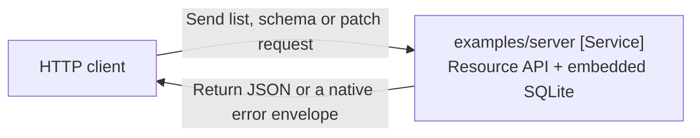
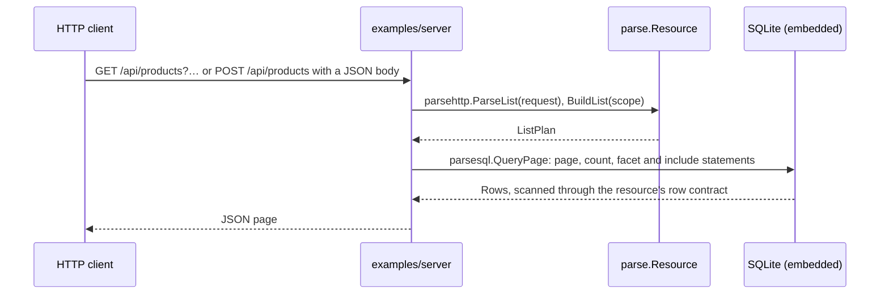

# parse/examples/server

Serve a seeded product API from an in-memory SQLite database. The example exercises Resource lists over both transports (a GET query string, or the same request as a POST body for a filter too large for a URL), keyset pages, schema discovery, facets and Merge Patch of one product or a batch, through the same compiler as the PostgreSQL adapter. It serves every route the TypeScript SDK calls ([server contract](../../sdk/ts/README.md#server-contract)).

## Architecture



**Entry points:** `main` loads settings and runs the HTTP server; `newServer` wires the seeded products resource.

**Exit points:** Parameterized SQL goes to SQLite; JSON pages, schema documents, facets and native error envelopes go to the HTTP client.

**Failure modes:** Invalid settings fail startup; invalid requests return Parse E-codes; a patch of a missing product, or of a key its columns cannot hold, is 404 `E4004`, and a batch's missing keys are its `failed` items; a request body the client did not finish sending is 400 `E4001`, logged at WARN; a request that outlives `--request-timeout` is 504 `E5004`, logged at WARN, and a request whose client left is not answered and is logged at DEBUG; any other SQL failure is 500 `E5001`, logged at ERROR; response failures are observed by the handler; an expired shutdown grace forces connections closed.

**Dependencies:** The example is a module of its own. It imports Parse, replaced by the working tree it sits in, the released `pkg/config` and Kong provider, Kong, and the pure-Go SQLite driver; Parse itself requires none of the CLI and configuration modules. Applications supply their own resource, storage, authenticated scope and authorization policy.

## Quick Start

From this directory (`parse/examples/server` in a repository checkout), a module outside the repository's Go workspace, so with `GOWORK=off`:

```bash
GOWORK=off go run . --addr 127.0.0.1:8080
curl 'http://127.0.0.1:8080/api/products?category=books&sort=-price&page_size=2'
curl -H 'Content-Type: application/json' \
  -d '{"filter":{"category":"books"},"sort":"-price","page_size":2}' \
  http://127.0.0.1:8080/api/products
```

The second request is the same list as a POST body ([HTTP contract](../../docs/http-errors.md#the-same-request-as-a-post-body)). `POST /api/products` lists, and the example has no create route, so nothing else claims it. A server that creates through `POST` on its collection path needs another path for POST lists.

## Routes

| Route | SDK call | Served by |
|---|---|---|
| `GET /api/products` | `list` | `parsehttp.ParseList`, `BuildList`, `parsesql.QueryPage`: the page, with the count and facets when asked |
| `POST /api/products` | `list` over the body transport | The same handler |
| `OPTIONS /api/products?facets=…` | `facets` | `parsehttp.ParseFacets`, `BuildFacets`: `{"facets": {…}}`; a page parameter (`cursor`, `sort`, `page_size`, …) is 422 `E2067` |
| `PATCH /api/products/{id}` | `patch` | The pattern is the collection's path, a slash and `parsehttp.ItemPattern(products)`, a wildcard per key column; `parsehttp.ItemKey` reads the key, `parsehttp.ParsePatch` the patch, then `BuildUpdate(…, parse.ByKey(key), …)`, `parsesql.Update`: a `parsehttp.PatchAnswer`, `{"updated": [product]}`, or 404 `E4004` for a key that names no product, one its columns cannot hold included |
| `PATCH /api/products?id[]=…` | `patchMany` | `parsehttp.Query`, `parsehttp.ParsePatch`, `BuildUpdate(…, parse.ByIDs(…), …)`, `parsesql.Update` for 1 to 100 keys: `{"updated": [...], "failed": [{"id", "code": "E4004", "error"}]}`; no key or more than 100 is 400 `E4001` |
| `GET /api/{resource}/schema` | `schema` | `parsehttp.SchemaHandler`: the resource's document, or 404 `E2078` |
| `GET /api/schemas` | `schemas` | `parsehttp.SchemaListHandler`: `{"schemas": [...]}`, every registered resource's document |

The patch routes read no query parameter but a batch's `id[]`, and answer any other with 400 `E4001`: a parameter a patch ignored, a filter meant to narrow it, would let it write rows the client did not mean to.

The item route derives from the resource's key: products, keyed by `id`, are `/api/products/{id}`, and a resource keyed by several columns, `parse.PrimaryKey("warehouse_id", "sku")`, would be `/api/stock/{warehouse_id}/{sku}` from the same code. Each key value is a path segment escaped on its own, so the SKU `a/b` travels as `a%2Fb` and stays in its segment: `PATCH /api/stock/w1/a%2Fb`, as the TypeScript SDK's `patch(["w1", "a/b"], …)` sends it. `ItemKey` reads each segment as its column's text (`Resource.ParseKey`, an integer column's as decimal digits). A batch's `id[]` holds one value per row, so `patchMany` addresses only a key of one column.

`E4001`, `E4004`, `E5001` (internal error) and `E5004` (the request timeout expired) are the example's own codes: parse's catalog holds request errors, and whether a row exists or the server failed is the application's to say. Every other code is parse's ([HTTP contract](../../docs/http-errors.md)).

The process writes JSON logs to stderr. Its first entry, `starting`, is written at any level: the service, its version, the effective log level and the settings, with secrets redacted (the example has none). At the default level, `warn`, a healthy process writes nothing else; `info` adds the listen address. SIGINT or SIGTERM stops new requests and drains active requests for the configured grace period. Connections close if that deadline expires; the database then closes.

## Configuration

`pkg/config` owns defaults, environment decoding and validation; Kong supplies explicit command-line overrides. An omitted flag preserves the environment value. Environment variables use the `PARSE_SERVER_` prefix. All durations must be positive.

| Flag | Environment | Default | Purpose |
|---|---|---|---|
| `--log-level` | `PARSE_SERVER_LOG_LEVEL` | `warn` | Minimum log level: `debug`, `info`, `warn` or `error`; the `starting` entry is written at any level |
| `--addr` | `PARSE_SERVER_ADDR` | `127.0.0.1:8080` | HTTP listen address |
| `--request-timeout` | `PARSE_SERVER_REQUEST_TIMEOUT` | `5s` | Deadline on each request's context, which its database work runs under; a request that outlives it is 504 `E5004` |
| `--shutdown-grace` | `PARSE_SERVER_SHUTDOWN_GRACE` | `10s` | Drain active requests before forced connection closure |
| `--read-header-timeout` | `PARSE_SERVER_READ_HEADER_TIMEOUT` | `5s` | Bound header reads |
| `--read-timeout` | `PARSE_SERVER_READ_TIMEOUT` | `10s` | Bound request reads |
| `--write-timeout` | `PARSE_SERVER_WRITE_TIMEOUT` | `10s` | Bound response writes |
| `--idle-timeout` | `PARSE_SERVER_IDLE_TIMEOUT` | `60s` | Bound idle keep-alive connections |

## Request flow



**Entry points:** An HTTP list request supplies its parameters in a GET's query string or a POST's `application/json` body; server-owned scope accompanies compilation.

**Exit points:** Database rows become a typed page and cursor metadata.

**Failure modes:** Query validation returns the native Parse error. A POST with list parameters in its query string, or a body that is not `application/json`, is E2067; a body over the resource's list body limit (80 KiB at the default limits) is E2063, read no further. Database execution and page construction errors reach the HTTP error boundary.

**Dependencies:** The request's context, carrying `--request-timeout`, flows to database execution; `parsesql` runs the plans (an update with relation changes or `SkipUnchanged` in one transaction, begun IMMEDIATE by the connection's `_txlock=immediate`), and the Resource owns grammar and page construction. A patch answers every target row it matched: those it wrote and those it left as they were.

## Security and operation

The default listener is loopback. The seeded demonstration exposes writes without authentication, tenant isolation or authorization; supply those application policies before exposing it to untrusted clients. Data is in memory and disappears when the process exits.

JSON logs report startup, request/response failures and shutdown. `request deadline exceeded` (WARN) means a request's queries outlived `--request-timeout`: when ordinary requests log it, check the filter and sort in the entry's path against the indexed fields, then the timeout. `request cancelled` (DEBUG) is a client that left before its answer. `request failed` (ERROR) is a server fault. HTTP and database deadlines bound active work; this example has no dedicated health or metrics endpoint. Use the integration checks below to verify the seeded API.

## Verification

From this directory:

```bash
GOWORK=off go test -tags=unit ./...
GOWORK=off go test -tags=integration -race ./...
```

`make parse-example-check` from the repository root runs both, after `go mod tidy -diff`, `go vet` and staticcheck; CI runs it whenever Parse or the example changes.

The unit checks cover explicit flags over environment values, omitted-flag precedence, rejection of an unbounded shutdown and of an unknown log level, the startup entry at any level, and the request timeout on every request's context. The integration checks request every route of the Routes table. The integration checks include an expired deadline (504 `E5004`, no ERROR entry) and a cancelled request (nothing written, a DEBUG entry) on every route that reaches the database. Integration checks exercise the HTTP resource against SQLite. See [the module overview](../../README.md), [query guide](../../docs/queries.md) and [error contract](../../docs/http-errors.md).

## Key Files

| File | Responsibility |
|---|---|
| `go.mod` | The example's own module: Kong and the released config modules, Parse replaced by this working tree |
| `main.go` | Configuration, HTTP lifecycle and seeded SQLite storage |
| `server.go` | Resource declaration, routes (the item route from the key, `parsehttp.ItemPattern`), list (GET and POST), facet, schema, single (key read by `parsehttp.ItemKey`) and batch patch handlers, the example's error codes |
| `settings_test.go` | Configuration source precedence, bounded shutdown, the log level and the startup entry |
| `server_test.go` | The request timeout on every request's context |
| `server_integration_test.go` | Requests against the SQLite HTTP server, one per row of the Routes table |
