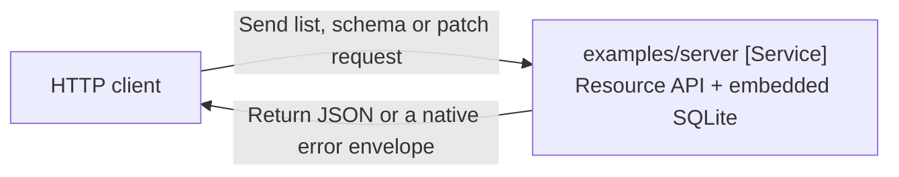
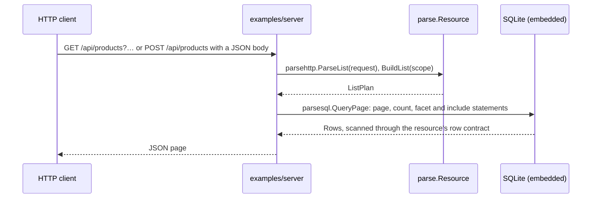

# parse/examples/server

Serve a seeded product API from an in-memory SQLite database. The example exercises Resource lists over both transports (a GET query string, or the same request as a POST body for a filter too large for a URL), keyset pages, schema discovery, facets and Merge Patch of one product or a batch, through the same compiler as the PostgreSQL adapter. It serves every route the TypeScript SDK calls ([server contract](../../sdk/ts/README.md#server-contract)).

## Architecture



**Entry points:** `main` loads settings and runs the HTTP server; `newServer` wires the seeded products resource.

**Exit points:** Parameterized SQL goes to SQLite; JSON pages, schema documents, facets and native error envelopes go to the HTTP client.

**Failure modes:** Invalid settings fail startup; invalid requests return Parse E-codes; a patch of a missing product is 404 `E4004`, and a batch's missing keys are its `failed` items; a request body the client did not finish sending is 400 `E4001`, logged at WARN; SQL and response failures are observed by the handler; an expired shutdown grace forces connections closed.

**Dependencies:** The example imports Parse, the released `pkg/config` and Kong provider, Kong, and the pure-Go SQLite driver. Applications supply their own resource, storage, authenticated scope and authorization policy.

## Quick Start

From the Parse module directory (`parse/` in a repository checkout):

```bash
go run ./examples/server --addr 127.0.0.1:8080
curl 'http://127.0.0.1:8080/api/products?category=books&sort=-price&page_size=2'
curl -H 'Content-Type: application/json' \
  -d '{"filter":{"category":"books"},"sort":"-price","page_size":2}' \
  http://127.0.0.1:8080/api/products
```

The second request is the same list as a POST body ([HTTP contract](../../docs/http-errors.md#the-same-request-as-a-post-body)). `POST /api/products` lists, and the example has no create route, so nothing else claims it. A server that creates through `POST` on its collection path needs another path for POST lists.

## Routes

| Route | SDK call | Served by |
|---|---|---|
| `GET /api/products` | `list` | `parsehttp.ParseList`, `BuildList`, `parsesql.QueryPage`: the page, with the count and facets when asked |
| `POST /api/products` | `list` over the body transport | The same handler |
| `OPTIONS /api/products?facets=…` | `facets` | `ParseList`, `BuildList`, the plan's facet statement |
| `PATCH /api/products/{id}` | `patch` | `parsehttp.ParsePatch`, `BuildUpdate(…, parse.ByID(id), …)`, `parsesql.Update`: `{"updated": [product]}`, or 404 `E4004` |
| `PATCH /api/products?id[]=…` | `patchMany` | `parsehttp.Query`, `parsehttp.ParsePatch`, `BuildUpdate(…, parse.ByIDs(…), …)`, `parsesql.Update` for 1 to 100 keys: `{"updated": [...], "failed": [{"id", "code": "E4004", "error"}]}`; no key or more than 100 is 400 `E4001` |

The patch routes read no query parameter but a batch's `id[]`, and answer any other with 400 `E4001`: a parameter a patch ignored, a filter meant to narrow it, would let it write rows the client did not mean to.
| `GET /api/{resource}/schema` | `schema` | `parsehttp.SchemaHandler` |

`E4001`, `E4004` and `E5001` (internal error) are the example's own codes: parse's catalog holds request errors, and whether a row exists or the server failed is the application's to say. Every other code is parse's ([HTTP contract](../../docs/http-errors.md)).

The process logs its listen address as JSON. SIGINT or SIGTERM stops new requests and drains active requests for the configured grace period. Connections close if that deadline expires; the database then closes.

## Configuration

`pkg/config` owns defaults, environment decoding and validation; Kong supplies explicit command-line overrides. An omitted flag preserves the environment value. Environment variables use the `PARSE_SERVER_` prefix. All durations must be positive.

| Flag | Environment | Default | Purpose |
|---|---|---|---|
| `--addr` | `PARSE_SERVER_ADDR` | `127.0.0.1:8080` | HTTP listen address |
| `--request-timeout` | `PARSE_SERVER_REQUEST_TIMEOUT` | `5s` | Bound database execution per request |
| `--shutdown-grace` | `PARSE_SERVER_SHUTDOWN_GRACE` | `10s` | Drain active requests before forced connection closure |
| `--read-header-timeout` | `PARSE_SERVER_READ_HEADER_TIMEOUT` | `5s` | Bound header reads |
| `--read-timeout` | `PARSE_SERVER_READ_TIMEOUT` | `10s` | Bound request reads |
| `--write-timeout` | `PARSE_SERVER_WRITE_TIMEOUT` | `10s` | Bound response writes |
| `--idle-timeout` | `PARSE_SERVER_IDLE_TIMEOUT` | `60s` | Bound idle keep-alive connections |

## Request flow



**Entry points:** An HTTP list request supplies its parameters in a GET's query string or a POST's `application/json` body; server-owned scope accompanies compilation.

**Exit points:** Database rows become a typed page and cursor metadata.

**Failure modes:** Query validation returns the native Parse error. A POST with list parameters in its query string, or a body that is not `application/json`, is E2067; a body over the resource's list body limit (80 KiB at the default limits) is E2063, read no further. Database execution and page construction errors reach the HTTP error boundary.

**Dependencies:** Request cancellation flows to database execution; `parsesql` runs the plans (an update with relation changes or `SkipUnchanged` in one transaction, begun IMMEDIATE by the connection's `_txlock=immediate`), and the Resource owns grammar and page construction. A patch answers every target row it matched: those it wrote and those it left as they were.

## Security and operation

The default listener is loopback. The seeded demonstration exposes writes without authentication, tenant isolation or authorization; supply those application policies before exposing it to untrusted clients. Data is in memory and disappears when the process exits.

JSON logs report startup, request/response failures and shutdown. HTTP and database deadlines bound active work; this example has no dedicated health or metrics endpoint. Use the integration checks below to verify the seeded API.

## Verification

```bash
go test -tags=unit ./examples/server
go test -tags=integration -race ./examples/server
```

The unit checks cover explicit flags over environment values, omitted-flag precedence and rejection of an unbounded shutdown. Integration checks exercise the HTTP resource against SQLite. See [the module overview](../../README.md), [query guide](../../docs/queries.md) and [error contract](../../docs/http-errors.md).

## Key Files

| File | Responsibility |
|---|---|
| `main.go` | Configuration, HTTP lifecycle and seeded SQLite storage |
| `server.go` | Resource declaration, routes, list (GET and POST), facet, schema, single and batch patch handlers, the example's error codes |
| `settings_test.go` | Configuration source precedence and bounded shutdown |
| `server_integration_test.go` | Requests against the SQLite HTTP server |
