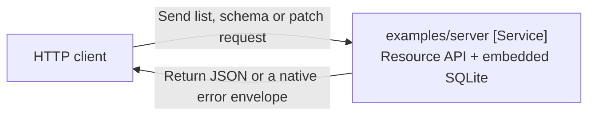
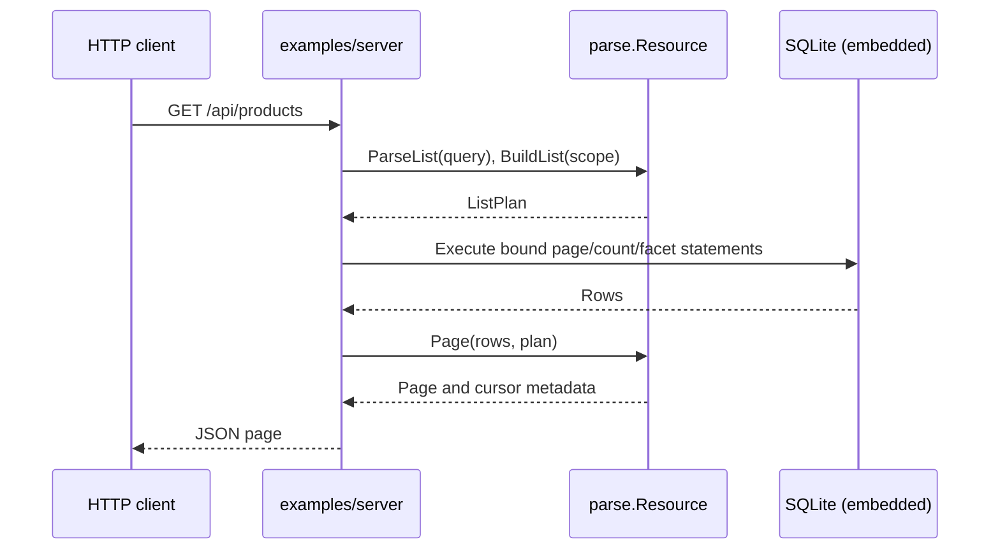

# parse/examples/server

Serve a seeded product API from an in-memory SQLite database. The example exercises Resource lists, keyset pages, schema discovery, facets and Merge Patch through the same compiler as the PostgreSQL adapter.

## Architecture



**Entry points:** `main` loads settings and runs the HTTP server; `newServer` wires the seeded products resource.

**Exit points:** Parameterized SQL goes to SQLite; JSON pages, schema documents, facets and native error envelopes go to the HTTP client.

**Failure modes:** Invalid settings fail startup; invalid requests return Parse E-codes; SQL and response failures are observed by the handler; an expired shutdown grace forces connections closed.

**Dependencies:** The example imports Parse, the released `pkg/config` and Kong provider, Kong, and the pure-Go SQLite driver. Applications supply their own resource, storage, authenticated scope and authorization policy.

## Quick Start

From the Parse module directory (`parse/` in a repository checkout):

```bash
go run ./examples/server --addr 127.0.0.1:8080
curl 'http://127.0.0.1:8080/api/products?category=books&sort=-price&page_size=2'
```

The process logs its listen address as JSON. SIGINT or SIGTERM stops new requests and drains active requests for the configured grace period. Connections close if that deadline expires; the database then closes.

## Configuration

`pkg/config` owns defaults, environment decoding and validation; Kong supplies explicit command-line overrides. An omitted flag preserves the environment value. Environment variables use the `PARSE_SERVER_` prefix. All durations must be positive.

| Flag | Environment | Default | Purpose |
|---|---|---|---|
| `--addr` | `PARSE_SERVER_ADDR` | `127.0.0.1:8080` | HTTP listen address |
| `--request-timeout` | `PARSE_SERVER_REQUEST_TIMEOUT` | `5s` | Bound database execution per request |
| `--shutdown-grace` | `PARSE_SERVER_SHUTDOWN_GRACE` | `10s` | Drain active requests before forced connection closure |
| `--read-header-timeout` | `PARSE_SERVER_READ_HEADER_TIMEOUT` | `5s` | Bound header reads |
| `--read-timeout` | `PARSE_SERVER_READ_TIMEOUT` | `10s` | Bound request reads |
| `--write-timeout` | `PARSE_SERVER_WRITE_TIMEOUT` | `10s` | Bound response writes |
| `--idle-timeout` | `PARSE_SERVER_IDLE_TIMEOUT` | `60s` | Bound idle keep-alive connections |

## Request flow



**Entry points:** An HTTP list request supplies query parameters; server-owned scope accompanies compilation.

**Exit points:** Database rows become a typed page and cursor metadata.

**Failure modes:** Query validation returns the native Parse error; database execution and page construction errors reach the HTTP error boundary.

**Dependencies:** Request cancellation flows to database execution; the handler owns execution and the Resource owns grammar and page construction.

## Security and operation

The default listener is loopback. The seeded demonstration exposes writes without authentication, tenant isolation or authorization; supply those application policies before exposing it to untrusted clients. Data is in memory and disappears when the process exits.

JSON logs report startup, request/response failures and shutdown. HTTP and database deadlines bound active work; this example has no dedicated health or metrics endpoint. Use the integration checks below to verify the seeded API.

## Verification

```bash
go test -tags=unit ./examples/server
go test -tags=integration -race ./examples/server
```

The unit checks cover explicit flags over environment values, omitted-flag precedence and rejection of an unbounded shutdown. Integration checks exercise the HTTP resource against SQLite. See [the module overview](../../README.md), [query guide](../../docs/queries.md) and [error contract](../../docs/http-errors.md).

## Key Files

| File | Responsibility |
|---|---|
| `main.go` | Configuration, HTTP lifecycle and seeded SQLite storage |
| `server.go` | Resource declaration, routes, list/facet/schema and patch handlers |
| `settings_test.go` | Configuration source precedence and bounded shutdown |
| `server_integration_test.go` | Requests against the SQLite HTTP server |
