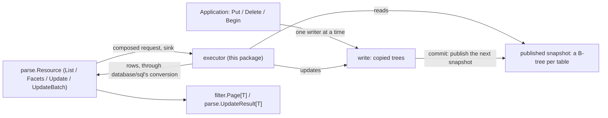

# parse/parsememory

parse's in-memory provider, a module of its own: `github.com/ashtonian/pkg/parse/parsememory`. It holds every table in the process and needs no database, no file and no driver, so it runs wherever Go builds, `GOOS=wasip1 GOARCH=wasm` with no filesystem included. `Open` opens an empty database (`Database`) and the provider on it. Each resource built on the provider (`parse.NewResource(p, …)`) declares its table to the database: its key, every column of its type, and the pair table of each many-to-many relation it filters by or patches. The application writes rows with `Put` and `Delete`, alone or in a transaction of its own (`Begin`, `Txn`), and the resources list, facet and update them through the API every provider has, each request evaluated in Go under the rules the SQL providers render.

The provider's API is the one every parse provider has: [`parsesql`](../parsesql/README.md) is SQLite's, [`parsepgx`](../parsepgx/README.md) PostgreSQL's, and [`parseprovider`](../parseprovider/README.md) opens whichever an application's configuration names among those its binary links (`Choice`). Providers are alternatives chosen at startup for different runtime requirements ([choosing a provider](../docs/providers.md)): parse never moves data between them or runs one beside another. The memory provider serves a process whose data lives and dies with it — a test suite, an embedded tool, a WebAssembly module, a demonstration — and refuses what only SQL can do (`parse.ErrUnsupported`): SQL builders, `Query`, full-text search, computed columns (`parse.ReadExpr`), `StampSQL` and raw SQL policy constraints.

## Quick Start

```sh
go get github.com/ashtonian/pkg/parse@latest github.com/ashtonian/pkg/parse/parsememory@latest
```

```go
db, err := parsememory.Open(ctx, parsememory.Config{MaxRows: 100_000})
defer db.Close()
devices, err := parse.NewResource[Device](db.Provider(), "devices", parse.TenantColumn("tenant_id")) // declares the table

err = db.Put(ctx, "devices",
	parsememory.Row{"id": "d1", "tenant_id": "t1", "name": "alpha", "updated_at": time.Now()},
	parsememory.Row{"id": "d2", "tenant_id": "t1", "name": "beta", "updated_at": time.Now()})

page, err := devices.List(ctx, req, parse.Scope{Tenant: "t1"})
res, err := devices.Update(ctx, patch, parse.ByID("d1"), scope, parse.SkipUnchanged())

// The application's writes and parse's updates, committed together:
txn, err := db.Begin(ctx)
defer txn.Rollback(ctx) // after Commit, a no-op
err = txn.Delete(ctx, "devices", parse.Key{"d2"})
scoped, err := devices.In(parsememory.Tx(txn))
_, err = scoped.Update(ctx, patch, parse.ByID("d1"), scope) // reads the delete, under a savepoint
err = txn.Commit(ctx)
```

A `Row` holds a value per column, each a Go value of the column's type as the application would bind it to SQL: a `time.Time` for a timestamp, a map, struct or `json.RawMessage` for a document. A column the row leaves out is NULL. The [server example](../examples/server/README.md) runs on this provider with `PARSE_SERVER_DB_PROVIDER=memory`, seeded through `Put`.

## Architecture



**Tables.** A resource declares its table as it is built (`backend.Declarer`): its key and every column of its type, typed as the resource types them, and the pair table of each many-to-many relation its filters read or its patches write, keyed by every column of the pair: sources, targets, then the tenant. Resources on one table declare it together, each adding the columns it lacks after the others' (a row written before reads a column declared later as NULL); they must agree on its key and on every column both declare, or the later one is refused (`ErrTableMismatch`) and declares nothing. A write to a table or column no resource declared is an error.

**Store.** A table is a B-tree of rows (`github.com/tidwall/btree`, without its locks) ordered by key, each key column in its type's order (`core.CompareCanonical`). The set of trees is one immutable snapshot published through an atomic pointer: a read loads it once, so a list's page, count, facets and includes come from one state, and a read never waits. There is one writer at a time, taken under the caller's context. A write copies each tree it changes the first time it changes it — an O(1) copy that shares the snapshot's nodes and copies each node as the write changes it, so readers of the snapshot never see the write — and its commit publishes the copies, with the snapshot's other trees, as the next snapshot. A write that fails publishes nothing.

**Values.** Each value is held in its storage form, exactly `core.StorageValue`'s, the form SQLite binds, so a filter selects the same rows of the same writes on either: a date or a timestamp as its canonical text (a timestamp in UTC at a fixed width, so text order is time order), a document, a geo shape or an array as its JSON text (a document's nil map as JSON `null`, which the row contract decodes only into a `json.RawMessage`), every other value as its `driver.Value`. A composed update's values are in that form too (`patch.ComposedPatch.Apply`), so a stored value and a written one compare as SQLite's change predicate compares them.

**Reads.** A list is one pass over the table's rows. Each row the filter selects is counted and faceted, and, past the cursor, offered to a bounded top-k selection of the page size plus one in walk order. Each row's sort keys are read to their canonical values once (`filter.KeyValueOrder`). A key whose type's canonical text orders as its values compares as text with `strings.Compare`, so a timestamp, date or UUID key is never parsed again. A page sorted by the table's key in one direction, with no facet and no count of a filter, reads the tree from its cursor and stops once it holds its rows; the count of no filter is the tree's size. Relation and membership predicates are resolved once per request (`filter.ResolveMemberships`) through lookups of the related tables; a governed list (`filter.RelationScope.RowTenant`) resolves them per row tenant. Includes are read once the page's keys are known (`backend.ListSink.Keys`, `filter.ResolveInclude`), and relation facets once per tenant of the population (`filter.ResolveRelationFacet`). A lookup that holds a table's leading key columns to a set of values, as an include holds a pair table to the page's owners, reads each value's key range in O(log n); any other lookup reads the table.

**Rows.** A row reaches the resource's sink as `database/sql` would hand it over: each value converted into its destination with `sql.ConvertAssign`, a timestamp as a `time.Time` parsed from its canonical text, a document or an array as its JSON text, which the resource's row contract decodes as it decodes SQLite's (`Documents()` names no column).

**Updates.** `Update` and `UpdateBatch` run under the writer and decide what the SQL providers' statements decide, in their order:

1. The patch is composed (stamps and counters included) and refused if it assigns a key or the tenant, before the writer is waited for.
2. The targets are found: each key by an O(log n) lookup, or, for a filter, by one scan with its relations and memberships resolved once under the update's scope.
3. A batch finds every row's target, held to that row's filter, and refuses the batch unless every key found its row (`parse.ErrUpdateBatchTargets`) before anything is written.
4. The composed patch is applied to each target's stored values, in key order; the first target a member operation does not apply to fails the update with that operation's error (a `*core.ParseError`), before anything is written.
5. Under `parse.SkipUnchanged`, a target the patch's columns already describe is not written.
6. The rows go to the sink as changed and unchanged, then the membership changes are made for the keys of both as `patch.RenderRelationOp`'s statements make them: a replace removes the owner's pairs to other targets and pairs it with each value, an add pairs it with each value, a remove removes its pairs to the values; a pair already held is kept, as `ON CONFLICT DO NOTHING` keeps it, every pair is the update's tenant's when the pair table holds one, and through a target table only targets the update may relate are paired and unpaired (`filter.VisibleTargets`).
7. The write commits, publishing every change at once.

An update in a transaction (`In`) runs under a savepoint of it, restored when the update fails or panics, so the transaction is left as it was and usable. A failure is a `*parse.StatementError` naming the part as the SQL providers name their statements: `begin` (the writer's wait), `savepoint`, `owner`, `current`, `relations`, `commit`, `page`, `facets`, `include <field>`. A request whose context is already done runs nothing, whether or not the writer is free.

## Configuration

`Config` is what `Open` opens, loaded through [`github.com/ashtonian/pkg/config`](../../config/README.md) (its `koanf` names, defaults and validation) or built in code. `Open` checks the setting whichever way it was built and refuses one out of range, naming it (`parsememory: max_rows: 0: must be at least 1`).

| Setting | Type | Default | Description |
|---|---|---|---|
| `max_rows` | int, at least 1 | `100000` | Rows one table may hold, pair tables included. A write that would leave a table holding more fails with `ErrRowLimit` and keeps nothing its transaction wrote: a `Put` or `Delete` of its own writes nothing, an update writes nothing, and in a `Txn` the transaction ends, rolled back. It bounds the process's memory: a database holds at most `max_rows` rows per declared table |

The provider has no other setting: no timeouts (nothing leaves the process; every wait is under the caller's context), no pool, no settle bound.

## External Dependencies

- `github.com/tidwall/btree` v1.8.2, the copy-on-write B-tree each table is held in. This module is the only one of parse's that requires it.
- `github.com/ashtonian/pkg/parse` at this module's own version: parse and its provider modules release together at one version ([versions](#versions)).
- No database, driver, file or network: the module imports none of parse's SQL packages (`internal/sqlplan`, `internal/sqlexec`, `internal/dialect`) and links no driver, which `TestLayout_LinksNoSQLExecutorOrDriver` holds; `tools/check-parse-release.sh` holds that no SQL provider links it.

## API Reference

- `Name` (`"memory"`): the provider's name in configuration, `parse.Provider.Name()`.
- `Config{MaxRows int}`: the setting above.
- `Open(ctx, cfg Config) (*Database, error)`: an empty database and the provider on it; refuses `MaxRows` below 1.
- `Choice(cfg Config) parseprovider.Choice`: this provider by its name, opened from `cfg`, for `parseprovider.Open` to choose among the providers a binary links.
- `Database`: safe for concurrent use.
  - `Provider() *parse.Provider`: the provider to build resources on; each resource declares its tables as it is built.
  - `Ping(ctx) error`: nil while the database is open, `ErrClosed` after `Close`.
  - `Close() error`: drops every row; every later operation is `ErrClosed`, and a transaction still open commits nothing.
  - `Put(ctx, table string, rows ...Row) error`: writes rows, each replacing the row of its key, in one write — all of them or, on an error, none — waiting for the writer under `ctx`. A table or column no resource declared, a row without a value for a key column, a value its column cannot hold, and a table past `MaxRows` are errors.
  - `Delete(ctx, table string, keys ...parse.Key) error`: deletes the rows of keys in one write; a key no row holds deletes nothing. A key holds a value per key column in key order; a pair table's key is every column of its relation: sources, targets, then the tenant.
  - `Begin(ctx) (*Txn, error)`: a transaction holding the writer from `Begin` until `Commit` or `Rollback`, waiting for it under `ctx`; it is not bound to `ctx` after.
- `Row map[string]any`: one row to write, by column name.
- `Txn`: a transaction of the application's own, used by one goroutine at a time. Its reads see its own writes, which other reads see only once it commits. `Put` and `Delete` as `Database`'s; `Commit(ctx) error` publishes what it wrote and releases the writer; `Rollback(ctx) error` drops it, and on a transaction already settled does nothing and returns nil.
- `Tx(txn *Txn) *parse.Tx`: `txn` as a transaction resources run in (`parse.Resource.In`), so the application's writes and parse's updates commit together. Commit or roll back through `txn` or the returned `*parse.Tx`.
- Errors, matched with `errors.Is`: `ErrRowLimit` (a table past `MaxRows`), `ErrClosed` (an operation after `Close`), `ErrTxnDone` (an operation on a transaction already committed or rolled back, one `ErrRowLimit` ended included), `ErrTableMismatch` (a resource whose table disagrees with what another resource declared: its key, or a column's type).

The resource methods (`List`, `Facets`, `Update`, `UpdateBatch`, `In`) are the root package's. `Query` and the SQL builders (`BuildList`, `BuildFacets`, `IncludeQueries`, `Page`, `PagePointers`, `ListQuery`, `BuildUpdate`, `BuildUpdateBatch`), a list or facets request with `search`, `parse.ReadExpr` and `parse.StampSQL` are refused with an `*parse.UnsupportedError` naming the provider and the operation (`parse: notes: the memory provider does not support SQL builders`; `errors.Is(err, parse.ErrUnsupported)`), and so is a server policy holding raw SQL (`filter.PolicyConstraint.RawSQL`): `TestCapabilities_RefuseWhatNeedsSQL`.

## Semantics

Every database-backed case of parse's corpus that does not need SQL runs on this provider (`TestCorpus`), with the same assertions as on SQLite and PostgreSQL; each case it skips names why. Where the provider differs from the SQL providers, it is by design:

| Behaviour | Memory provider | SQL providers | Why |
|---|---|---|---|
| Schema | Declared by the resources, from their types | The application's `CREATE TABLE` | No schema to migrate; the table is what its resources read |
| Constraints | Key columns are required and unique; no `NOT NULL`, `CHECK`, foreign key or default | The application's | The application owns its rules, as on SQL; the provider stores what it is given |
| Keys | A NULL key value is refused; no key is generated | A database may generate one | A key orders the tree; a pair table keyed by a column no pair writes cannot take a membership change (`TestUpdate_RefusesPairsATableCannotKey`) |
| Text order | By code point | By code point (`pg_c_utf8`, `C`, SQLite's `BINARY`) | One order on every provider |
| Timestamps | Held as canonical UTC text, handed to the scan as `time.Time` | SQLite text, PostgreSQL `timestamptz` | The row contract reads either |
| Facets | A facet no row reaches is left out | No row for it | As a facet statement returns no row |
| Preconditions | The first target in key order that a member operation does not apply to is reported | The conflict statement's first row | One target named either way; nothing is written |
| A batch's per-row filter | Resolved for each row | Compiled per row | Same rows selected |
| Owner rows | In key order | In the statement's order | The sink orders what it returns |
| Isolation | Reads see one published snapshot; writes are serialized | The database's | Snapshot reads, one writer |
| `parse.ErrCommitUnknown` | Never | PostgreSQL's | A commit in the process always answers |
| Settle | Nothing to settle past a cancellation: a write that has begun commits or aborts in the process | `SettleTimeout` | No statement runs past the request |
| Refusals | SQL builders, `Query`, search, computed columns, `StampSQL`, raw SQL policies | Supported | They are SQL |

## Versions

parse and its provider modules release together, at one version: require `parse` and `parse/parsememory` at the same one, as `go get` of both `@latest` does, and as each release of this module requires its own release of parse. The provider runs on parse's internal contract, which no other module implements and which changes between releases, so a build that pairs this module with another release of parse fails to compile at this module's `contract.go`, naming this module's release and then parse's as `[major][minor][patch]` arrays:

```text
parsememory/contract.go:21:84: cannot use [releaseMajor][releaseMinor][releasePatch]struct{}{} (value of type [0][18][0]struct{}) as [0][19][0]struct{} value in variable declaration
```

Here parsememory 0.18.0 meets parse 0.19.0: move both to one release. Dependabot updates them as one group.

## Build and test

From this module's directory (the repository's `go.work` builds it against the working tree's parse):

```sh
go test -tags=unit ./...                          # the provider's own tests, the layout test among them
go test -tags=concurrency -race ./...             # concurrent updates and reads, the writer's wait
go test -tags=integration ./...                   # TestCorpus: parse's database corpus on this provider
go test -tags=integration -run 'TestCorpus/ComposeConstraints' .   # one case
go test -tags=unit -run '^$' -bench . ./...       # BenchmarkList, BenchmarkWrite
```

From the repository root, `make test-parse-unit`, `make test-parse-race`, `make test-parse-race-all` and `make test-parse-integration` run them with parse's other modules, and `make test-parse-wasip1` builds the unit tests for `GOOS=wasip1 GOARCH=wasm` and runs them under wazero (v1.12.0) with no directory preopened, so a test that reached the filesystem would fail; CI runs it in the test job. The repository's `core` benchmarks `BenchmarkKeysetWalk` and `BenchmarkKeysetWalkCanonical` compare a keyset's comparisons on stored values with those on values read to canonical once, as this provider's walk reads them.

The tests hold: the configuration's default and range; `Choice` through `parseprovider`; every refusal of what needs SQL; resources declaring one table together, and the refusals of a disagreement; `Put` and `Delete` writing all or nothing; `MaxRows` keeping nothing a write or transaction wrote; a transaction's isolation, rollback and writer; `Close`; lists with their pages both ways, counts, facets and includes; key-ordered pages agreeing with a full pass, forward and backward; updates writing all or nothing, in and out of a transaction; a relation only patches reach; a request whose context is done running nothing; and, under the race detector, a list's page, count and facets reading one state while batches commit, a failed update leaving the store as it was while others commit, and a writer's wait ending with its context.

## Operations

- *Health*: `Database.Ping(ctx)` answers a readiness probe: nil while open, `ErrClosed` once closed.
- *Observability*: the package emits no metrics or logs of its own, as parse writes none; label failures by `parse.StatementError.Statement`.
- *Shutdown*: close the database after the HTTP server has drained. `Close` drops every row at once; a write still running when it closes publishes nothing (`ErrClosed`).
- *Memory*: every row of every table is in the process heap, a document or an array as its JSON text. `max_rows` bounds each table; size it from the largest table the process holds, pair tables included. A list holds at most the page size plus one rows beyond the snapshot; a list with relation facets holds its population's rows by tenant until it returns.
- *Concurrency*: reads never wait and never block a writer. Writes — `Put`, `Delete`, `Begin` until it settles, each `Update` and `UpdateBatch` — take the one writer in turn; a `Txn` holds it until `Commit` or `Rollback`, so keep transactions short and always settle them (`defer txn.Rollback(ctx)`).
- *Cost*, for a table of n rows; measured on an Apple M2 Pro over 100,000 rows (`BenchmarkList`, `BenchmarkWrite`):

  | Operation | Cost | Measured |
  |---|---|---|
  | Key lookup (`ByID`, `ByKeys`, a batch's targets, `Put`, `Delete`) | O(log n) per key | `Put` of one row ~2.6 µs, 25 allocations; `Update` by key ~5 µs, 87 allocations |
  | A page in key order, no facet, no count of a filter | O(log n + page size) | ~40 µs for 50 rows, from the start, past a cursor or with the count of no filter |
  | Any other list, its count and its facets | One pass over the rows: O(n) evaluations of the filter, and O(n log limit) comparisons at most for the page's top-k selection, each row's sort keys read to canonical once | ~16 ms by timestamp, ~10 ms by float, ~14 ms filtered with its count, ~23 ms with a terms facet |
  | Page memory | Bounded by the page size plus one | 33–70 KB allocated for a page of 50 rows, whatever n |
  | An include | O(k log n) for a page of k owners: each owner's pairs by a range of the pair table's key | ~0.1 ms for 50 owners over 100,000 pairs |
  | A relation or membership filter | One read of each related table per request | |
  | A write's copy | O(1) per table it changes, then O(log n) per row it writes | |

  A filter on a document path decodes the row's stored JSON text once per condition on its paths (`filter.ColumnRow`). A context is checked every 1024 rows a scan reads.
- *Failure modes and troubleshooting*:
  - `parsememory: max_rows: 0: must be at least 1`: `Open` refused the setting; set `max_rows` to a positive number.
  - `parsememory: table "t": more than N rows: parsememory: row limit` (`ErrRowLimit`): a write would leave table `t` past `max_rows`. Nothing the write, or its transaction, wrote is kept, and a `Txn` it happened in is over (`ErrTxnDone`): begin again. Raise `max_rows`, or delete rows first. In an update it is a membership change growing a pair table.
  - `parsememory: putting into "t": no resource declares the table`, `parsememory: putting into "t": row 0: no resource declares the column c` (`deleting from` for a `Delete`): the application wrote a table or column before building, or without, the resource that reads it. Build every resource at startup, before seeding.
  - `parsememory: table "t": no resource declares it` on a list or update: the resource's table was declared to another database, or not at all; build the resource on this database's `Provider()`.
  - `parse: t: declaring the table: parsememory: resources disagree on a table: table "t": column "c" is declared as … and as …` (`ErrTableMismatch`): two resources on one table declare another key, or another type for one column; the message names both. Make the types agree, or use separate tables.
  - `parsememory: putting into "t": row 0: key column id: NULL`: a row lacks a value for a key column; the provider generates no key.
  - `parsememory: waiting for the writer: context deadline exceeded`: a write waited past its deadline for another write, usually a `Txn` left open; settle transactions with a deferred `Rollback`.
  - `parsememory: transaction already committed or rolled back` (`ErrTxnDone`): the transaction was settled, or `ErrRowLimit` ended it.
  - `parsememory: database closed` (`ErrClosed`): the database was closed, usually during shutdown; a readiness probe then answers not ready.
  - `parse: t: the memory provider does not support …` (`parse.ErrUnsupported`): the request needs SQL. Remove the search, the computed column or the SQL stamp, or run on a SQL provider ([choosing a provider](../docs/providers.md)).
  - `parse: t: relations: parsememory: relation tags: pair table "t_tags": key column seq: NULL`: a resource keys the pair table by a column of its own, which no pair writes; key it by the pair's columns.
  - A build that fails at `contract.go`: parse and this module are at different releases ([versions](#versions)).

## Security

The provider runs no SQL: nothing a request carries is ever executed, and every predicate is evaluated in Go over stored values. The tenant, policy and deleted-row visibility come only from the `parse.Scope` the call is given; the provider adds no predicate. Membership changes are made for the rows the update selected under its scope, never for the keys the request named, and pair and unpair only targets the update may relate. A request whose filter holds a raw SQL fragment is refused rather than ignored, so a policy written for SQL never admits rows it would refuse there. The rows are in the process's memory: anything that can read the process's memory reads them, and they are gone when it exits. `max_rows` bounds each table, so a client cannot grow a table past it through membership changes.

## Code Map

| File | Responsibility |
|------|----------------|
| [`parsememory.go`](parsememory.go) | `Name`, `Config`, `Open`, `Choice`, `Database` (`Provider`, `Ping`, `Close`, `Put`, `Delete`, `Begin`), `Row`, `Txn`, `Tx`, `ErrTxnDone`; a row checked against its table's definition, a key's probe |
| [`catalog.go`](catalog.go) | The tables the resources declare (`backend.Declarer`): each table's columns and key, the pair tables of the relations their filters read and their patches write, declarations merged and refused (`ErrTableMismatch`) |
| [`store.go`](store.go) | The published snapshot, the one writer under the caller's context, the copy-on-write write, its savepoints, commit and abort; `ErrRowLimit`, `ErrClosed` |
| [`keyrange.go`](keyrange.go) | The rows of a key prefix, found by the tree's order: a lookup's key ranges, a pair table's pairs of one owner |
| [`exec.go`](exec.go) | The executor (`backend.Executor`): reads on the snapshot or the transaction, updates under a write or a savepoint; `Query` refused; the transaction resources join |
| [`list.go`](list.go) | `List` and `Facets`: the one pass, its top-k page, the key-ordered walk, the seek past the cursor, counts, facets, relation facets, includes, governed lists by row tenant |
| [`update.go`](update.go) | `Update` and `UpdateBatch`: targets, the composed patch applied to stored values, `SkipUnchanged`, the sinks |
| [`relate.go`](relate.go) | Membership changes on pair tables, as `patch.RenderRelationOp`'s statements make them |
| [`rows.go`](rows.go) | Rows handed to a sink (`backend.Rows`), a row read as a filter reads it, the lookups relation predicates, includes and relation facets read (`filter.RelationLookup`, `filter.IncludeLookup`), raw SQL refused |
| [`storage.go`](storage.go) | The storage form of a value (`backend.Storage`) |
| [`contract.go`](contract.go) | The compile-time check that parse is at this module's release ([versions](#versions)) |
| [`parsememory_test.go`](parsememory_test.go) | The provider's behaviour: configuration, declarations, writes, transactions, refusals, lists, updates, cancellation |
| [`concurrency_test.go`](concurrency_test.go) | Under the race detector: one state per read while batches commit, a failed update writing nothing, the writer's wait |
| [`corpus_integration_test.go`](corpus_integration_test.go) | `TestCorpus`: parse's database corpus on this provider, through `corpus.Store` |
| [`bench_test.go`](bench_test.go) | `BenchmarkList` and `BenchmarkWrite` over 100,000 rows |
| [`layout_test.go`](layout_test.go) | No SQL package and no driver linked |
