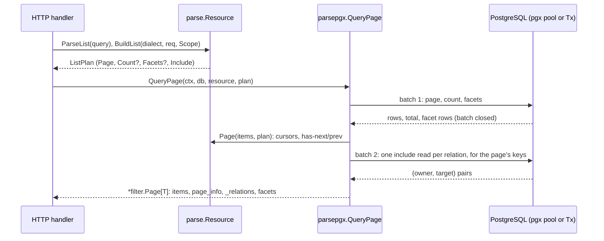

# parse/parsepgx

Runs parse's plans on PostgreSQL through pgx. `QueryPage` answers a list plan — page, total, facets and includes — in two batches; `Update` applies an update plan and its relation changes in one transaction and reports which rows it changed; `UpdateBatch` applies a batch plan in one transaction. [`parsesql`](../parsesql/README.md) runs the same plans on SQLite with the same calls and results. The caller owns the context, the pool or transaction and its isolation; the core parse packages stay free of I/O.

## Quick Start

```go
func (a *deviceAPI) list(w http.ResponseWriter, r *http.Request) {
	tenant, err := a.tenant(r) // from the request's authentication
	if err != nil {
		http.Error(w, "unauthorized", http.StatusUnauthorized)
		return
	}
	req, err := parsehttp.ParseList(r, devices)
	if err != nil {
		a.fail(w, r, err)
		return
	}
	plan, err := devices.BuildList(filter.PostgresDialect{}, req, parse.Scope{Tenant: tenant.String()})
	if err != nil {
		a.fail(w, r, err)
		return
	}
	page, err := parsepgx.QueryPage(r.Context(), a.db, devices, plan)
	if err != nil {
		a.fail(w, r, err) // parsehttp.WriteError for parse errors, 500 otherwise
		return
	}
	a.reply(w, r, page)
}
```

The complete recipe — resource declaration, list and Merge Patch endpoints, error handling — is [`recipe_test.go`](recipe_test.go), compiled in the unit lane and served against PostgreSQL by `TestRecipe`.

## Architecture



**Entry points**
- `QueryPage(ctx, db, r, plan)` — a list plan from `Resource.BuildList`, compiled for `filter.PostgresDialect`.
- `Update(ctx, db, r, plan)` — an update plan from `Resource.BuildUpdate`.
- `UpdateBatch(ctx, db, r, plan)` — a batch plan from `Resource.BuildUpdateBatch`.

**Exit points**
- Include results pass through `filter.Page.SetInclude`: `_relations` and `_truncated` omit empty projections, and cut owners are reported with the retained IDs.
- Statements to `db` through `SendBatch` (and `Begin` for an update that changes relations). Statement text and arguments come only from the plan.
- Rows scan through the resource's row contract (`parse.RowScanner`): each column into the field the resource compiled it from — the column tag `core.WithColumnTag` names (default `db`), else the column convention over the field's JSON name, with embedded structs promoted as encoding/json promotes them and nil embedded pointers allocated. Columns omitted by `parse.ReadColumns` stay zero; a `parse.ReadExpr` column scans its expression's value under its column name; declared JSON storage and JSON/JSONB result types (`parse.ScanJSON`, from the result's type OIDs) use the checked JSON decoder described below.

**Failure modes**
- A plan compiled for another dialect: `ErrDialect`, before any statement runs.
- A statement error: the pgx/PostgreSQL error, wrapped with the table (`parsepgx: devices: …`); `errors.As(err, &*pgconn.PgError)` reaches it. In pgx's default mode a batch prepares every statement first, so a bad column fails there.
- Invalid or lossy stored JSON: the decoding or key-validation error, wrapped with the table and read operation. No partial page or returned row slice is exposed.
- A cursor value that cannot be minted from a row: `Resource.Page`'s error.
- A relation statement that fails inside `Update`: the transaction (or savepoint) rolls back the row change too.
- A batch chunk whose targets are not exactly its keys: `parse.ErrUpdateBatchTargets`, before any owner statement; the transaction rolls back.
- Context cancelled or past its deadline: pgx's context error; nothing is retried.

**Dependencies**
- *Imports*: `parse`, `parse/core`, `parse/filter`, released `pkg/jsonvalue`, `github.com/jackc/pgx/v5`
- *Imported by*: applications serving parse resources on PostgreSQL
- *Package boundary*: optional pgx execution; no application imports

## Execution modes

The plans' arguments are typed (`[]string`, `[]uuid.UUID`, `float64`, …), so every pgx `QueryExecMode` runs them; `TestEveryExecMode` runs a list walk and an update in each.

| `ConnConfig.DefaultQueryExecMode` | Use |
|---|---|
| `QueryExecModeCacheStatement` (default) | Recommended: prepared once per connection, binary protocol |
| `QueryExecModeCacheDescribe` | Behind PgBouncer in transaction mode with statement caching off |

A pooler in statement mode may send each statement of a batch to a different server connection, so a batch is no longer one implicit transaction. `Update` relies on that transaction for a `SkipUnchanged` plan — `Current`'s lock holding every target while the guarded `UPDATE` compares them — so behind a statement-mode pooler the split between `Changed` and `Unchanged` can misreport a row another writer changed between the two (reasoned from the batch protocol, not tested behind a pooler). Pass a `pgx.Tx` there, or use transaction mode.
| `QueryExecModeDescribeExec` | No cache; one extra round trip per statement |
| `QueryExecModeExec`, `QueryExecModeSimpleProtocol` | Poolers or proxies that cannot prepare; text encoding |

`pgx.NamedArgs` rewrites whole statements and cannot compose with the plans' positional placeholders; it is not used.

## JSON storage

Declared JSON columns and inferred PostgreSQL JSON/JSONB results decode as typed Go values: a stored JSON string becomes a Go string, and JSON-encoded bytes become the decoded byte slice. Native text, bytea and array columns retain pgx's normal codecs.

SQL NULL resets the destination field. A present JSON document decodes into a fresh candidate, with custom JSON decoders called once; canonical map keys and recognized struct-member names are checked before assignment. Lossy spellings such as `{"01":1}` into `map[int]int` are rejected. Custom JSON subtrees, interfaces and `json.RawMessage` retain their documented opaque representation.

A present JSON `null` cannot be represented by a nil map, slice, pointer or interface without losing its distinction from SQL NULL; use `json.RawMessage` to retain that document. Decoding and key-validation failures preserve the prior destination. Lists, empty-patch reads and update results use the same decoding boundary.

## Consistency

The page, count and facet statements run in one batch, the includes in a second once the page's keys are known. On a pool each statement sees its own snapshot, so a concurrent write can make the total disagree with the page by a row. Pass a `pgx.Tx` begun with `IsoLevel: pgx.RepeatableRead` (read-only is enough) when the total, facets and includes must describe exactly the page's rows.

`Update` returns a `parse.UpdateResult`: `Changed`, the target rows whose columns the update wrote, stamped and counted; `Unchanged`, the target rows it left — every row of a plan that assigns no column (an empty patch reads its targets, a relation-only patch locks them) and, under `SkipUnchanged`, the rows the patch already described; and `RelationRows`, the junction rows its membership changes deleted and inserted, zero when none changed. Emit a per-row event for `Changed` and a membership event when `RelationRows` is not zero. No row in either slice means not found.

It changes the relation memberships of the rows the owner statement returned only (changed, then unchanged), never the requested keys. With relation changes it runs in a transaction — a savepoint when `db` is already a `pgx.Tx` — so the caller's own transaction can still roll it back. For a resource with [computed columns](../docs/queries.md#computed-columns) it then reads those rows again (`Resource.Reread`), in the batch that changes the memberships and after the changes, so a column over a relation's pairs returns them as the update left them rather than as the owner statement read them; the changed and the unchanged rows are read again apart, so each keeps its side of the split.

A [`SkipUnchanged`](../docs/patches.md#skipping-unchanged-rows) plan sends `plan.Current` and then the guarded `UPDATE` in one batch, so one transaction (the caller's when `db` is a `pgx.Tx`): `Current` locks every target first, the update writes only the rows it changes, and the rows `Current` read and the update did not return are exactly `Unchanged` (`Resource.UpdatedRows`).

`UpdateBatch` runs in one transaction (a savepoint in a caller's `pgx.Tx`): every chunk's `Current` in one batch, locking its targets in key order, each checked against its keys (`UpdateBatchChunk.CheckCurrent`); then every `Owner` in a second batch. `Changed` are the rows the owners wrote, chunk by chunk; `Unchanged` the locked rows a `SkipUnchanged` owner left.

## Operations

- *Timeouts*: every statement takes the caller's context; give the request a deadline. Pool limits and lifetimes (`MaxConns`, `MaxConnLifetime`, `MaxConnIdleTime`, `ConnConfig.ConnectTimeout`) belong to the caller's `pgxpool.Config`.
- *Cancellation*: a call whose context is cancelled, or whose deadline passes, mid-statement returns an error that `errors.Is` matches to `context.Canceled` or `context.DeadlineExceeded`. Under pgx's default context handling the connection is closed and its statement cancelled on the server, so an update's transaction rolls back and writes none of its rows or memberships; the pool opens a new connection for the next call.
- *Concurrent updates*: updates of one owner's relations serialize on the owner's row lock, taken by the owner statement before any membership change, so two replacements of one owner's set leave exactly one of them.
- *Observability*: the package emits no metrics or logs of its own. Instrument the pool with a pgx `QueryTracer` / `BatchTracer` (for example an OpenTelemetry tracer on `ConnConfig.Tracer`); each list is one or two batches, each update one batch, or two and a transaction; a `SkipUnchanged` plan's batch holds two statements; a batch plan is two batches in a transaction.
- *Troubleshooting*: an `ErrDialect` means the plan was built with another dialect; build it with `filter.PostgresDialect{}`. A `parse.ErrUpdateBatchTargets` means a batch named a key that is missing, deleted, another tenant's, outside the policy or at another revision; nothing was written. A `55P03` or a lock wait on an update is another transaction holding the target rows (`Current` and relation-only owners lock them); keep those transactions short. A `42703` (undefined column) means the table and the columns `T`'s fields compile to (the column tag, else the column convention over the JSON name) disagree. A list whose total looks one off under load is the per-statement snapshot; use a REPEATABLE READ transaction.

## Security

The tenant, authorization policy and deleted-row visibility come only from the `parse.Scope` the server built the plan with; `QueryPage`, `Update` and `UpdateBatch` add no predicates and take none from the request. Includes read junction rows in the plan's tenant. SQL text comes from the plan, never from request strings, and every value is a bound argument.

## Build, run and test

From the module directory (`parse/`):

```bash
go test -tags=unit ./parsepgx/...                                                     # without a database
PARSE_POSTGRES_DSN=postgres://… go test -tags=integration -count=1 ./parsepgx/...     # every pgx execution mode, against PostgreSQL
```

`make parse-postgres-up` starts the PostGIS server the integration suite uses ([verification](../docs/operations.md#verification)). Each PostgreSQL test's deadline is `PARSE_TEST_TIMEOUT`, a Go duration (default `30s`); raise it on a contended host.

## API Reference

- `QueryPage[T](ctx, db Querier, r *parse.Resource[T], plan *parse.ListPlan) (*filter.Page[T], error)` — the page with its total, facets (`Page.Facets`) and includes (`Page.Relations`) as the plan asks.
- `Update[T](ctx, db DB, r *parse.Resource[T], plan *parse.UpdatePlan) (parse.UpdateResult[T], error)` — the target rows as the update left them, split into `Changed` and `Unchanged`, computed columns read after the membership changes, and `RelationRows`; no row in either when no row in scope is a target.
- `UpdateBatch[T](ctx, db DB, r *parse.Resource[T], plan *parse.UpdateBatchPlan) (parse.UpdateResult[T], error)` — the batch in one transaction; `parse.ErrUpdateBatchTargets` when a chunk's targets are not exactly its keys.
- `Query[T](ctx, db Querier, r *parse.Resource[T], st parse.Statement) ([]T, error)` — the rows of one statement over `r.Columns`, scanned through the row contract: a repository's own read of the table, or one of a plan's statements run by hand.
- `Querier` — `SendBatch`: `*pgxpool.Pool`, `*pgx.Conn`, `pgx.Tx`.
- `DB` — `Querier` plus `Begin`: `*pgxpool.Pool`, `*pgx.Conn`, `pgx.Tx` (a savepoint).
- `ErrDialect` — a plan not compiled for PostgreSQL.

## Key Files

| File | Responsibility |
|------|----------------|
| `parsepgx.go` | `Querier`, `DB`, `QueryPage`, `Query`, `Update`, `UpdateBatch`, `ErrDialect` |
| `json.go` | Rows through `parse.RowScanner`, JSON/JSONB result columns named to it (`parse.ScanJSON`) from the first row's field descriptions |
| `json_integration_test.go` | Typed JSON lists/updates, nulls, projections and failure isolation in every execution mode |
| `recipe_test.go` | The README recipe: `Device`, list and Merge Patch handlers, `Example` |
| `recipe_integration_test.go` | `TestRecipe`: the recipe served against PostgreSQL |
| `parsepgx_integration_test.go` | Page walks, tenancy, every exec mode, snapshots, updates (guarded ones, on the pool and in a transaction, with relations and rereads) and rollback |
| `cancel_integration_test.go` | Concurrent relation replaces of one owner; a list and an update cancelled mid-statement, and an update past its deadline in a policy subquery: the error, the rollback and the pool's next call |

## References

- [Package overview](../README.md) · [Integrations](../docs/integrations.md#pgx) · [Resource updates](../docs/patches.md#resource-updates)
- [pgx](https://pkg.go.dev/github.com/jackc/pgx/v5) — batches, exec modes, tracers
