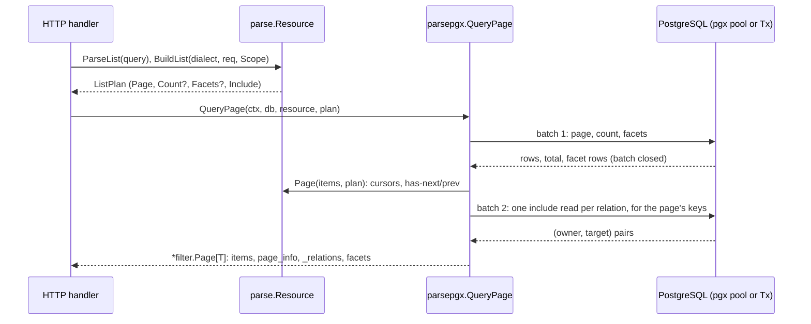

# parse/parsepgx

Runs parse's plans on PostgreSQL through pgx. `QueryPage` answers a list plan — page, total, facets and includes — in two batches; `Update` applies an update plan and its relation changes in one transaction. The caller owns the context, the pool or transaction and its isolation; the core parse packages stay free of I/O.

## Quick Start

```go
func (a *deviceAPI) list(w http.ResponseWriter, r *http.Request) {
	tenant, err := a.tenant(r) // from the request's authentication
	if err != nil {
		http.Error(w, "unauthorized", http.StatusUnauthorized)
		return
	}
	req, err := devices.ParseList(r.URL.Query())
	if err != nil {
		a.fail(w, r, err)
		return
	}
	plan, err := devices.BuildList(filter.PostgresDialect{}, req, parse.Scope{Tenant: tenant.String()})
	if err != nil {
		a.fail(w, r, err)
		return
	}
	page, err := parsepgx.QueryPage(r.Context(), a.db, devices, plan)
	if err != nil {
		a.fail(w, r, err) // parsehttp.WriteError for parse errors, 500 otherwise
		return
	}
	a.reply(w, r, page)
}
```

The complete recipe — resource declaration, list and Merge Patch endpoints, error handling — is [`recipe_test.go`](recipe_test.go), compiled in the unit lane and served against PostgreSQL by `TestRecipe`.

## Architecture



**Entry points**
- `QueryPage(ctx, db, r, plan)` — a list plan from `Resource.BuildList`, compiled for `filter.PostgresDialect`.
- `Update(ctx, db, r, plan)` — an update plan from `Resource.BuildUpdate`.

**Exit points**
- Include results pass through `filter.Page.SetInclude`: `_relations` and `_truncated` omit empty projections, and cut owners are reported with the retained IDs.
- Statements to `db` through `SendBatch` (and `Begin` for an update that changes relations). Statement text and arguments come only from the plan.
- Rows scanned into `T` with `pgx.RowToStructByNameLax` — the `db` tags that named the plan's columns; fields of columns the resource does not read (`parse.ReadColumns`) stay zero.

**Failure modes**
- A plan compiled for another dialect: `ErrDialect`, before any statement runs.
- A statement error: the pgx/PostgreSQL error, wrapped with the table (`parsepgx: devices: …`); `errors.As(err, &*pgconn.PgError)` reaches it. In pgx's default mode a batch prepares every statement first, so a bad column fails there.
- A cursor value that cannot be minted from a row: `Resource.Page`'s error.
- A relation statement that fails inside `Update`: the transaction (or savepoint) rolls back the row change too.
- Context cancelled or past its deadline: pgx's context error; nothing is retried.

**Dependencies**
- *Imports*: `parse`, `parse/filter`, `github.com/jackc/pgx/v5`
- *Imported by*: applications serving parse resources on PostgreSQL
- *Package boundary*: optional pgx execution; no application imports

## Execution modes

The plans' arguments are typed (`[]string`, `[]uuid.UUID`, `float64`, …), so every pgx `QueryExecMode` runs them; `TestEveryExecMode` runs a list walk and an update in each.

| `ConnConfig.DefaultQueryExecMode` | Use |
|---|---|
| `QueryExecModeCacheStatement` (default) | Recommended: prepared once per connection, binary protocol |
| `QueryExecModeCacheDescribe` | Behind PgBouncer in transaction mode with statement caching off |
| `QueryExecModeDescribeExec` | No cache; one extra round trip per statement |
| `QueryExecModeExec`, `QueryExecModeSimpleProtocol` | Poolers or proxies that cannot prepare; text encoding |

`pgx.NamedArgs` rewrites whole statements and cannot compose with the plans' positional placeholders; it is not used.

## Consistency

The page, count and facet statements run in one batch, the includes in a second once the page's keys are known. On a pool each statement sees its own snapshot, so a concurrent write can make the total disagree with the page by a row. Pass a `pgx.Tx` begun with `IsoLevel: pgx.RepeatableRead` (read-only is enough) when the total, facets and includes must describe exactly the page's rows.

`Update` reads the owners the plan's scope admits and changes the relation memberships of those rows only, never the requested keys. A plan that writes nothing (`plan.Writes` false: an empty patch) only reads its targets; a caller that audits or fans hooks for every updated row checks `plan.Writes` before calling. With relation changes it runs in a transaction — a savepoint when `db` is already a `pgx.Tx` — so the caller's own transaction can still roll it back.

## Operations

- *Timeouts*: every statement takes the caller's context; give the request a deadline. Pool limits and lifetimes (`MaxConns`, `MaxConnLifetime`, `MaxConnIdleTime`, `ConnConfig.ConnectTimeout`) belong to the caller's `pgxpool.Config`.
- *Observability*: the package emits no metrics or logs of its own. Instrument the pool with a pgx `QueryTracer` / `BatchTracer` (for example an OpenTelemetry tracer on `ConnConfig.Tracer`); each list is one or two batches, each update one batch, or two and a transaction.
- *Troubleshooting*: an `ErrDialect` means the plan was built with another dialect; build it with `filter.PostgresDialect{}`. A `42703` (undefined column) means the table and `T`'s `db` tags disagree. A list whose total looks one off under load is the per-statement snapshot; use a REPEATABLE READ transaction.

## Security

The tenant, authorization policy and deleted-row visibility come only from the `parse.Scope` the server built the plan with; `QueryPage` and `Update` add no predicates and take none from the request. Includes read junction rows in the plan's tenant. SQL text comes from the plan, never from request strings, and every value is a bound argument.

## API Reference

- `QueryPage[T](ctx, db Querier, r *parse.Resource[T], plan *parse.ListPlan) (*filter.Page[T], error)` — the page with its total, facets (`Page.Facets`) and includes (`Page.Relations`) as the plan asks.
- `Update[T](ctx, db DB, r *parse.Resource[T], plan *parse.UpdatePlan) ([]T, error)` — the owner rows as the update left them; none when no row in scope is a target.
- `Querier` — `SendBatch`: `*pgxpool.Pool`, `*pgx.Conn`, `pgx.Tx`.
- `DB` — `Querier` plus `Begin`: `*pgxpool.Pool`, `*pgx.Conn`, `pgx.Tx` (a savepoint).
- `ErrDialect` — a plan not compiled for PostgreSQL.

## Key Files

| File | Responsibility |
|------|----------------|
| `parsepgx.go` | `Querier`, `DB`, `QueryPage`, `Update`, `ErrDialect` |
| `recipe_test.go` | The README recipe: `Device`, list and Merge Patch handlers, `Example` |
| `recipe_integration_test.go` | `TestRecipe`: the recipe served against PostgreSQL |
| `parsepgx_integration_test.go` | Page walks, tenancy, every exec mode, snapshots, updates and rollback |

## References

- [Package overview](../README.md) · [Integrations](../docs/integrations.md#pgx) · [Resource updates](../docs/patches.md#resource-updates)
-  — `parsepgx`
- [pgx](https://pkg.go.dev/github.com/jackc/pgx/v5) — batches, exec modes, tracers
