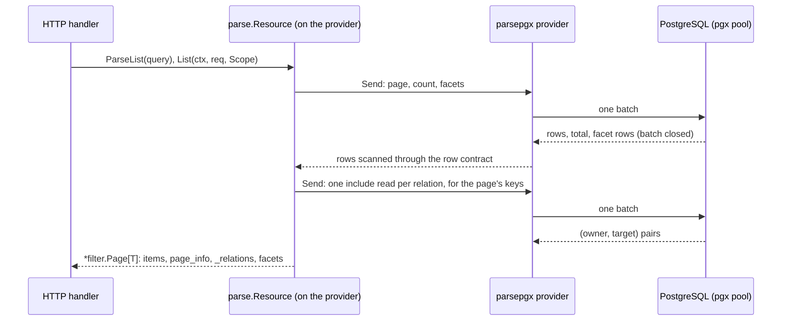

# parse/parsepgx

The PostgreSQL provider. `New` opens a `*parse.Provider` over the application's `*pgxpool.Pool`; every resource built on it (`parse.NewResource`) compiles for `filter.PostgresDialect` and runs its lists, facets, queries and updates on that pool, the statements of each step in one pgx batch. `Tx` wraps a transaction of the application's own for a resource to run in (`Resource.In`). [`parsesql`](../parsesql/README.md) is the SQLite provider, with the same API on the resources; an application uses one or the other, as its configuration names ([`parseprovider`](../parseprovider/README.md)).

## Quick Start

```go
pool, err := pgxpool.NewWithConfig(ctx, poolConfig) // the application's pool, its limits set
p, err := parsepgx.New(ctx, pool)                   // checks the server has pg_c_utf8
devices, err := parse.NewResource[Device](p, "devices", parse.TenantColumn("tenant_id"), parse.PageSize(25, 100))

func (a *deviceAPI) list(w http.ResponseWriter, r *http.Request) {
	tenant, err := a.tenant(r) // from the request's authentication
	if err != nil {
		http.Error(w, "unauthorized", http.StatusUnauthorized)
		return
	}
	req, err := parsehttp.ParseList(r, a.devices)
	if err != nil {
		a.fail(w, r, err)
		return
	}
	page, err := a.devices.List(r.Context(), req, parse.Scope{Tenant: tenant.String()})
	if err != nil {
		a.fail(w, r, err) // parsehttp.WriteError for parse errors, 500 otherwise
		return
	}
	a.reply(w, r, page)
}
```

The complete recipe — resource declaration, list and Merge Patch endpoints, error handling — is [`recipe_test.go`](recipe_test.go), compiled in the unit lane and served against PostgreSQL by `TestRecipe`.

## Architecture



**Entry points**
- `New(ctx, pool, opts...)` — the provider over a pool; `Collation`, `ContainmentMaxValues` and `SettleTimeout` configure it.
- `Tx(tx)` — the application's own `pgx.Tx` as a `*parse.Tx` for `Resource.In`.
- Every call on a resource built on the provider: `List`, `Facets`, `Query`, `Update`, `UpdateBatch`, and `Provider.Begin`.

**Exit points**
- Statements to the pool through `SendBatch`, and for an update through `Begin` (a transaction of its own) or `Exec` of a savepoint (in a transaction the resource runs in). Statement text and arguments come only from the resource's plans.
- Rows scan through the resource's row contract (`parse.RowScanner`): each column into the field the resource compiled it from — the column tag `core.WithColumnTag` names (default `db`), else the column convention over the field's JSON name, with embedded structs promoted as encoding/json promotes them and nil embedded pointers allocated. Columns omitted by `parse.ReadColumns` stay zero; a `parse.ReadExpr` column scans its expression's value under its column name; declared JSON storage and the columns PostgreSQL types json or jsonb (`parse.ScanJSON`, from the result's type OIDs) use the checked JSON decoder described below.

**Failure modes**
- `New`: a nil pool, a settle timeout that is not positive or a collation that is no `filter.PostgresCollation` is refused before any statement; a server without the collation is `parsepgx: collation pg_c_utf8: …; on PostgreSQL 14 to 16 open the provider with Collation(filter.CollationC)`, and an unreachable one `parsepgx: checking collation …: …`.
- A statement error: a `*parse.StatementError` naming the table and the statement (`page`, `count`, `facets`, `include <field>`, `query`, `current`, `conflict`, `lock`, `owner`, `relations`, `reread`, or the transaction's `begin`, `savepoint`, `release savepoint`, `rollback to savepoint`, `rollback`, `commit`): `parse: devices: owner: …`; `errors.As` reaches it and the pgx/PostgreSQL error under it (`*pgconn.PgError`). In pgx's default mode a batch prepares every statement first, so a bad column fails there.
- Invalid or lossy stored JSON: the decoding or key-validation error, inside the statement's `StatementError` with the column it names. No partial page or returned row slice is exposed, and an update whose returned row fails to scan is rolled back: an update's error means nothing it wrote is kept, unless it is `parse.ErrCommitUnknown`.
- Any failure inside `Update` or `UpdateBatch`, a cancellation included: the transaction (or savepoint) rolls back everything the update wrote, and a transaction the resource runs in stays usable.
- A `COMMIT` sent and never answered — the connection lost, or the settle timeout run out, while it was in flight, or a `FATAL` that ended the session: `parse: devices: commit: commit outcome unknown: …`, which matches `parse.ErrCommitUnknown` (`errors.Is`), and the update may have been applied. Read the rows back before retrying a write that is not idempotent. A `COMMIT` PostgreSQL refused with an `ERROR` (a deferred constraint, a serialization failure), or one pgx never sent, rolled back: an ordinary error.
- A panic while the update runs — a type's own `UnmarshalJSON` as a row is read: the rest of the batch is read, the transaction (or savepoint) rolls back, and the panic goes on to the caller, leaving the connection idle and a transaction the resource runs in usable.
- A batch chunk whose targets are not exactly its keys: `parse.ErrUpdateBatchTargets`, before any owner statement; the transaction rolls back.
- Context cancelled or past its deadline: pgx's context error; nothing is retried. Once every statement of an update has run and its rows have scanned, the update commits (or releases its savepoint) whatever the context does since, and reports success: an update's error never hides an applied one, so a retry never applies it twice. Each settling statement — `COMMIT`, `ROLLBACK`, `RELEASE SAVEPOINT`, `ROLLBACK TO SAVEPOINT` — runs under the context's values without its cancellation, bounded by the settle timeout.

**Dependencies**
- *Imports*: `parse`, `parse/filter`, `parse/internal/backend`, `github.com/jackc/pgx/v5`
- *Imported by*: applications serving parse resources on PostgreSQL, and `parseprovider`
- *Package boundary*: the PostgreSQL provider; no application imports

## Configuration

`New` takes these options:

| Option | Type | Default | Description |
|---|---|---|---|
| `Collation(c)` | `filter.PostgresCollation` | `filter.CollationPgCUTF8` | The code-point collation string sorts, keyset seeks and string ranges compile under: `pg_c_utf8` (PostgreSQL 17+) or `filter.CollationC` (`"C"`, PostgreSQL 14–16). `New` checks that the database compares strings under it. Index the sorted text columns with the same collation. |
| `ContainmentMaxValues(n)` | int | `0` (`filter.DefaultContainmentMaxValues`, 256) | The largest `$in` set a jsonb path compares by containment, which `GIN (doc jsonb_path_ops)` serves; a negative value compares none so. |
| `SettleTimeout(d)` | `time.Duration` | `10s` (`parse.DefaultSettleTimeout`) | Bounds each statement that settles an update (`COMMIT`, `ROLLBACK`, `RELEASE SAVEPOINT`, `ROLLBACK TO SAVEPOINT`), which runs past the caller's cancellation. A `COMMIT` still in flight when it runs out is `parse.ErrCommitUnknown`. Must be positive. |

The pool, its limits and its connections' settings (`MaxConns`, `MaxConnLifetime`, `MaxConnIdleTime`, `ConnConfig.ConnectTimeout`, `DefaultQueryExecMode`) belong to the application's `pgxpool.Config`; [`parseprovider`](../parseprovider/README.md#configuration) sets them from configuration.

## Execution modes

The plans' arguments are typed (`[]string`, `[]uuid.UUID`, `float64`, …), so every pgx `QueryExecMode` runs them; `TestEveryExecMode` runs a list walk and an update in each.

| `ConnConfig.DefaultQueryExecMode` | Use |
|---|---|
| `QueryExecModeCacheStatement` (default) | Recommended: prepared once per connection, binary protocol |
| `QueryExecModeCacheDescribe` | Behind PgBouncer in transaction mode with statement caching off |
| `QueryExecModeDescribeExec` | No cache; one extra round trip per statement |
| `QueryExecModeExec`, `QueryExecModeSimpleProtocol` | Poolers or proxies that cannot prepare; text encoding |

Every update runs in a transaction, so a pooler must keep a transaction on one server connection: use a direct connection or a pooler in transaction (or session) mode. A pooler in statement mode, which may send each statement to a different server connection, cannot hold one, and `Update` and `UpdateBatch` are not supported behind it. Lists need no transaction and run behind any pooler, each statement in its own snapshot.

`pgx.NamedArgs` rewrites whole statements and cannot compose with the plans' positional placeholders; it is not used.

## JSON storage

Declared JSON columns and inferred PostgreSQL JSON/JSONB results decode as typed Go values: a stored JSON string becomes a Go string, and JSON-encoded bytes become the decoded byte slice. Native text, bytea and array columns retain pgx's normal codecs.

SQL NULL resets the destination field. A present JSON document decodes into a fresh candidate, with custom JSON decoders called once; canonical map keys and recognized struct-member names are checked before assignment. Lossy spellings such as `{"01":1}` into `map[int]int` are rejected. Custom JSON subtrees, interfaces and `json.RawMessage` retain their documented opaque representation.

A present JSON `null` cannot be represented by a nil map, slice, pointer or interface without losing its distinction from SQL NULL; use `json.RawMessage` to retain that document. Decoding and key-validation failures preserve the prior destination. Lists, empty-patch reads and update results use the same decoding boundary.

## Consistency

The page, count and facet statements run in one batch, the includes in a second once the page's keys are known. On a pool each statement sees its own snapshot, so a concurrent write can make the total disagree with the page by a row. Run the list in a `pgx.Tx` begun with `IsoLevel: pgx.RepeatableRead` (read-only is enough), through `devices.In(parsepgx.Tx(tx))`, when the total, facets and includes must describe exactly the page's rows.

`Update` returns a `parse.UpdateResult`: `Changed`, the target rows whose columns the update wrote, stamped and counted; `Unchanged`, the target rows it left — every row of a plan that assigns no column (an empty patch reads its targets, a relation-only patch locks them) and, under `SkipUnchanged`, the rows the patch already described; and `RelationRows`, the junction rows its membership changes deleted and inserted, zero when none changed. Emit a per-row event for `Changed` and a membership event when `RelationRows` is not zero. No row in either slice means not found.

Every update runs in a transaction of its own on a pool or connection — `BEGIN`, its batches, then `COMMIT` once every returned row has scanned, so an update of columns alone is three round trips — and under a savepoint (`parsepgx_update`) in a transaction the resource runs in (`In`), so that transaction can still roll it back. It changes the relation memberships of the rows the owner statement returned only (changed, then unchanged), never the requested keys. For a resource with [computed columns](../docs/queries.md#computed-columns) it then reads those rows again, in the batch that changes the memberships and after the changes, so a column over a relation's pairs returns them as the update left them rather than as the owner statement read them; the changed and the unchanged rows are read again apart, so each keeps its side of the split.

A [`SkipUnchanged`](../docs/patches.md#skipping-unchanged-rows) plan sends `plan.Current` and then the guarded `UPDATE` in one batch of the update's transaction: `Current` locks every target first, the update writes only the rows it changes, and the rows `Current` read and the update did not return are exactly `Unchanged`.

`UpdateBatch` runs in one transaction (a savepoint in a transaction the resource runs in): every chunk's `Current` in one batch, locking its targets in key order, each checked against its keys; then every `Owner` in a second batch. `Changed` are the rows the owners wrote, chunk by chunk; `Unchanged` the locked rows a `SkipUnchanged` owner left.

What runs, in what order, and what the result holds is the root package's (`parse/execute.go`), shared with [`parsesql`](../parsesql/README.md). This package holds only what is pgx's: the batches the statements are pipelined in, the rows' JSON column types, and the transaction or savepoint and how each is settled.

## Operations

- *Timeouts*: every statement of a list, and of an update up to its settle, takes the caller's context, as does `Begin`'s wait for a pool's connection; give the request a deadline. The settle runs past the caller's cancellation, each statement bounded by `SettleTimeout` (default `10s`). Pool limits and lifetimes (`MaxConns`, `MaxConnLifetime`, `MaxConnIdleTime`, `ConnConfig.ConnectTimeout`) belong to the application's `pgxpool.Config`.
- *Cancellation*: a call whose context is cancelled, or whose deadline passes, mid-statement returns an error that `errors.Is` matches to `context.Canceled` or `context.DeadlineExceeded`. Under pgx's default context handling the connection is closed and its statement cancelled on the server, so an update's transaction rolls back and writes none of its rows or memberships; the pool opens a new connection for the next call.
- *Concurrent updates*: updates of one owner's relations serialize on the owner's row lock, taken by the owner statement before any membership change, so two replacements of one owner's set leave exactly one of them. Every update of a target that can hold several rows (`ByIDs`, `ByKeys`, `ByFilter`) locks them in key order before it writes one: `Current` when the plan has one, else `Lock` ahead of a plain `UPDATE`, which would otherwise lock rows in the order its plan reads them; a relation-only patch's owner; and every batch's `Current`. Two updates over overlapping rows therefore cannot deadlock on each other, whatever order they name the keys in or their plans read the rows in. A `40P01` that remains involves another writer of those rows that locks in its own order; PostgreSQL aborts one, and it is safe to retry.
- *Observability*: the package emits no metrics or logs of its own. Instrument the pool with a pgx `QueryTracer` / `BatchTracer` (for example an OpenTelemetry tracer on `ConnConfig.Tracer`); each list is one or two batches, each update a transaction of one batch, or two; the batch of a `SkipUnchanged` plan, and of a plain update of a target that can hold several rows (`Lock`, then the `UPDATE`), holds two statements; a batch plan is two batches in a transaction.
- *Troubleshooting*: a `parse.ErrCommitUnknown` means the `COMMIT` went unanswered: look for a dropped connection, a server restart or failover, or a commit slower than the settle timeout (synchronous replication waiting on a standby); the update may have been applied, so read before retrying. A `parse.ErrProviderMismatch` means a resource was given a transaction another provider began or of another kind (`In`), or related to a target built on another provider; build every resource of the database on its one provider. A `*parse.StatementError`'s `Table` and `Statement` say which statement failed; log them as attributes. A `parse.ErrUpdateBatchTargets` means a batch named a key that is missing, deleted, another tenant's, outside the policy or at another revision; nothing was written. A `55P03` or a lock wait on an update is another transaction holding the target rows (`Current`, `Lock` and relation-only owners lock them); keep those transactions short. `no such savepoint` / `25P01` on `parsepgx_update`: the transaction the resource runs in ended under the update (a `COMMIT` or `ROLLBACK` from another goroutine on the same transaction). A `42703` (undefined column) means the table and the columns `T`'s fields compile to (the column tag, else the column convention over the JSON name) disagree. A list whose total looks one off under load is the per-statement snapshot; use a REPEATABLE READ transaction. A `22021` (`invalid byte sequence for encoding "UTF8"`) or `22P05` (`unsupported Unicode escape sequence`) is text holding invalid UTF-8 or U+0000 that parse never read as request text: parse refuses both in request values, keys and patches (`core.CheckText`), so look at the values the server supplies, such as a policy constraint, a stamp or an `AcceptParams` parameter the handler binds itself.

## Security

The tenant, authorization policy and deleted-row visibility come only from the `parse.Scope` the server passes; the provider adds no predicates and takes none from the request. Includes read junction rows in the plan's tenant. SQL text comes from the plan, never from request strings, and every value is a bound argument.

## Build, run and test

From the module directory (`parse/`):

```bash
go test -tags=unit ./parsepgx/...                                                     # without a database
PARSE_POSTGRES_DSN=postgres://… go test -tags=integration -count=1 ./parsepgx/...     # every pgx execution mode, against PostgreSQL
```

`make parse-postgres-up` starts the PostGIS server the integration suite uses ([verification](../docs/operations.md#verification)). Each PostgreSQL test's deadline is `PARSE_TEST_TIMEOUT`, a Go duration (default `30s`); raise it on a contended host.

## API Reference

- `New(ctx, pool *pgxpool.Pool, opts ...Option) (*parse.Provider, error)` — the PostgreSQL provider over pool, which stays the application's to close.
- `Tx(tx pgx.Tx) *parse.Tx` — the application's own transaction on the provider's pool, for `Resource.In`; commit or roll back tx itself, or through the returned `Tx`.
- `Option`: `Collation`, `ContainmentMaxValues`, `SettleTimeout` (the table above).
- `Name` — `"postgres"`, the provider's `parse.Provider.Name` and its `parseprovider` setting.

## Key Files

| File | Responsibility |
|------|----------------|
| `parsepgx.go` | `New` and its collation check, `Option`s, `Tx`; the database and transaction the root package sends steps to: batches read to their end even past a panic (`send`), the transaction-or-savepoint wrapper and its settle under `backend.Settle`, which failed `COMMIT`s are `parse.ErrCommitUnknown` (`commitFailed`), and the json/jsonb columns a result reports (`rows.Documents`) |
| `corpus_integration_test.go` | `TestCorpus`: parse's database corpus (`internal/corpus`) on PostgreSQL, as `parsesql`'s runs it on SQLite |
| `new_test.go` | What `New` refuses before any statement |
| `commit_test.go` | Which failed `COMMIT`s are `parse.ErrCommitUnknown`, and the table they name |
| `json_integration_test.go` | Typed JSON lists/updates, nulls, projections and failure isolation in every execution mode |
| `recipe_test.go` | The README recipe: `Device`, list and Merge Patch handlers, `Example` |
| `recipe_integration_test.go` | `TestRecipe`: the recipe served against PostgreSQL |
| `parsepgx_integration_test.go` | Page walks, tenancy, every exec mode, snapshots, updates (guarded ones, on the pool and in a transaction, with relations and rereads), rollback, `Provider.Begin` and `Tx`, both collations |
| `cancel_integration_test.go` | Concurrent relation replaces of one owner; a list and an update cancelled mid-statement, and an update past its deadline in a policy subquery: the error, the rollback and the pool's next call |
| `civil_date_integration_test.go`, `column_type_integration_test.go`, `sql_text_values_integration_test.go` | Native date, network, interval and text values read back through the row contract and cursors |

## References

- [Package overview](../README.md) · [Integrations](../docs/integrations.md#postgresql) · [Transactions](../docs/integrations.md#transactions) · [Resource updates](../docs/patches.md#resource-updates)
- [pgx](https://pkg.go.dev/github.com/jackc/pgx/v5) — batches, exec modes, tracers
