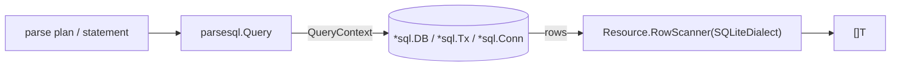

# parse/parsesql

Runs parse statements on SQLite through `database/sql`, with any SQLite driver, and scans their rows into the resource's type through its row contract (`parse.RowScanner`).

## Quick Start

```go
db, err := sql.Open("sqlite", "file:app.db")
// parsesqlite.Register() first when the driver is modernc.org/sqlite.

plan, err := devices.BuildList(filter.SQLiteDialect{}, req, parse.Scope{Tenant: tenantID})
rows, err := parsesql.Query(ctx, db, devices, plan.Page)
page, err := devices.Page(rows, plan)
```

## Architecture



A statement over a resource reads `Resource.Columns(d)`, so every row holds `Resource.ColumnNames()` in order. `Query` builds one `RowScanner` per statement and scans each row with `rows.Scan`:

- Each column lands in the field the resource compiled it from: the column tag `core.WithColumnTag` names (default `db`), else the column convention over the field's JSON name; embedded structs are promoted as encoding/json promotes them, and nil embedded pointers are allocated. A field of a column the resource does not read (`parse.ReadColumns`) stays zero.
- SQLite stores documents and arrays as JSON text: a document or array field (`core.TypeOf`) whose type is not an `sql.Scanner`, and any column declared JSON (`parse.ColumnType`), is decoded into a fresh value, its presence and member spelling checked, before it reaches the row. SQL NULL leaves the field zero; a JSON `null` is refused for a field that cannot keep it (use `json.RawMessage`).
- A timestamp is the canonical UTC text parse writes (`core.FormatTimestamp`), parsed into `time.Time` or `*time.Time`; a driver that reads a `DATETIME` column as a `time.Time` hands that over unchanged.
- Every other column, and any `sql.Scanner` field (parse's value types, decimals, UUIDs, `sql.Null*`), is scanned by the driver.

A row that fails to scan fails the statement: `Query` returns no rows.

PostgreSQL runs through [`parsepgx`](../parsepgx/README.md): `database/sql` hands its native arrays to a scanner as text that only pgx's codecs read.

## Configuration

The package has no configuration of its own. The connection, its pool limits and its transaction mode belong to the caller's `*sql.DB`.

## External Dependencies

`database/sql` and a SQLite driver the caller registers. Plans that compare decimals or decide geo predicates need the functions [`parsesqlite`](../parsesqlite/README.md) registers.

## API Reference

- `Query[T](ctx, db Queryer, r *parse.Resource[T], st parse.Statement) ([]T, error)` — the rows of one statement over `r.Columns` compiled for SQLite: a plan's page, `Owner`, `Current` or `Reread`, or a repository's own read of the table.
- `Queryer` — `QueryContext`: `*sql.DB`, `*sql.Conn`, `*sql.Tx`.

## Build and test

```sh
make test-parse-unit       # unit tests, SQLite in memory
make test-parse-integration
```

The row contract's cases (`row_contract_cases_test.go` in the root package) page every row shape on SQLite and PostgreSQL.

## Operations

- *Timeouts*: every statement takes the caller's context; give the request a deadline.
- *Observability*: the package emits no metrics or logs of its own; instrument the driver or wrap the `*sql.DB`.
- *Troubleshooting*: `no such column` means the table and the columns `T`'s fields compile to disagree. `JSON scan source must be string or []byte` means a document column holds a number or a blob: store JSON text. `timestamp text` errors mean a timestamp column holds text parse did not write; write `core.FormatTimestamp` or declare the column `DATETIME` for a driver that parses it. `no such function: parse_decimal` means `parsesqlite.Register` ran after the database opened a connection, or not at all.

## Security

SQL text comes from the plan, never from request strings, and every value is a bound argument. The tenant, policy and deleted-row visibility come only from the `parse.Scope` the plan was built with; `Query` adds no predicate. Stored documents are decoded into fresh values, so a document whose member names do not match its Go type never reaches a row.

## Code Map

| File | Responsibility |
|------|----------------|
| `parsesql.go` | `Queryer`, `Query` |
