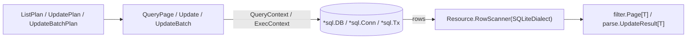

# parse/parsesql

Runs parse plans on SQLite through `database/sql`, with any SQLite driver: `QueryPage` answers a list plan with its page, total, facets and includes; `Update` applies an update plan with its relation changes and reports which rows it changed; `UpdateBatch` applies a batch plan; `Query` reads one statement's rows. Rows scan into the resource's type through its row contract (`parse.RowScanner`). The calls and results are those of [`parsepgx`](../parsepgx/README.md), which runs the same plans on PostgreSQL.

## Quick Start

```go
// One write transaction at a time, waited for: parsesql's updates read
// before they write, and SQLite has no row lock.
db, err := sql.Open("sqlite", "file:app.db?_txlock=immediate&_busy_timeout=5000")
// parsesqlite.Register() first when the driver is modernc.org/sqlite.

plan, err := devices.BuildList(filter.SQLiteDialect{}, req, parse.Scope{Tenant: tenantID})
page, err := parsesql.QueryPage(ctx, db, devices, plan)

upd, err := devices.BuildUpdate(filter.SQLiteDialect{}, patch, parse.ByID(id), scope, parse.SkipUnchanged())
res, err := parsesql.Update(ctx, db, devices, upd)
// res.Changed: written, stamped, counted — emit events for these.
// res.Unchanged: matched and left as they were. Neither: not found.
```

## Architecture



**Lists.** `QueryPage` runs the page statement, then the count and the facet union when the plan has them, builds the page from them (`Resource.ListPage`: cursors, has-next, total and facets), then runs the include statements it returns for the page's keys, each through `filter.Page.SetInclude`, which omits empty projections. Each statement sees its own snapshot unless `db` is a transaction.

**Updates.** `Update` runs `Current` (a `SkipUnchanged` plan's read of every target), then `Owner`, and splits the target rows with `parse.Resource.FollowUp`, which also renders the relation statements and rereads: `Changed` are the rows whose columns `Owner` wrote, `Unchanged` the rows it left — every row of an empty or relation-only patch. The relation statements then run for the keys of those rows (changed, then unchanged), never for the requested keys, and their affected rows sum into `RelationRows`. For a resource with computed columns (`parse.ReadExpr`), the changed and the unchanged rows are read again apart (`Resource.Reread`), so a column over a relation's pairs reads them as the update left them. Every update runs in one transaction: its own on a `*sql.DB` or `*sql.Conn`, a savepoint (`parsesql_update`) on a `*sql.Tx`. Any other `DB` is refused with `ErrNoTransaction` before a statement is sent, since its statements might each take another connection of a pool; lists run on any. On a `*sql.DB` the transaction is begun on a connection taken under the caller's context, so the wait for one keeps its deadline; the transaction itself is begun without the context's cancellation, which `database/sql` would answer by rolling back what is already done. It is settled only once every returned row has scanned, so an error — a failed statement, a row that fails to scan, a cancellation — means nothing the update wrote is kept, and the caller's transaction stays usable and its rollback undoes the update. Once every statement has run, the update commits (or releases its savepoint) whatever its context does since and reports success, so an error never hides an applied update and a retry never applies it twice; SQLite's commit always answers, so `parse.ErrCommitUnknown` is `parsepgx`'s alone. A panic while the update runs — a type's own `UnmarshalJSON` as a row is read — rolls the transaction (or savepoint) back on its way to the caller, so no transaction stays open on the connection. The contract is `parsepgx`'s.

**Batches.** `UpdateBatch` runs in one transaction (or savepoint): every chunk's `Current`, each checked against its keys (`Resource.CheckBatchCurrent`: `parse.ErrUpdateBatchTargets` and nothing written when a target is missing, stale, another tenant's or outside the policy), then every `Owner` in chunk order. `Changed` are the rows the owners wrote; `Unchanged` the read rows a `SkipUnchanged` owner left (`Resource.BatchResult`).

**Shared steps.** What runs, in what order, and what the result holds is the root package's, shared with `parsepgx`: `Resource.CheckPlan` before any statement, then the steps above. This package holds only what is `database/sql`'s: running the statements one after another, scanning, and the transaction or savepoint.

**Write transactions.** SQLite has no row lock: an update that reads before it writes holds its targets only in a write transaction, so no other writer commits between `Current` and `Owner`. `database/sql` begins transactions in the mode the connection string names; open the database with `_txlock=immediate`, and a `*sql.Tx` you pass in is then begun as a write transaction too.

**Rows.** A statement over a resource reads `Resource.Columns(d)`, so every row holds `Resource.ColumnNames()` in order. One `RowScanner` is built per statement and each row scanned with `rows.Scan`:

- Each column lands in the field the resource compiled it from: the column tag `core.WithColumnTag` names (default `db`), else the column convention over the field's JSON name; embedded structs are promoted as encoding/json promotes them, and nil embedded pointers are allocated. A field of a column the resource does not read (`parse.ReadColumns`) stays zero.
- SQLite stores documents and arrays as JSON text: a document or array field (`core.TypeOf`) whose type is not an `sql.Scanner`, and any column declared JSON (`parse.ColumnType`), is decoded into a fresh value, its presence and member spelling checked, before it reaches the row. The decode runs once `rows.Scan` has returned, so a type's own `UnmarshalJSON` runs outside it. SQL NULL leaves the field zero; a JSON `null` is refused for a field that cannot keep it (use `json.RawMessage`).
- A timestamp is the canonical UTC text parse writes (`core.FormatTimestamp`), parsed into `time.Time` or `*time.Time`; a driver that reads a `DATETIME` column as a `time.Time` hands that over unchanged.
- Every other column, and any `sql.Scanner` field (parse's value types, decimals, UUIDs, `sql.Null*`), is scanned by the driver.

A row that fails to scan fails its statement, and the call returns no rows; in an update it rolls the update back.

PostgreSQL runs through [`parsepgx`](../parsepgx/README.md): `database/sql` hands its native arrays to a scanner as text that only pgx's codecs read. Every call refuses a nil plan, a plan another resource built, and a plan compiled for another dialect (`parse.ErrDialect`) before any statement (`Resource.CheckPlan`).

## Configuration

`Update` and `UpdateBatch` take `parse.ExecOption`s after the plan:

| Option | Type | Default | Description |
|---|---|---|---|
| `parse.WithSettleTimeout` | `time.Duration` | `10s` (`parse.DefaultSettleTimeout`) | Bounds each statement that settles an update in a caller's `*sql.Tx` (`RELEASE SAVEPOINT`, `ROLLBACK TO SAVEPOINT`), which runs past the caller's cancellation. `database/sql`'s `Commit` and `Rollback` take no context, so a transaction the update begins itself settles as the driver runs them. Must be positive; otherwise the call is refused before any statement. |

The connection, its pool limits and its transaction mode belong to the caller's `*sql.DB`:

| Connection setting | Type | Recommended | Why |
|---|---|---|---|
| `_txlock` (DSN) | `deferred` \| `immediate` \| `exclusive` | `immediate` | An update that reads before it writes (`SkipUnchanged`, batches) holds its targets only in a write transaction |
| `_busy_timeout` (DSN) | milliseconds | `5000` | A second writer waits for the first instead of failing with `SQLITE_BUSY` |

Both are read by `modernc.org/sqlite` and `mattn/go-sqlite3`.

## External Dependencies

`database/sql` and a SQLite driver the caller registers. Plans that compare decimals or decide geo predicates need the functions [`parsesqlite`](../parsesqlite/README.md) registers.

## API Reference

- `QueryPage[T](ctx, db Queryer, r *parse.Resource[T], plan *parse.ListPlan) (*filter.Page[T], error)` — the page, with `page_info.total_count`, `facets`, `_relations` and `_truncated` as the request asked.
- `Update[T](ctx, db DB, r *parse.Resource[T], plan *parse.UpdatePlan, opts ...parse.ExecOption) (parse.UpdateResult[T], error)` — `Changed`, `Unchanged` and `RelationRows`; no row in either slice means not found.
- `UpdateBatch[T](ctx, db DB, r *parse.Resource[T], plan *parse.UpdateBatchPlan, opts ...parse.ExecOption) (parse.UpdateResult[T], error)` — the batch in one transaction; `parse.ErrUpdateBatchTargets` when a chunk's targets are not exactly its keys.
- `Query[T](ctx, db Queryer, r *parse.Resource[T], st parse.Statement) ([]T, error)` — the rows of one statement over `r.Columns` compiled for SQLite: a repository's own read of the table, or one of a plan's statements run by hand.
- `Queryer` — `QueryContext`: `*sql.DB`, `*sql.Conn`, `*sql.Tx`.
- `DB` — `Queryer` and `ExecContext`. On a `*sql.DB` or `*sql.Conn` (which have `BeginTx`) an update begins its own transaction; on a `*sql.Tx` it takes a savepoint.
- `ErrNoTransaction` — an update given a `DB` that is no `*sql.Tx` and has no `BeginTx`, before any statement; the error names the type. A type that embeds a `*sql.Tx` (such as `*sqlx.Tx`) passes the one it embeds.

A statement's failure is a `*parse.StatementError` naming it, wrapped once with the table: `parsesql: devices: owner: …`, `… current: …`, `… conflict: …`, `… relations: …`, `… reread: …`, `… page: …`, `… count: …`, `… facets: …`, `… include tags: …`, and the transaction's `begin`, `savepoint`, `release savepoint`, `rollback to savepoint`, `rollback` and `commit`. `errors.As` reaches it and the driver's error under it; `parsepgx` names its statements the same way.

## Build and test

```sh
make test-parse-unit         # unit tests, SQLite in memory
make test-parse-integration  # SQLite and PostgreSQL
```

The executor contract (`executor_contract_cases_test.go` in the root package: changed and unchanged rows, junction counts, rollback, savepoints, batches, pages, dialect refusal) runs on SQLite through this package and on PostgreSQL through `parsepgx`. The row contract's cases (`row_contract_cases_test.go`) page every row shape on both.

## Operations

- *Timeouts*: every statement of a list, and of an update up to its settle, takes the caller's context, as does an update's wait for a pool's connection; give the request a deadline. The settle runs past the caller's cancellation: in a caller's `*sql.Tx` each settling statement is bounded by `parse.WithSettleTimeout` (default `10s`); the `COMMIT` or `ROLLBACK` of a transaction the update began takes no context in `database/sql` and runs as the driver runs it.
- *Transactions*: an update holds a write transaction from `Current` (or `Owner`) to its last relation statement; a batch holds one for every chunk. Keep batches bounded (`parse.UpdateBatchLimits`) so the write lock is short.
- *Observability*: the package emits no metrics or logs of its own; instrument the driver or wrap the `*sql.DB`.
- *Troubleshooting*:
  - `database is locked` / `SQLITE_BUSY`: another writer held the database past the busy timeout; set `_busy_timeout`, and keep transactions short.
  - `cannot start a transaction within a transaction`: a `DB` that is not a `*sql.Tx` is already inside a transaction (a `*sql.Conn` after `BEGIN`); pass the `*sql.Tx` instead.
  - `parsesql.ErrNoTransaction` (`an update needs a *sql.Tx, or a DB with BeginTx …`): the update was given a wrapper that hides its `*sql.DB`, `*sql.Conn` or `*sql.Tx`; the error names the wrapper's type. Pass the value it wraps, or instrument the driver instead of wrapping the handle. Nothing ran.
  - A call that hangs where it should have panicked (a goroutine dump shows it in `(*sql.Rows).close`): the panic came from inside `rows.Scan` — an `sql.Scanner` field's own `Scan` — where `database/sql` holds the rows' lock without releasing it, so closing the rows as the panic unwinds waits forever and the connection is lost. Fix the scanner. A panic anywhere else, a document's `UnmarshalJSON` included, rolls the update back and frees the connection.
  - `no such savepoint: parsesql_update`: the caller's transaction ended under the update (a `COMMIT` or `ROLLBACK` from another goroutine on the same `*sql.Tx`).
  - `parse.ErrUpdateBatchTargets`: a batch named a key that is missing, deleted, another tenant's, outside the policy or at another revision; nothing was written.
  - `parse.ErrDialect`: the plan was built with another dialect; build it with `filter.SQLiteDialect{}`. `plan built for "…"`: the plan came from another resource than the one passed with it. Nothing ran in either case.
  - `no such column` means the table and the columns `T`'s fields compile to disagree. `JSON scan source must be string or []byte` means a document column holds a number or a blob: store JSON text. `timestamp text` errors mean a timestamp column holds text parse did not write; write `core.FormatTimestamp` or declare the column `DATETIME` for a driver that parses it. `no such function: parse_decimal` means `parsesqlite.Register` ran after the database opened a connection, or not at all.

## Security

SQL text comes from the plan, never from request strings, and every value is a bound argument. The tenant, policy and deleted-row visibility come only from the `parse.Scope` the plan was built with; the executor adds no predicate. Relation statements are keyed by the rows the owner statement returned, never by the keys the request named, so a request cannot change memberships of rows its scope does not admit. Stored documents are decoded into fresh values, so a document whose member names do not match its Go type never reaches a row.

## Code Map

| File | Responsibility |
|------|----------------|
| `parsesql.go` | `Queryer`, `DB`, `ErrNoTransaction`, `QueryPage`, `Update`, `UpdateBatch`, `Query`: the root package's executor steps run one statement at a time; the transaction-or-savepoint wrapper, which takes a pool's connection under the caller's context and settles the savepoint under `parse.ExecConfig.SettleContext` |
