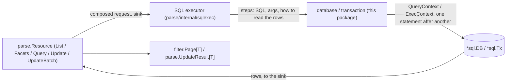

# parse/parsesql

parse's SQLite provider, a module of its own: `github.com/ashtonian/pkg/parse/parsesql`, which brings `modernc.org/sqlite` into the module graph of an application that requires it, and no other driver. `Open` opens a SQLite database from `Config` through modernc.org/sqlite, with the SQL functions parse's SQLite plans call registered, and returns the provider on it (`Database`). `New` opens a `parse.Provider` over a `*sql.DB` the application opened itself, on any SQLite driver that has the functions. Every resource built on the provider (`parse.NewResource(p, …)`) compiles its statements for `filter.SQLiteDialect` and runs its lists, facets, queries and updates on that database, scanning rows into the resource's type through its row contract (`parse.RowScanner`). `Tx` wraps a transaction of the application's own for a resource to run in (`parse.Resource.In`).

The provider's API is the one every parse provider has: [`parsepgx`](../parsepgx/README.md) is PostgreSQL's, and [`parseprovider`](../parseprovider/README.md) opens whichever an application's configuration names among those its binary links (`Choice`). Providers are alternatives chosen at startup: parse never moves data between them or runs one beside another.

SQLite has no exact decimal type: a `NUMERIC` column converts text past 64-bit integers to a double, and `json_extract` reads a JSON number as one. `filter.SQLiteDialect` therefore reads every decimal column and decimal path member through deterministic functions this package registers, so equality, sets, ranges, sorts, keyset seeks and facets on SQLite agree with PostgreSQL's `numeric` and with `filter.Evaluate` to `core.MaxDecimalDigits` (1000) digits. A numeric facet keys its values through them too, as canonical decimal text. SQLite has no geometry either: geo filters on a JSONB point call functions that decide them as PostGIS does, `$near` by the WGS 84 geodesic distance and `$within` / `$intersects` a box or polygon with its boundary, so SQLite, PostgreSQL with PostGIS and `filter.Evaluate` select the same rows ([functions](#functions)).

## Quick Start

```sh
go get github.com/ashtonian/pkg/parse@latest github.com/ashtonian/pkg/parse/parsesql@latest
```

```go
db, err := parsesql.Open(ctx, cfg) // cfg parsesql.Config: DSN "./app.db", or the default ":memory:"
defer db.Close()
devices, err := parse.NewResource[Device](db.Provider(), "devices", parse.TenantColumn("tenant_id"))

page, err := devices.List(ctx, req, parse.Scope{Tenant: tenantID})
res, err := devices.Update(ctx, patch, parse.ByID(id), scope, parse.SkipUnchanged())
// res.Changed: written, stamped, counted — emit events for these.
// res.Unchanged: matched and left as they were. Neither: not found.

// Several operations, with the application's own SQL, in one transaction:
tx, err := db.DB().BeginTx(ctx, nil)
scoped, err := devices.In(parsesql.Tx(tx))
_, err = scoped.Update(ctx, patch, parse.ByID(id), scope) // under a savepoint of tx
err = tx.Commit()
```

`Example_quickStart` (`example_test.go`) is the parse README's complete program, and `Example_updateMembership` a membership update; both run in the unit lane. On a database the application opens itself, register the functions before its first connection, open it with the settings [SQLite configuration](#sqlite-configuration) lists, and hand it to `New`:

```go
if err := parsesql.Register(); err != nil { // modernc.org/sqlite: parse's SQL functions
	return err
}
sqlDB, err := sql.Open("sqlite", "./app.db?_journal_mode=WAL&_txlock=immediate&_busy_timeout=5000")
p, err := parsesql.New(ctx, sqlDB) // refuses a SQLite older than MinSQLiteVersion
```

## Architecture



What runs, in what order, and what the result holds is the SQL executor's, `parse/internal/sqlexec`, the same on both SQL providers ([`parse` code map](../README.md#api-and-code-map)): a list's page, count and facets, then its includes; an update's `Current`, `Conflict`, `Lock` and `Owner`, then its relation statements and rereads; a batch's every `Current`, then every `Owner`. The resource composes each request and scans the rows it gets back. This package supplies what is `database/sql`'s: sending each step's statement, handing its rows back to the executor, and holding the transaction.

**Statements.** The statements of one step run one after another on the provider's `*sql.DB` (each on a connection the pool hands out) or on the transaction's connection. A step's failure stops the rest and is reported as that step (`parse.StatementError`).

**Updates.** An update on the provider runs in a transaction of its own, begun on a connection taken under the caller's context, so the wait for one keeps its deadline. The provider begins it (`BEGIN IMMEDIATE`) and settles it (`COMMIT`, `ROLLBACK`) itself, each without the context's cancellation, which could report a statement that took effect as failed. On a resource scoped to a transaction (`In`) it runs under a savepoint (`parsesql_update`) of that transaction, released once it succeeds and rolled back to otherwise, so a failed update leaves the caller's transaction as it was and usable. Either way it settles only once every returned row has scanned: an error — a failed statement, a row that fails to scan, a cancellation — means nothing the update wrote is kept. Once every statement has run the update commits (or releases its savepoint) whatever its context does since, and reports success, so an error never hides an applied update. SQLite's commit always answers, so `parse.ErrCommitUnknown` is `parsepgx`'s alone. A panic while the update runs — a type's own `UnmarshalJSON` as a row is read — rolls the transaction or savepoint back on its way to the caller, so no transaction stays open on the connection. A statement can end the whole transaction itself (a trigger's `RAISE(ROLLBACK)`, `SQLITE_FULL`, an interrupt), leaving nothing to roll back: the update reports that statement's error alone, and its connection goes back to the pool outside any transaction, an in-memory database on it intact. A connection a failed `ROLLBACK` leaves inside a transaction is closed rather than returned holding the write lock. `Provider.Begin` begins and settles its transaction the same way, on a connection it holds until `Commit` or `Rollback`.

**Write transactions.** SQLite has no row lock: an update that reads before it writes (a `SkipUnchanged` plan's `Current`, a batch's preimages) holds its targets only while it holds the write lock from its read to its write, so no other writer commits between `Current` and `Owner`. The transactions the provider begins take the lock as they begin (`BEGIN IMMEDIATE`), whatever the connection string says; a `*sql.Tx` of the application's own takes it only on a connection that begins transactions `IMMEDIATE` ([transaction mode](#sqlite-configuration)).

**Rows.** A statement over a resource reads `Resource.Columns()`, so every row holds `Resource.ColumnNames()` in order, scanned with `rows.Scan`:

- Each column lands in the field the resource compiled it from: the column tag `core.WithColumnTag` names (default `db`), else the column convention over the field's JSON name; embedded structs are promoted as encoding/json promotes them, and nil embedded pointers are allocated. A field of a column the resource does not read (`parse.ReadColumns`) stays zero.
- SQLite stores documents and arrays as JSON text: a document or array field (`core.TypeOf`) whose type is not an `sql.Scanner`, and any column declared JSON (`parse.ColumnType`), is decoded into a fresh value, its presence and member spelling checked, before it reaches the row. The decode runs once `rows.Scan` has returned, so a type's own `UnmarshalJSON` runs outside it. SQL NULL leaves the field zero; a JSON `null` is refused for a field that cannot keep it (use `json.RawMessage`).
- A timestamp is the canonical UTC text parse writes (`core.FormatTimestamp`), parsed into `time.Time` or `*time.Time`; a driver that reads a `DATETIME` column as a `time.Time` hands that over unchanged.
- Every other column, and any `sql.Scanner` field (parse's value types, decimals, UUIDs, `sql.Null*`), is scanned by the driver.

A row that fails to scan fails its statement, and the call returns no rows; in an update it rolls the update back.

## Supported SQLite

parse's SQLite statements need **SQLite 3.47.0** or later (`MinSQLiteVersion`), with its JSON functions, which are built in unless a build omits them. The JSON functions decide the release. From 3.45.0 they compare a path's label with a member's name as decoded, so a member encoding/json wrote escaped (`"a<b"`) is the one `$."a<b"` names, where an older release finds none and `json_set` appends a second member. From 3.47.0 they read an escaped double quote inside a quoted label, where an older release ends the label there: `$."x\".y"` reads as the members `x\` and `y"`, and `json_set` creates them. The statements also use the `->` operator (3.38.0), which reads a document member's JSON text, row values (3.15.0: a keyset seek over several keys, `(a, b) > (?1, ?2)`, and a key set of several columns, `(a, b) IN (SELECT … FROM json_each(?1))`), `ON CONFLICT DO NOTHING` (3.24.0), window functions (3.25.0) and `NULLS FIRST` / `NULLS LAST` (3.30.0). An older SQLite refuses those when it prepares a statement; parse has no fallback SQL for any of them.

`New` enforces the minimum: it reads `sqlite_version()` once and refuses an older library with a `*VersionError` (`Have`, `Need`; `errors.As`): `parsesql: SQLite 3.46.1 is older than 3.47.0, the oldest release parse's plans run on`. Every connection of a `*sql.DB` comes from one driver, and so from one library, so the one check covers them all, and a statement never meets a library that misreads a member name: a JSON Patch writes any document member, `"` and `\` in its name included. `CheckVersion(version)` is the same check on a release string.

| Driver | SQLite it runs |
|---|---|
| `modernc.org/sqlite` | the release it bundles, at the version this module requires |
| `github.com/mattn/go-sqlite3` | the release it bundles: 3.54.1 in v1.14.53 (`SQLITE_VERSION` in its `sqlite3-binding.c`); built with the `libsqlite3` tag, the system's library, which must meet the minimum itself |

`TestDriver_MeetsTheSQLiteMinimum` opens `modernc.org/sqlite` at the version this module requires, checks that the release above is `MinSQLiteVersion` and that the bundled library passes `CheckVersion`, and runs each construct it lists, a label compared as decoded and one holding an escaped double quote included. `TestNew_RefusesAnOlderSQLite` opens the provider over the bundled library with the release it needs raised past the bundled one, and gets the `*VersionError`. The functions run on any release.

## Configuration

`Config` is what `Open` opens, loaded through [`github.com/ashtonian/pkg/config`](../../config/README.md) (its `koanf` names and defaults) or built in code. `Open` checks every setting whichever way it was built, and refuses one out of range naming it (`parsesql: max_open_conns: 0: must be at least 1`); its errors never quote the DSN.

| Setting | Type | Default | Description |
|---|---|---|---|
| `dsn` | string (sensitive) | `:memory:` | The database: a file path (absolute, `./` or `../`, ending `.db`, `.sqlite` or `.sqlite3`), a `file:` URI, or `:memory:`, with any parameter of modernc.org/sqlite but the ones `Open` sets. Refused: a connection string of another database, a `sqlite://` URL (the driver would open it as a file name), an extended-length path (`\\?\`, which the driver splits at its `?`), and the parameters `_txlock`, `_busy_timeout` and `_timeout` |
| `max_open_conns` | int | `1` | Connections the database holds open, all kept idle and never recycled (an in-memory database lives only while a connection to it is open). An in-memory database without `cache=shared` is a database per connection: `Open` refuses more than 1 for one. A file database in WAL mode reads concurrently on more |
| `busy_timeout` | duration | `5s` | How long a statement waits for another connection's write lock before failing with `SQLITE_BUSY` (`_busy_timeout`); 0 fails at once, negative is refused |
| `settle_timeout` | duration | `10s` (`parse.DefaultSettleTimeout`) | Bounds each statement that settles an update in a transaction the resource is scoped to (`RELEASE SAVEPOINT`, `ROLLBACK TO SAVEPOINT`), which runs past the caller's cancellation. The `COMMIT` or `ROLLBACK` of a transaction the provider begins itself takes no deadline, since an interrupted `COMMIT` could have taken effect; SQLite runs it in process, and its wait for a lock is the busy timeout's. Must be positive |

`Open` puts `_busy_timeout` (from `busy_timeout`) and `_txlock=immediate` in the DSN, so every transaction on its database begins `IMMEDIATE`, the application's own on `DB()` included. The journal mode is the DSN's ([SQLite configuration](#sqlite-configuration)).

`New` takes the settle timeout as an option, `SettleTimeout(d)` (default `parse.DefaultSettleTimeout`; must be positive). The connection, its pool limits, its journal mode and its transaction mode belong to the caller's `*sql.DB`, set as [SQLite configuration](#sqlite-configuration) lists. The functions take no configuration: they are pure and deterministic.

## SQLite configuration

What a SQLite database needs to serve parse, whether `Open` opens it or the application opens it for `New`, and how to back it up. Each setting names the test that holds it: the on-disk tests (`ondisk_integration_test.go`) run in the integration lane on a database file in the test's temporary directory, `Open`'s refusals (`open_test.go`) in the unit lane.

```go
// Open: the journal mode in the DSN; the busy timeout and IMMEDIATE transactions are Open's.
db, err := parsesql.Open(ctx, parsesql.Config{DSN: "./app.db?_journal_mode=WAL", MaxOpenConns: 4,
	BusyTimeout: 5 * time.Second, SettleTimeout: parse.DefaultSettleTimeout})

// New: all three in the DSN of a database the application opens (modernc.org/sqlite and mattn/go-sqlite3 both read them).
sqlDB, err := sql.Open("sqlite", "./app.db?_journal_mode=WAL&_txlock=immediate&_busy_timeout=5000")
```

| Setting | Set it to | Default | Without it | Test |
|---|---|---|---|---|
| Journal mode: `_journal_mode` in the DSN, or `_pragma=journal_mode(WAL)` | `WAL` on a file database | SQLite's rollback journal (`DELETE`) | A reader's transaction holds a writer's `COMMIT` until the reader ends | `TestOnDisk_AWriterBesideAReader`, `TestOnDisk_AReopenKeepsRowsStoredResultsAndCursors` |
| Busy timeout: `Open`'s `busy_timeout`, `_busy_timeout` (ms) in the DSN | How long a writer may wait for another's write lock | `Open`: `5s`; modernc.org/sqlite: `0`; mattn/go-sqlite3: `5000` | A writer that finds the lock held fails at once with `SQLITE_BUSY` | `TestOnDisk_AWriterWaitsForTheWriteLockUpToTheBusyTimeout` |
| Transaction mode: `_txlock` in the DSN | `immediate` | `Open`: `immediate`; both drivers: `deferred` | An update in the application's own `*sql.Tx` that reads before it writes fails with `SQLITE_BUSY_SNAPSHOT` once another writer commits between | `TestOnDisk_UpdatesHoldTheWriteLockFromTheirReadToTheirWrite`, `TestOnDisk_AnUpdateInADeferredTransactionFailsWhenAnotherWriterCommitsBetweenItsReadAndWrite` |
| Connections: `max_open_conns`, `SetMaxOpenConns` | `1` for `:memory:`; more for a file in WAL mode | `Open`: `1` | Each connection to `:memory:` is a database of its own | `TestOpen_RefusesNamingTheSetting`, `TestOpen_SharedInMemoryOnSeveralConnections` |

**Journal mode.** In SQLite's default rollback-journal mode a writer commits only once no reader holds the database: while a reader's transaction is open, an update's `COMMIT` waits up to the busy timeout and then fails (`parse: devices: commit: database is locked (5)`), keeping nothing, and its connection is left outside any transaction for the next. In WAL mode readers and one writer run at once: a reader's transaction keeps the snapshot its first read took while the writer commits, without waiting. WAL is a property of the database file, set once and kept across a close and reopen. It keeps a `-wal` and a `-shm` file beside the database, and every process that opens the database shares the `-shm` file's memory, so they run on one host, never over a network filesystem. An in-memory database has no WAL. Held by `TestOnDisk_AWriterBesideAReader` (both modes, with a busy timeout of 0, so any wait fails) and `TestOnDisk_AReopenKeepsRowsStoredResultsAndCursors` (the mode kept across a reopen).

**Busy timeout.** SQLite has one write lock per database. A transaction that finds it held waits up to its connection's busy timeout, then fails with `SQLITE_BUSY` (`database is locked (5)`): `parse: devices: begin: database is locked (5)` for an update. `Open` sets it from `busy_timeout`; a database the application opens sets `_busy_timeout`, since modernc.org/sqlite's default, 0, fails at once (mattn/go-sqlite3's is 5000). Keep write transactions short: every other writer waits behind one. Held by `TestOnDisk_AWriterWaitsForTheWriteLockUpToTheBusyTimeout`: with no timeout the update fails at once, having written nothing; with one it writes once the other writer commits.

**Transaction mode.** An update that reads before it writes needs the write lock from its read to its write. The provider begins the transactions it settles itself — an update's own, and `Provider.Begin`'s — with `BEGIN IMMEDIATE`, which takes the lock as the transaction begins, whatever `_txlock` the DSN names. `database/sql` begins the application's own `*sql.Tx`, the one `Tx` wraps, in the DSN's mode: `_txlock=immediate` makes it a write transaction from its start (`Open` sets it). Begun `DEFERRED`, the drivers' default, it holds only a read snapshot once an update in it has read, and when another writer commits before the update writes, the write fails at once, whatever the busy timeout, with `database is locked (517)` (`SQLITE_BUSY_SNAPSHOT`): the update keeps nothing, and the application rolls the transaction back and retries it. An update that writes without reading first (no `SkipUnchanged`, no batch) waits for the lock as any writer does. Held by `TestOnDisk_UpdatesHoldTheWriteLockFromTheirReadToTheirWrite` — an update skipping unchanged rows, a batch, and an update in `Provider.Begin`'s transaction, on a DSN without `_txlock`, and one in the application's transaction begun `IMMEDIATE`: another writer, with no busy timeout, fails at the update's write — and by `TestOnDisk_AnUpdateInADeferredTransactionFailsWhenAnotherWriterCommitsBetweenItsReadAndWrite`.

**Connections.** Each connection to `:memory:` without `cache=shared` is a database of its own, so it takes one connection, and `Open` refuses more. A file database takes several: in WAL mode they read at once, and their writes take turns on the write lock. Every connection stays open (no lifetime or idle timeout): a connection is an in-process handle with nothing to refresh.

**Backup.** Copy a live database with `VACUUM INTO` or SQLite's online backup API, not by copying its file: in WAL mode committed transactions sit in the `-wal` file until a checkpoint moves them into the database file. Either runs beside a writer in WAL mode and copies what is committed: the rows, and index entries that agree with parse's functions. Open the copy as the original was opened, with the functions registered; it resumes the original's keyset cursors.

- `VACUUM INTO 'path'` (on `Database.DB()`, or a database the application opened) writes a compacted copy in rollback-journal mode, rebuilding every index, so an index on parse's functions needs them on the connection that runs it: on a connection without them it fails with `no such function: parse_decimal_key`. Open the copy with `_journal_mode=WAL` to serve it in WAL mode.
- The online backup API copies the database page by page, WAL mode included, and calls no function. modernc.org/sqlite offers it on its connection, through `sql.Conn.Raw`:

  ```go
  conn, err := db.DB().Conn(ctx)
  defer conn.Close()
  err = conn.Raw(func(driverConn any) error {
  	source := driverConn.(interface{ NewBackup(string) (*sqlite.Backup, error) })
  	backup, err := source.NewBackup("/backups/app.db")
  	if err != nil {
  		return err
  	}
  	_, err = backup.Step(-1) // every page in one step
  	return errors.Join(err, backup.Finish())
  })
  ```

  The copy holds the connection, one of the pool's, while it runs. mattn/go-sqlite3 offers the API on the destination's connection: `(*SQLiteConn).Backup("main", source, "main")`.

Held by `TestOnDisk_ABackupCopiesRowsStoredResultsAndCursors` (each way, beside a writer holding an uncommitted change, the online backup also on a connection without the functions) and `TestOnDisk_VacuumIntoNeedsParsesFunctions`.

## External Dependencies

- `modernc.org/sqlite`, the driver `Open` opens databases through and `Register` registers the functions with, at the version this module's `go.mod` requires (a pure-Go SQLite; no cgo).
- `github.com/ashtonian/pkg/parse` at this module's own version: parse and its provider modules release together at one version ([versions](#versions)).
- For `New` on another driver: `database/sql` and that driver, running at least `MinSQLiteVersion`, with every function `Functions()` lists registered. Statements that compare decimals, filter, sort or facet an int or float path, decide geo predicates, or skip unchanged rows need them.

## API Reference

- `Open(ctx, cfg Config) (*Database, error)`: registers the functions, opens `cfg.DSN` through modernc.org/sqlite with the settings above, and opens the provider on it (`New`) under `ctx`; a failure closes what it opened.
- `Database`: `Provider()` (the provider to build resources on), `DB()` (the `*sql.DB`, for the application's schema, its own statements and a transaction it shares with parse), `Ping(ctx)` (a readiness probe), `Close()`.
- `Choice(cfg Config) parseprovider.Choice`: this provider by its name, opened from `cfg`, for `parseprovider.Open` to choose among the providers a binary links.
- `New(ctx, db *sql.DB, opts ...Option) (*parse.Provider, error)`: the provider over `db`, after the version check, which runs under `ctx`. `db` stays the caller's to close. Refuses a nil `db` and a non-positive settle timeout.
- `Tx(tx *sql.Tx) *parse.Tx`: a transaction the application began on the provider's database, for `parse.Resource.In`. Commit or roll it back through `tx` or the returned `*parse.Tx`.
- `Name` (`"sqlite"`): the provider's name in configuration, `parse.Provider.Name()`.
- `SettleTimeout(d)`, `Option`: `New`'s option.
- `MinSQLiteVersion`, `CheckVersion(version)`, `VersionError{Have, Need}`: the minimum, its check, its refusal.
- `Register()`: registers the seven functions with modernc.org/sqlite's `"sqlite"` driver, once per process; it returns its first result on every call. `RegisterOn(d *sqlite.Driver)`: registers them on a `sqlite.Driver` the caller constructs, which then carries them on its own connections only; package-level registrations, `Register`'s included, never reach a constructed driver. Register before the database opens its first connection: modernc.org/sqlite installs registered functions on each connection it opens afterwards.
- `Functions()`: the table both install, as `Function{Name, NArgs, Call}`, for registering with another SQLite driver ([below](#another-sqlite-driver)). `Decimal(v)`, `DecimalKey(v)`, `DecimalFloat32(v)`, `GeoNear(…)`, `GeoInBox(…)`, `GeoCoveredBy(…)`, `Canonical(v, kind)`: the functions over one SQLite value, and the constants `DecimalFunc`, `DecimalKeyFunc`, `DecimalFloat32Func`, `GeoNearFunc`, `GeoInBoxFunc`, `GeoCoveredByFunc` and `CanonicalFunc` their SQL names.

The resource methods (`List`, `Facets`, `Query`, `Update`, `UpdateBatch`, `In`) are the root package's, run by the SQL executor. A statement's failure is a `*parse.StatementError` naming it, wrapped once with the table: `parse: devices: owner: …`, `… current: …`, `… conflict: …`, `… lock: …`, `… relations: …`, `… reread: …`, `… page: …`, `… count: …`, `… facets: …`, `… include tags: …`, `… query: …`, and the transaction's `begin`, `savepoint`, `release savepoint`, `rollback to savepoint`, `rollback` and `commit`. `errors.As` reaches it and the driver's error under it; `parsepgx` names its statements the same way.

## Functions

**When a function fails**
- A connection opened before `Register`, or a database whose driver never registered the functions: every statement on a decimal field or an int or float path, and every facet of a number, fails with SQLite's `no such function: parse_decimal` (or `parse_decimal_key`, `parse_decimal_float32`), every geo filter with `no such function: parse_geo_near` (or `parse_geo_in_box`, `parse_geo_covered_by`), and an update that skips unchanged rows (`SkipUnchanged`) and writes a column [compared by value](#change-comparison) with `no such function: parse_canonical`. parse never falls back to a rounded comparison or key, a spherical distance, or a comparison of stored text.
- `Register` failing: `parsesql: registering parse_decimal: a function named "parse_decimal" is already registered` means another package registered that name with modernc.org/sqlite first. The functions before the taken name in `Functions()` are registered and the rest are not, so fix the conflict rather than retrying: `Register` returns its first result on every call. `RegisterOn` fails the same way on a driver that already has a name, and is not memoized: call it once per driver.
- A value that holds no decimal (a JSON boolean, a string with an exponent, text that is no number, a BLOB): NULL, so a filter treats it as missing, as `filter.PathValue` does.
- A point member that holds no coordinate (missing, JSON `null`, a boolean, an object or array, text float8 rejects such as `1_0`, a value beyond float8's range): the point is NULL, so the geo filter is unknown and `$not` does not select the row. PostgreSQL refuses the query on any of these but a missing or null member; check the stored documents when the two disagree. A member holding `NaN` or `Infinity` is a coordinate on both, and its point is near, in and on nothing.
- `parse_canonical: want the comparison kind as text, got …` or `parse_canonical: no comparison kind "…"`: hand-written SQL called the function with a kind `filter.SQLiteDialect` never passes; the error comes on the first row.
- `parse_canonical: document: decoding the stored document: …` (or `array:<type>: …`): a statement with the change predicate (`SkipUnchanged`, `patch.WithChangePredicate`) met a row whose document or array column another writer filled with text that is not JSON, or not valid UTF-8; nothing was written. A resource's update that skips unchanged rows of an untyped document usually fails first, reading its targets (`parse: <table>: current: column <col>: …`). Find the rows with `SELECT … WHERE json_valid(col) = 0`, then repair the value, or write it with an update that does not skip unchanged rows, which replaces it. PostgreSQL fails the same statement with `invalid input syntax for type json`.
- `parse_geo_near: geo: decode point: …`: the stored point is not JSON (`json()` in the plan reports malformed JSON first). `want the point's member names as text`, `want the point as JSON text`, `want a number for operand n`, `parse_geo_covered_by: want the polygon as a WKB blob` or `geo: want a little-endian one-ring polygon WKB`: hand-written SQL called a geo function with arguments `filter.SQLiteDialect` never binds. The operands are checked before the point, so the error comes on the first row, a NULL point's included. The dialect passes `json(column)`, the member names as text, numbers, and the polygon `geo.AppendPolygonWKB` writes.

The constants `DecimalFunc`, `DecimalKeyFunc`, `DecimalFloat32Func`, `GeoNearFunc`, `GeoInBoxFunc`, `GeoCoveredByFunc` and `CanonicalFunc` hold the SQL names below, as `filter.SQLiteDialect` calls them.

| SQL | Returns | Used for |
|---|---|---|
| `parse_decimal(x)` | `x`'s canonical decimal text (`core.DecimalText`): plain notation, no exponent, no leading or trailing zeros, `0` for either zero; NULL when `x` holds no decimal | facet terms, a decimal field's value as a statement reads it (`filter.FieldExpr`), whether an int or float path's member written with an exponent or more than 1000 characters is a number member |
| `parse_decimal_key(x)` | a BLOB whose bytes order as `x`'s value, equal exactly where the values are; NULL exactly where `parse_decimal(x)` is | equality, `$ne`, `$in` / `$nin` against each member's key, ranges, `ORDER BY`, keyset seeks, range facets |
| `parse_decimal_float32(x)` | the canonical decimal text of `x` rounded to float32 (an INTEGER, a REAL or TEXT holding a JSON number literal); NULL for anything else or a value beyond float32's range | facet terms of a `float32` field, whose REAL column holds the double of the float32 (`0.10000000149011612` for `0.1`) |

`x` is read as:

| SQLite value | Decimal |
|---|---|
| INTEGER | its digits |
| REAL | its shortest decimal form |
| TEXT holding a JSON number literal (`10.50`, `1.05e1`) | its value: a `TEXT` column's exact decimal, or a document member's number as `->` returns it |
| TEXT holding a JSON string literal (`"9.50"`) | its content, if it is a decimal in plain notation of at most 1000 characters: a document member's string, as `filter.PathValue` reads a decimal member |
| anything else (NULL, a BLOB, JSON `null` / `true` / an object, other text) | none: NULL |

The key is a sign byte (negative, zero, positive), then for a nonzero value `0.d₁…dₙ × 10^e` the exponent `e` biased to two big-endian bytes and the digits; a negative's exponent and digits are complemented and end with `0xFF`, so a greater magnitude orders lower.

### Geo functions

| SQL | Returns | Used for |
|---|---|---|
| `parse_geo_near(point, latKey, lonKey, lat, lon, meters)` | 1 when the stored point lies within `meters` of `(lat, lon)` by the geodesic distance on the WGS 84 ellipsoid, as PostGIS's `ST_DWithin` measures geography (Karney's algorithm, to nanometres), else 0; a stored latitude beyond a pole is coerced as geography coerces it; NULL when the point is | `$near` |
| `parse_geo_in_box(point, latKey, lonKey, south, north, west, east)` | 1 when the stored point lies in the box or on its edge, else 0; NULL when the point is | `$within` and `$intersects` a box |
| `parse_geo_covered_by(point, latKey, lonKey, polygon)` | 1 when the stored point lies in the polygon or on its boundary (the ring's winding number, as PostGIS's point-in-polygon test), else 0; NULL when the point is. `polygon` is a little-endian one-ring polygon WKB in lon/lat order | `$within` and `$intersects` a polygon |

`point` is the column's JSON text (`json(column)` in the plan); it is NULL when the column is NULL, is not an object, or lacks a coordinate under `latKey` or `lonKey`. A duplicated member reads its last value, as jsonb keeps it. Each member is read as PostgreSQL reads `(doc->>'lat')::float8`:

| Member | Coordinate |
|---|---|
| a JSON number (`10`, `1e1`) | its value |
| a JSON string float8 accepts: decimal (`"10"`, `" 10 "`, `"1e1"`, `".5"`), hexadecimal (`"0x10"`, `"0x1.8"`, `"0x1p3"`), `"NaN"`, `"Infinity"`, `"-inf"` | its value; a point holding NaN or an infinity is near, in and on nothing |
| missing, JSON `null`, a boolean, an object, an array, a string float8 rejects (`"1_0"`, `"1e"`, `"ten"`), a value beyond float8's range (`1e400`, `"1e-400"`) | none: the point is NULL |

### Change comparison

| SQL | Returns | Used for |
|---|---|---|
| `parse_canonical(x, kind)` | The form two stored values of one value share, as text: the form `ComposedPatch.Apply` compares too (`internal/canonical`); NULL when `x` is; `x` itself when it is a scalar that holds no value of `kind`; an error when it is a document or array that holds no JSON value | The change predicate of an update that skips unchanged rows (`SkipUnchanged`, [skipping unchanged rows](../docs/patches.md#skipping-unchanged-rows)): `(col COLLATE BINARY IS NOT ? AND parse_canonical(col, kind) IS NOT parse_canonical(?, kind))` |

`kind` is the column's comparison kind, as `filter.SQLiteDialect` passes it from the type the patch's path declares:

| `kind` | Columns | Form of `x` |
|---|---|---|
| `document` | A JSON document, a column declared `json` or `jsonb`, a document whose members a patch writes | The document as PostgreSQL's `jsonb` text compares: members sorted and unspaced, a duplicated member by its last value, and each number in the one spelling of its value and display scale, the literal's fractional digits less its exponent — its coefficient without leading zeros, trailing zeros folded into the exponent where it has no display scale (`1e2`, `100` and `10e1` as `1e2`; `1.50e1` and `15.0` as `150e-1`; `-0` as `0`; `1.0` as `10e-1`), never padded out, so `1e100000` stays seven characters |
| `array:<type>`, `array` | A native array of elements of `<type>` (`array:uuid`, `array:float`), or of no scalar type | The array unspaced, each element in its type's canonical value (`core.NormalizeStored`): a UUID in lower case, a timestamp at its instant, a float by its value keeping its zero's sign; an element that holds no value of its type, and every element of `array`, as written |
| `decimal` | A decimal | Its canonical decimal text, as `parse_decimal` reads `x` |
| `uuid`, `timestamp`, `date`, `time`, `interval`, `inet`, `cidr`, `macaddr` | A column of that type | The canonical text of the value `x` holds (`core.NormalizeStored`): `0190a5b4-…` for `{0190A5B4-…}`, `2026-01-01T00:00:00.000000000Z` for `2025-12-31T19:00:00-05:00` |

A scalar `x` holds no value of its kind when it is a BLOB (as `parse_decimal` reads one) or text that does not parse as the kind, such as a legacy midnight timestamp in a date column. Such an `x` is returned as it is, which no form of another value equals, so the predicate compares it as stored, as `Apply` does, and never reports a false "unchanged": the write stores parse's text. A document or array `x` — text or a BLOB — that is not one JSON value, or not valid UTF-8, is an error, which fails the statement: no form decides whether a write changes it, PostgreSQL's cast to `jsonb` refuses a `text` column's alike, and `Apply` refuses it. Text, an integer, a float and a boolean column compare as stored, with no call.

### Another SQLite driver

`Functions()` is the registration contract for a database the application opens on another driver and hands to `New`: each entry's `Name` is what `filter.SQLiteDialect` calls, `NArgs` how many arguments it passes, and `Call` the implementation over the `database/sql/driver` values a scalar function receives. Register every entry, as a deterministic function: SQLite uses an index on an expression only when its functions are deterministic. `New` checks the release the database runs ([supported SQLite](#supported-sqlite)).

| Name | Arguments |
|---|---|
| `parse_decimal` | 1 |
| `parse_decimal_key` | 1 |
| `parse_decimal_float32` | 1 |
| `parse_geo_near` | 6 |
| `parse_geo_in_box` | 7 |
| `parse_geo_covered_by` | 4 |
| `parse_canonical` | 2 |

The functions need nothing from modernc.org/sqlite, but this package registers them with it and opens its databases through it, so a program on another driver that imports it links modernc.org/sqlite too.

## Versions

parse and its provider modules release together, at one version: require `parse` and `parse/parsesql` at the same one, as `go get` of both `@latest` does, and as each release of this module requires its own release of parse. The provider runs on parse's internal contract, which no other module implements and which changes between releases, so a build that pairs this module with another release of parse fails to compile at this module's `contract.go`, naming this module's release and then parse's as `[major][minor][patch]` arrays:

```text
parsesql/contract.go:21:84: cannot use [releaseMajor][releaseMinor][releasePatch]struct{}{} (value of type [0][18][0]struct{}) as [0][19][0]struct{} value in variable declaration
```

Here parsesql 0.18.0 meets parse 0.19.0: move both to one release. Dependabot updates them as one group.

## Build and test

From this module's directory (the repository's `go.work` builds it against the working tree's parse):

```sh
go test -tags=unit -race ./...           # the version check, Open's settings, the functions, the examples
go test -tags=integration ./...          # TestCorpus: parse's database corpus on SQLite; the on-disk tests
go test -tags=integration -run 'TestCorpus/ExecutorContract' .   # one case
```

`make test-parse-unit` and `make test-parse-integration` run them with parse's other modules. `TestCorpus` (`corpus_integration_test.go`) runs parse's database corpus (`internal/corpus`) on SQLite through this package, as `parsepgx`'s runs it on PostgreSQL: the executor contract (changed and unchanged rows, junction counts, rollback, savepoints, batches, pages, transactions), the row contract over every row shape, and the list, filter, patch, key, value, update, policy, relation and tenancy cases, the decimal and geo matrices among them (`TestCorpus/(DecimalMatrix|NumberKeys|GeoMatrix|FilterMatrix)$`). This package's own tests cover `Open`'s settings, the version check, transactions and savepoints, a connection wait under the caller's context, and the functions. The on-disk tests (`TestOnDisk_*`, `ondisk_integration_test.go`) run on a database file in the test's temporary directory and hold each setting of [SQLite configuration](#sqlite-configuration): a reopen, a reader beside a writer in each journal mode, the busy timeout, the write lock each update path takes, and backups. They coordinate the connections through channels, a statement hook (`HookedFileDB`, `dbtest.OnStatement`) and SQLite's own locks, never sleeps, so they are deterministic under `-race`. Of the functions, `TestDecimalKey_EqualExactlyWhereTextIsEqual` compares every pair of stored forms in SQL (INTEGER, REAL, TEXT in plain and exponent notation, a member's JSON string, either zero, BLOB, NULL and text that is no number), and each with the canonical text a filter binds: two keys are equal exactly where `parse_decimal`'s texts are, and NULL together; `TestDecimalKey_AgreesWithDecimal` holds `Decimal` and `DecimalKey`, called directly, to the same rule over Go values a driver hands them (zero of either sign, an integer and a REAL around 2^63, REALs that are not finite), and pins each one's text; `TestCanonical` calls `parse_canonical` in SQL over each kind's stored forms, a BLOB, NULL and the kinds it refuses. `internal/canonical` checks that two stored forms share a form exactly where they are one value, and that a form's form is itself; `TestCorpus/ComposedPatch_ApplyAgreesWithTheDatabase` checks that SQLite's change predicate reaches `Apply`'s verdict over values another writer stored in other forms. `internal/decimals` checks over generated literals that the key orders as `core.CompareDecimals` does; `internal/geo` checks the distance against GeographicLib's test set, and with PostGIS (`PARSE_POSTGIS_DSN`) thousands of seeded distances and points on polygons' vertices and edges against PostGIS.

## Operations

- *Timeouts*: every statement of a list, and of an update up to its settle, takes the caller's context, as does an update's or `Provider.Begin`'s wait for a connection; give the request a deadline. The `BEGIN IMMEDIATE` and the settle run past the caller's cancellation: in a scoped transaction each settling statement is bounded by `SettleTimeout` (default `10s`); the `COMMIT` or `ROLLBACK` of a transaction the provider began takes no deadline, and the busy timeout bounds its wait for a lock.
- *Transactions*: an update holds a write transaction from `Current` (or `Owner`) to its last relation statement; a batch holds one for every chunk. Keep batches bounded (`parse.UpdateBatchLimits`) so the write lock is short.
- *Health*: `Database.Ping(ctx)` answers a readiness probe.
- *Backups*: `VACUUM INTO` or the online backup API, beside the running service in WAL mode ([backup](#sqlite-configuration)); never a copy of the database file alone.
- *Observability*: the package emits no metrics or logs of its own; instrument the driver, and label failures by `parse.StatementError.Statement`. A missing function registration surfaces as the statement error under [functions](#functions).
- *Cost*: one Go call per row for each decimal expression a statement evaluates, and for each number a facet keys. An update that skips unchanged rows makes two `parse_canonical` calls per row for each by-value column whose stored text differs from the written one, each decoding and re-encoding a document or array, linear in its text, and none for a row that holds that text. A key is one byte for zero; otherwise the value's significant digits plus three bytes, and one more for a negative, which ends with a terminator. A geo filter is one call per row, which decodes the point's JSON text: a distance then iterates a handful of times (more near the antipode), a polygon test is linear in its points (at most 100).
- *Indexes*: no index serves a geo filter on SQLite; it reads every row its other predicates leave. SQLite indexes an expression of deterministic functions. `CREATE INDEX … ON t (parse_decimal_key(amount), id)`, the key and then the keyset's tiebreaker, serves decimal equality, sets, ranges, sorts and keyset seeks. An index on them needs the functions on every connection that writes the table, the `sqlite3` shell included, since its maintenance calls them.
- *Stored results*: what `parse_canonical` returns is compared within one statement and is no persisted format: do not index it. What `parse_decimal`, `parse_decimal_key` and `parse_decimal_float32` return for a stored value is a persisted format, held by every index on them; the bytes of `parse_decimal_key` are pinned by golden vectors in `internal/decimals`. Any change in what one of them returns for a value already stored is a breaking change, whether it changes a key's bytes or which values have a result at all: 0.15.0 reads a BLOB as no decimal (NULL), where 0.14.0 read the decimal text a BLOB held. SQLite trusts a deterministic function to return what it returned when an index entry was written, so after such a release an index built before it answers equality, ranges, sorts and keyset seeks with other rows than a scan finds, without an error, until it is rebuilt: see [upgrading across a change in results](#upgrading-across-a-change-in-results).
- *Troubleshooting*:
  - `parsesql: SQLite 3.x.y is older than 3.47.0`: the driver links, or with mattn's `libsqlite3` tag loads, an older SQLite. Move to a driver release that bundles a newer one, or upgrade the system library; `SELECT sqlite_version()` shows what it runs.
  - `parsesql: dsn: …`, `parsesql: max_open_conns: …`, `parsesql: busy_timeout: …`, `parsesql: settle_timeout: …`: `Open` refused that setting; the message says why, and never quotes the DSN.
  - `parsesql: reading sqlite_version(): …`: `New` could not reach the database: the DSN names a path the process cannot open, or the driver is not registered under the name `sql.Open` used.
  - `begin: database is locked (5)` / `SQLITE_BUSY`: another writer held the write lock past the busy timeout. Check the busy timeout (`busy_timeout`; `_busy_timeout` on a database the application opened, which modernc.org/sqlite leaves at 0), then what holds the lock: a long batch, or a transaction the application left open.
  - `commit: database is locked (5)`: the database is in rollback-journal mode and a reader's transaction held it past the busy timeout. Nothing was kept. Open it in WAL mode (`_journal_mode=WAL`).
  - `owner: database is locked (517)` (`SQLITE_BUSY_SNAPSHOT`): an update in the application's own transaction, begun `DEFERRED`, read and then lost the race to write to another writer, whatever the busy timeout. Begin the application's transactions `IMMEDIATE` (`_txlock=immediate`, as `Open` does) and retry after a rollback ([transaction mode](#sqlite-configuration)).
  - A call that hangs where it should have panicked (a goroutine dump shows it in `(*sql.Rows).close`): the panic came from inside `rows.Scan` — an `sql.Scanner` field's own `Scan` — where `database/sql` holds the rows' lock without releasing it, so closing the rows as the panic unwinds waits forever and the connection is lost. Fix the scanner. A panic anywhere else, a document's `UnmarshalJSON` included, rolls the update back and frees the connection.
  - `no such savepoint: parsesql_update`: the caller's transaction ended under the update (a `COMMIT` or `ROLLBACK` from another goroutine on the same `*sql.Tx`).
  - `parse.ErrUpdateBatchTargets`: a batch named a key that is missing, deleted, another tenant's, outside the policy or at another revision; nothing was written.
  - `parse.ErrProviderMismatch` from `In`: the transaction is another provider's (a `parsepgx.Tx`); scope the resource to a transaction on its own provider.
  - `no such column` means the table and the columns `T`'s fields compile to disagree. `JSON scan source must be string or []byte` means a document column holds a number or a blob: store JSON text. `timestamp text` errors mean a timestamp column holds text parse did not write; write `core.FormatTimestamp` or declare the column `DATETIME` for a driver that parses it. `no such function: parse_decimal` means `Register` ran after a database the application opened itself opened a connection, or not at all; `Open` registers first.
  - A build that fails at `contract.go`: parse and this module are at different releases ([versions](#versions)).

### Upgrading across a change in results

Run these on a connection with the functions registered, through the application's driver: maintaining an index on them calls them, and the `sqlite3` shell has none of them. For each table `t` with an index on a decimal function of a column `amount`:

1. Find the values whose result changed; for 0.15.0, BLOBs: `SELECT count(*) FROM t WHERE typeof(amount) = 'blob'`. parse writes a decimal as canonical TEXT, so only rows the application wrote itself, from a Go `[]byte`, hold one.
2. Convert them to TEXT: `UPDATE t SET amount = CAST(amount AS TEXT) WHERE typeof(amount) = 'blob'`.
3. Rebuild the indexes: `REINDEX t`, or each index by name. A value left unconverted is then NULL in the index as in a scan.
4. Check: `PRAGMA integrity_check(t)` returns `ok`. Before the rebuild it names each index that disagrees with its rows: `row 1 missing from index t_amount`.

Converting before the upgrade, on the release that wrote the BLOBs, keeps the indexes consistent throughout, since that release reads the converted text as it read the BLOB; steps 3 and 4 after the upgrade cost a rebuild and confirm it.

## Security

SQL text comes from the resource's compiled plans, never from request strings, and every value is a bound argument. The tenant, policy and deleted-row visibility come only from the `parse.Scope` the call is given; the provider adds no predicate. Relation statements are keyed by the rows the owner statement returned, never by the keys the request named, so a request cannot change memberships of rows its scope does not admit. Stored documents are decoded into fresh values, so a document whose member names do not match its Go type never reaches a row. The DSN is a secret (`sensitive`): `Open`'s errors never quote it. The functions read only their arguments and have no side effects. The decimal functions allocate at most the value's digits (bounded by `core.MaxDecimalDigits`); `parse_canonical` allocates in proportion to the stored text, and pads a document number's scale only within that bound. A decimal string member longer than 1000 characters is NULL before it is parsed. A polygon blob must hold exactly the points its header counts, at least four of them with the last repeating the first, and its points must be finite, before it is read.

## Code Map

| File | Responsibility |
|------|----------------|
| [`open.go`](open.go) | `Config`, `Open`, `Database`, `Choice`: the database opened from configuration, its DSN checked and its connection limits set |
| [`parsesql.go`](parsesql.go) | `New`, `Tx`, `Name`, `SettleTimeout`; the database and transactions the SQL executor's steps run on (`internal/sqlexec`'s `Conn`, `DB` and `Tx`): statements one after another, the write transactions the provider begins (`BEGIN IMMEDIATE`) on a connection taken under the caller's context and settles itself, the application's transaction (`Tx`), the savepoint in a scoped transaction, and their settle |
| [`functions.go`](functions.go) | `Function` and the `Functions` table, `Register`, `RegisterOn`, `Decimal`, `DecimalKey`, `DecimalFloat32`, `GeoNear`, `GeoInBox`, `GeoCoveredBy`, `Canonical` and the function names |
| [`version.go`](version.go) | `MinSQLiteVersion`, `CheckVersion`, `VersionError`, and the `sqlite_version()` read `New` checks |
| [`contract.go`](contract.go) | The compile-time check that parse is at this module's release ([versions](#versions)) |
| [`../internal/decimals`](../internal/decimals/decimals.go) | `Value` (a SQLite value as a decimal), `Float32Value` (as a float32), `Member` (a document member as a decimal), `Key`, the function names |
| [`../internal/canonical`](../internal/canonical/canonical.go) | `Kind`, `KindOf`, `ParseKind`, `Text` (a stored value's comparison form, which `ComposedPatch.Apply` compares), `Value` (the form, or a value that holds none as itself), `Decode`, the function name |
| [`../internal/geo`](../internal/geo/geo.go) | `Distance` (WGS 84 geodesic, ported from GeographicLib), `Geodetic`, `Box`, `CoveredBy`, `Near`, `ReadPoint` / `ReadPointJSON` and `Coordinate` (a stored point, its members read as float8), the polygon WKB, the function names |
| [`example_test.go`](example_test.go) | The parse README's quick start and a membership update, run with their output checked |
| [`corpus_integration_test.go`](corpus_integration_test.go) | `TestCorpus`: parse's database corpus on SQLite |
| [`sqlite_test.go`](sqlite_test.go) | `MemoryDB`, `HookedMemoryDB`, `HookedFileDB`: the in-memory and file databases this module's tests open |
| [`ondisk_integration_test.go`](ondisk_integration_test.go) | The on-disk tests that hold [SQLite configuration](#sqlite-configuration) |
| [`connection_integration_test.go`](connection_integration_test.go) | A connection wait under the caller's context, and a connection left usable by a statement that ended its transaction |
| [`drivers_test.go`](drivers_test.go) | The [supported SQLite](#supported-sqlite) check: the required driver's release and the constructs the minimum is for |
