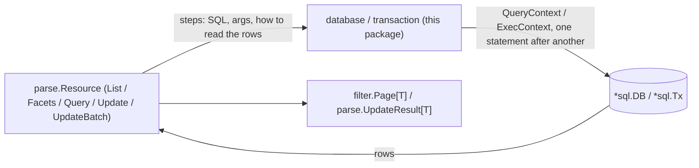

# parse/parsesql

parse's SQLite provider. `New` opens a `parse.Provider` over a `*sql.DB` on any SQLite driver; every resource built on it (`parse.NewResource(p, …)`) compiles its statements for `filter.SQLiteDialect` and runs its lists, facets, queries and updates on that database, scanning rows into the resource's type through its row contract (`parse.RowScanner`). `Tx` wraps a transaction of the application's own for a resource to run in (`parse.Resource.In`). The provider's API is the one every parse provider has: [`parsepgx`](../parsepgx/README.md) is PostgreSQL's, and [`parseprovider`](../parseprovider/README.md) opens whichever an application's configuration names. Providers are alternatives chosen at startup: parse never moves data between them or runs one beside another.

## Quick Start

```go
// One write transaction at a time, waited for: updates read before they
// write, and SQLite has no row lock.
if err := parsesqlite.Register(); err != nil { // modernc.org/sqlite: parse's SQL functions
	return err
}
db, err := sql.Open("sqlite", "./app.db?_txlock=immediate&_busy_timeout=5000")
p, err := parsesql.New(ctx, db) // refuses a SQLite older than MinSQLiteVersion
devices, err := parse.NewResource[Device](p, "devices", parse.TenantColumn("tenant_id"))

page, err := devices.List(ctx, req, parse.Scope{Tenant: tenantID})
res, err := devices.Update(ctx, patch, parse.ByID(id), scope, parse.SkipUnchanged())
// res.Changed: written, stamped, counted — emit events for these.
// res.Unchanged: matched and left as they were. Neither: not found.

// Several operations, with the application's own SQL, in one transaction:
tx, err := db.BeginTx(ctx, nil)
scoped, err := devices.In(parsesql.Tx(tx))
_, err = scoped.Update(ctx, patch, parse.ByID(id), scope) // under a savepoint of tx
err = tx.Commit()
```

[`parseprovider.Open`](../parseprovider/README.md) does the registration, the DSN parameters and the pool settings from configuration.

## Architecture



What runs, in what order, and what the result holds is the root package's, the same on every provider ([`parse` executor contract](../README.md)): a list's page, count and facets, then its includes; an update's `Current`, `Conflict`, `Lock` and `Owner`, then its relation statements and rereads; a batch's every `Current`, then every `Owner`. This package supplies what is `database/sql`'s: sending each step's statement, handing its rows back to the resource, and holding the transaction.

**Statements.** The statements of one step run one after another on the provider's `*sql.DB` (each on a connection the pool hands out) or on the transaction's connection. A step's failure stops the rest and is reported as that step (`parse.StatementError`).

**Updates.** An update on the provider runs in a transaction of its own, begun on a connection taken under the caller's context, so the wait for one keeps its deadline; the transaction is begun without the context's cancellation, which `database/sql` would answer by rolling back what is already done. On a resource scoped to a transaction (`In`) it runs under a savepoint (`parsesql_update`) of that transaction, released once it succeeds and rolled back to otherwise, so a failed update leaves the caller's transaction as it was and usable. Either way it settles only once every returned row has scanned: an error — a failed statement, a row that fails to scan, a cancellation — means nothing the update wrote is kept. Once every statement has run the update commits (or releases its savepoint) whatever its context does since, and reports success, so an error never hides an applied update. SQLite's commit always answers, so `parse.ErrCommitUnknown` is `parsepgx`'s alone. A panic while the update runs — a type's own `UnmarshalJSON` as a row is read — rolls the transaction or savepoint back on its way to the caller, so no transaction stays open on the connection.

**Write transactions.** SQLite has no row lock: an update that reads before it writes (a `SkipUnchanged` plan's `Current`, a batch's preimages) holds its targets only in a write transaction, so no other writer commits between `Current` and `Owner`. `database/sql` begins transactions in the mode the connection string names: open the database with `_txlock=immediate`, and a `*sql.Tx` passed to `Tx` is then begun as a write transaction too.

**Rows.** A statement over a resource reads `Resource.Columns()`, so every row holds `Resource.ColumnNames()` in order, scanned with `rows.Scan`:

- Each column lands in the field the resource compiled it from: the column tag `core.WithColumnTag` names (default `db`), else the column convention over the field's JSON name; embedded structs are promoted as encoding/json promotes them, and nil embedded pointers are allocated. A field of a column the resource does not read (`parse.ReadColumns`) stays zero.
- SQLite stores documents and arrays as JSON text: a document or array field (`core.TypeOf`) whose type is not an `sql.Scanner`, and any column declared JSON (`parse.ColumnType`), is decoded into a fresh value, its presence and member spelling checked, before it reaches the row. The decode runs once `rows.Scan` has returned, so a type's own `UnmarshalJSON` runs outside it. SQL NULL leaves the field zero; a JSON `null` is refused for a field that cannot keep it (use `json.RawMessage`).
- A timestamp is the canonical UTC text parse writes (`core.FormatTimestamp`), parsed into `time.Time` or `*time.Time`; a driver that reads a `DATETIME` column as a `time.Time` hands that over unchanged.
- Every other column, and any `sql.Scanner` field (parse's value types, decimals, UUIDs, `sql.Null*`), is scanned by the driver.

A row that fails to scan fails its statement, and the call returns no rows; in an update it rolls the update back.

## Supported SQLite

parse's SQLite statements need **SQLite 3.47.0** or later (`MinSQLiteVersion`), with its JSON functions, which are built in unless a build omits them. The JSON functions decide the release. From 3.45.0 they compare a path's label with a member's name as decoded, so a member encoding/json wrote escaped (`"a<b"`) is the one `$."a<b"` names, where an older release finds none and `json_set` appends a second member. From 3.47.0 they read an escaped double quote inside a quoted label, where an older release ends the label there: `$."x\".y"` reads as the members `x\` and `y"`, and `json_set` creates them. The statements also use the `->` operator (3.38.0), which reads a document member's JSON text, row values (3.15.0: a keyset seek over several keys, `(a, b) > (?1, ?2)`, and a key set of several columns, `(a, b) IN (SELECT … FROM json_each(?1))`), `ON CONFLICT DO NOTHING` (3.24.0), window functions (3.25.0) and `NULLS FIRST` / `NULLS LAST` (3.30.0). An older SQLite refuses those when it prepares a statement; parse has no fallback SQL for any of them.

`New` enforces the minimum: it reads `sqlite_version()` once and refuses an older library with a `*VersionError` (`Have`, `Need`; `errors.As`): `parsesql: SQLite 3.46.1 is older than 3.47.0, the oldest release parse's plans run on`. Every connection of a `*sql.DB` comes from one driver, and so from one library, so the one check covers them all, and a statement never meets a library that misreads a member name: a JSON Patch writes any document member, `"` and `\` in its name included. `CheckVersion(version)` is the same check on a release string.

| Driver | SQLite it runs |
|---|---|
| `modernc.org/sqlite` | the release it bundles, at the version this module requires |
| `github.com/mattn/go-sqlite3` | the release it bundles: 3.54.1 in v1.14.53 (`SQLITE_VERSION` in its `sqlite3-binding.c`); built with the `libsqlite3` tag, the system's library, which must meet the minimum itself |

`TestDriver_MeetsTheSQLiteMinimum` opens `modernc.org/sqlite` at the version this module requires, checks that the release above is `MinSQLiteVersion` and that the bundled library passes `CheckVersion`, and runs each construct it lists, a label compared as decoded and one holding an escaped double quote included. `TestOpen_RefusesAnOlderSQLite` opens the provider over the bundled library with the release it needs raised past the bundled one, and gets the `*VersionError`.

## Configuration

`New` takes options:

| Option | Type | Default | Description |
|---|---|---|---|
| `SettleTimeout` | `time.Duration` | `10s` (`parse.DefaultSettleTimeout`) | Bounds each statement that settles an update in a transaction the resource is scoped to (`RELEASE SAVEPOINT`, `ROLLBACK TO SAVEPOINT`), which runs past the caller's cancellation. `database/sql`'s `Commit` and `Rollback` take no context, so the `COMMIT` or `ROLLBACK` of a transaction an update begins itself runs as the driver runs it; SQLite runs it in process. Must be positive; `New` refuses another. |

The connection, its pool limits and its transaction mode belong to the caller's `*sql.DB` (`parseprovider` sets them from configuration):

| Connection setting | Type | Recommended | Why |
|---|---|---|---|
| `_txlock` (DSN) | `deferred` \| `immediate` \| `exclusive` | `immediate` | An update that reads before it writes (`SkipUnchanged`, batches) holds its targets only in a write transaction |
| `_busy_timeout` (DSN) | milliseconds | `5000` | A second writer waits for the first instead of failing with `SQLITE_BUSY` |
| `SetMaxOpenConns` | int | `1` for `:memory:` | Each connection to `:memory:` is a database of its own; a file database in WAL mode reads concurrently on more |

`modernc.org/sqlite` and `mattn/go-sqlite3` both read the two DSN parameters.

## External Dependencies

`database/sql` and a SQLite driver the caller registers, running at least `MinSQLiteVersion`. Statements that compare decimals, filter, sort or facet an int or float path, or decide geo predicates need the functions [`parsesqlite`](../parsesqlite/README.md) registers (`Register` for modernc.org/sqlite, `Functions` for another driver).

## API Reference

- `New(ctx, db *sql.DB, opts ...Option) (*parse.Provider, error)`: the provider over `db`, after the version check, which runs under `ctx`. `db` stays the caller's to close. Refuses a nil `db` and a non-positive settle timeout.
- `Tx(tx *sql.Tx) *parse.Tx`: a transaction the application began on the provider's database, for `parse.Resource.In`. Commit or roll it back through `tx` or the returned `*parse.Tx`.
- `Name` (`"sqlite"`): the provider's name in configuration, `parse.Provider.Name()`.
- `SettleTimeout(d)`, `Option`: the option above.
- `MinSQLiteVersion`, `CheckVersion(version)`, `VersionError{Have, Need}`: the minimum, its check, its refusal.

The resource methods (`List`, `Facets`, `Query`, `Update`, `UpdateBatch`, `In`) are the root package's. A statement's failure is a `*parse.StatementError` naming it, wrapped once with the table: `parse: devices: owner: …`, `… current: …`, `… conflict: …`, `… lock: …`, `… relations: …`, `… reread: …`, `… page: …`, `… count: …`, `… facets: …`, `… include tags: …`, `… query: …`, and the transaction's `begin`, `savepoint`, `release savepoint`, `rollback to savepoint`, `rollback` and `commit`. `errors.As` reaches it and the driver's error under it; `parsepgx` names its statements the same way.

## Build and test

```sh
make test-parse-unit         # unit tests, SQLite in memory
make test-parse-integration  # SQLite and PostgreSQL
```

The executor contract (`executor_contract_integration_test.go` in the root package: changed and unchanged rows, junction counts, rollback, savepoints, batches, pages, transactions) runs on SQLite through this package and on PostgreSQL through `parsepgx`. The row contract's cases (`row_contract_integration_test.go`) page every row shape on both. This package's own tests cover the version check, transactions and savepoints, and a connection wait under the caller's context.

## Operations

- *Timeouts*: every statement of a list, and of an update up to its settle, takes the caller's context, as does an update's wait for a connection; give the request a deadline. The settle runs past the caller's cancellation: in a scoped transaction each settling statement is bounded by `SettleTimeout` (default `10s`); the `COMMIT` or `ROLLBACK` of a transaction the update began takes no context in `database/sql`.
- *Transactions*: an update holds a write transaction from `Current` (or `Owner`) to its last relation statement; a batch holds one for every chunk. Keep batches bounded (`parse.UpdateBatchLimits`) so the write lock is short.
- *Observability*: the package emits no metrics or logs of its own; instrument the driver, and label failures by `parse.StatementError.Statement`.
- *Troubleshooting*:
  - `parsesql: SQLite 3.x.y is older than 3.47.0`: the driver links, or with mattn's `libsqlite3` tag loads, an older SQLite. Move to a driver release that bundles a newer one, or upgrade the system library; `SELECT sqlite_version()` shows what it runs.
  - `parsesql: reading sqlite_version(): …`: `New` could not reach the database: the DSN names a path the process cannot open, or the driver is not registered under the name `sql.Open` used.
  - `database is locked` / `SQLITE_BUSY`: another writer held the database past the busy timeout; set `_busy_timeout`, and keep transactions short.
  - A call that hangs where it should have panicked (a goroutine dump shows it in `(*sql.Rows).close`): the panic came from inside `rows.Scan` — an `sql.Scanner` field's own `Scan` — where `database/sql` holds the rows' lock without releasing it, so closing the rows as the panic unwinds waits forever and the connection is lost. Fix the scanner. A panic anywhere else, a document's `UnmarshalJSON` included, rolls the update back and frees the connection.
  - `no such savepoint: parsesql_update`: the caller's transaction ended under the update (a `COMMIT` or `ROLLBACK` from another goroutine on the same `*sql.Tx`).
  - `parse.ErrUpdateBatchTargets`: a batch named a key that is missing, deleted, another tenant's, outside the policy or at another revision; nothing was written.
  - `parse.ErrProviderMismatch` from `In`: the transaction is another provider's (a `parsepgx.Tx`); scope the resource to a transaction on its own provider.
  - `no such column` means the table and the columns `T`'s fields compile to disagree. `JSON scan source must be string or []byte` means a document column holds a number or a blob: store JSON text. `timestamp text` errors mean a timestamp column holds text parse did not write; write `core.FormatTimestamp` or declare the column `DATETIME` for a driver that parses it. `no such function: parse_decimal` means `parsesqlite.Register` ran after the database opened a connection, or not at all.

## Security

SQL text comes from the resource's compiled plans, never from request strings, and every value is a bound argument. The tenant, policy and deleted-row visibility come only from the `parse.Scope` the call is given; the provider adds no predicate. Relation statements are keyed by the rows the owner statement returned, never by the keys the request named, so a request cannot change memberships of rows its scope does not admit. Stored documents are decoded into fresh values, so a document whose member names do not match its Go type never reaches a row.

## Code Map

| File | Responsibility |
|------|----------------|
| [`parsesql.go`](parsesql.go) | `New`, `Tx`, `Name`, `SettleTimeout`; the database and transaction the root package's steps run on: statements one after another, the transaction an update begins on a connection taken under the caller's context, the savepoint in a scoped transaction, and their settle |
| [`version.go`](version.go) | `MinSQLiteVersion`, `CheckVersion`, `VersionError`, and the `sqlite_version()` read `New` checks |
| [`drivers_test.go`](drivers_test.go) | The [supported SQLite](#supported-sqlite) check: the required driver's release and the constructs the minimum is for |
