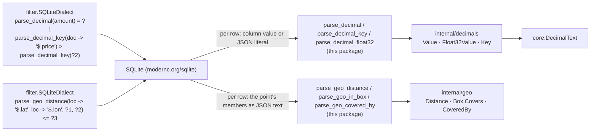

# parse/parsesqlite

Registers the SQL functions parse's SQLite plans compare decimals, key numbers and decide geo filters through, with `modernc.org/sqlite`. SQLite has no exact decimal type: a `NUMERIC` column converts text past 64-bit integers to a double, and `json_extract` reads a JSON number as one. `filter.SQLiteDialect` therefore reads every decimal column and decimal path member through deterministic functions, so equality, sets, ranges, sorts, keyset seeks and facets on SQLite agree with PostgreSQL's `numeric` and with `filter.Evaluate` to `core.MaxDecimalDigits` (1000) digits. A numeric facet keys its values through them too, as canonical decimal text. SQLite has no geometry either: geo filters on a JSONB point call functions that decide them as PostGIS does, `$near` by the WGS 84 geodesic distance and `$within` / `$intersects` a box or polygon with its boundary, so SQLite, PostgreSQL with PostGIS and `filter.Evaluate` select the same rows.

## Quick Start

```go
func openDB(ctx context.Context, dsn string) (*sql.DB, error) {
	if err := parsesqlite.Register(); err != nil {
		return nil, err
	}
	return sql.Open("sqlite", dsn)
}
```

Register before the database opens its first connection: modernc.org/sqlite installs registered functions on each connection it opens afterwards. Declare decimal columns `TEXT` so they hold every decimal exactly ([decimals](../docs/schema-configuration.md#decimals)). The [example server](../examples/server/main.go) registers in `openDB`.

## Architecture



**Entry points**
- `Register()`: registers the three functions with the driver, once per process.
- `Decimal(v)`, `DecimalKey(v)`, `DecimalFloat32(v)`: the functions over one SQLite value, for registering with another driver.
- `GeoDistance(lat, lon, lat2, lon2)`, `GeoInBox(lat, lon, south, north, west, east)`, `GeoCoveredBy(lat, lon, polygon)`: the geo functions over a point's members and the bound operand, for registering with another driver.

**Exit points**
- Function results: TEXT, a BLOB, a REAL distance, 1 or 0, or NULL. Nothing is written or logged.

**Failure modes**
- A connection opened before `Register`, or a database whose driver never registered the functions: every statement on a decimal field, and every facet of a number, fails with SQLite's `no such function: parse_decimal` (or `parse_decimal_key`, `parse_decimal_float32`), and every geo filter with `no such function: parse_geo_distance` (or `parse_geo_in_box`, `parse_geo_covered_by`). parse never falls back to a rounded comparison or key, or to a spherical distance.
- `Register` failing: `parsesqlite: register parse_decimal: a function named "parse_decimal" is already registered` means another package registered that name with modernc.org/sqlite first. `Register` returns its first result on every call.
- A value that holds no decimal (a JSON boolean, a string with an exponent, text that is no number, a BLOB): NULL, so a filter treats it as missing, as `filter.PathValue` does.
- A point member that holds no coordinate (missing, JSON `null`, a boolean, text that is no number): the point is NULL, so the geo filter is unknown and `$not` does not select the row. PostgreSQL refuses the query on a boolean or non-numeric text member instead; check the stored documents when the two disagree.
- `parse_geo_distance: want a number for each coordinate`, `parse_geo_in_box: want a number for each side of the box`, `parse_geo_covered_by: want the polygon as a WKB blob` or `geo: want a little-endian one-ring polygon WKB`: hand-written SQL called a geo function with an operand `filter.SQLiteDialect` never binds. The dialect binds numbers and the polygon `geo.AppendPolygonWKB` writes.

**Dependencies**
- *Imports*: `parse/internal/decimals`, `parse/internal/geo`, `parse/core`, `modernc.org/sqlite`
- *Imported by*: applications running parse plans on SQLite, `parse/internal/dbtest`, the example server
- *Package boundary*: `filter` does not import this package, so the compiler stays driver-free; both read the function names from `internal/decimals` and `internal/geo`

## Functions

| SQL | Returns | Used for |
|---|---|---|
| `parse_decimal(x)` | `x`'s canonical decimal text (`core.DecimalText`): plain notation, no exponent, no leading or trailing zeros, `0` for either zero; NULL when `x` holds no decimal | equality, `$in` / `$nin` against the set's canonical texts, facet terms |
| `parse_decimal_key(x)` | a BLOB whose bytes order as `x`'s value, equal for equal values; NULL when `x` holds no decimal | ranges, `ORDER BY`, keyset seeks, range facets |
| `parse_decimal_float32(x)` | the canonical decimal text of `x` rounded to float32 (an INTEGER, a REAL or TEXT holding a JSON number literal); NULL for anything else or a value beyond float32's range | facet terms of a `float32` field, whose REAL column holds the double of the float32 (`0.10000000149011612` for `0.1`) |

`x` is read as:

| SQLite value | Decimal |
|---|---|
| INTEGER | its digits |
| REAL | its shortest decimal form |
| TEXT holding a JSON number literal (`10.50`, `1.05e1`) | its value: a `TEXT` column's exact decimal, or a document member's number as `->` returns it |
| TEXT holding a JSON string literal (`"9.50"`) | its content, if it is a decimal in plain notation of at most 1000 characters: a document member's string, as `filter.PathValue` reads a decimal member |
| anything else (NULL, a BLOB, JSON `null` / `true` / an object, other text) | none: NULL |

The key is a sign byte (negative, zero, positive), then for a nonzero value `0.d₁…dₙ × 10^e` the exponent `e` biased to two big-endian bytes and the digits; a negative's exponent and digits are complemented and end with `0xFF`, so a greater magnitude orders lower.

### Geo functions

| SQL | Returns | Used for |
|---|---|---|
| `parse_geo_distance(lat, lon, lat2, lon2)` | the geodesic distance in meters on the WGS 84 ellipsoid from the stored point to `(lat2, lon2)`, as PostGIS measures geography (Karney's algorithm, to nanometres); a stored latitude beyond a pole is coerced as geography coerces it; NULL when the point is | `$near`: `parse_geo_distance(…) <= meters` |
| `parse_geo_in_box(lat, lon, south, north, west, east)` | 1 when the stored point lies in the box or on its edge, else 0; NULL when the point is | `$within` and `$intersects` a box |
| `parse_geo_covered_by(lat, lon, polygon)` | 1 when the stored point lies in the polygon or on its boundary (the ring's winding number, as PostGIS's point-in-polygon test), else 0; NULL when the point is. `polygon` is a little-endian one-ring polygon WKB in lon/lat order | `$within` and `$intersects` a polygon |

`lat` and `lon` are the point's members as `->` returns them, read as PostgreSQL reads `(doc->>'lat')::float8`:

| Member | Coordinate |
|---|---|
| a JSON number (`10`, `1e1`) | its value |
| a JSON string holding a number (`"10"`, `" 10 "`, `"1e1"`) | its value |
| missing, JSON `null`, a boolean, an object, an array, text that is no number, a value that is not finite | none: the point is NULL |

An INTEGER or REAL argument is its value, so `json_extract` results work too.

## Configuration

None. The functions are pure and deterministic; `Register` takes no options.

## Build and test

From the parse module directory:

```bash
go test -tags=unit -race ./parsesqlite/ ./internal/decimals/ ./internal/geo/
go test -tags=unit -race -run 'TestDecimalMatrix_SQLite|TestNumberKeys_SQLite|TestEvaluateDecimalConformance|TestGeoMatrix_SQLite|TestFilterMatrix_SQLite|TestEvaluateGeoConformance|TestEvaluateConformance' ./ ./filter/
PARSE_INTEG_PG=1 go test -tags=integration -run 'MatchesPostGIS|TestGeoMatrix_PostGIS|TestFilterMatrix_PostgreSQL' ./ ./internal/geo/
```

`internal/decimals` checks over generated literals that the key orders as `core.CompareDecimals` does. `TestDecimalMatrix_SQLite` runs `filtertest.DecimalCases`, the decimal sorts, keyset walks and facets on SQLite; the PostgreSQL and `filter.Evaluate` runs of the same cases must agree with it. `TestNumberKeys_SQLite` counts `filtertest.NumberKeyFacets` (number members written several ways, float64, float32 and int columns) on SQLite; `TestNumberKeys_PostgreSQL` and `filter.FacetKeys` must count the same buckets. `internal/geo` checks the distance against GeographicLib's test set to 1e-8 m; with PostGIS (`PARSE_POSTGIS_DSN` or `PARSE_INTEG_PG=1`) it checks thousands of seeded distances against `ST_Distance` and `ST_DWithin`, and points at polygons' vertices and edges against `ST_CoveredBy` and `ST_Intersects`. `TestGeoMatrix_SQLite` runs `filtertest.GeoCases` (members held as numbers and strings, partial points, latitudes beyond a pole) and `TestFilterMatrix_SQLite` the operator cases' geo filters; PostGIS and `filter.Evaluate` run the same cases.

## Operations

- **Cost**: one Go call per row for each decimal expression a statement evaluates, and for each number a facet keys. A key is the value's significant digits plus three bytes. A geo filter is one call per row: a distance iterates a handful of times (more near the antipode), a polygon test is linear in its points (at most 100).
- **Indexes**: no index serves a geo filter on SQLite; it reads every row its other predicates leave. SQLite indexes an expression of deterministic functions. `CREATE INDEX … ON t (parse_decimal_key(amount))` serves decimal ranges, sorts and keyset seeks; `(parse_decimal(amount))` serves equality and sets. An index on them needs the functions on every connection that writes the table, the `sqlite3` shell included, since its maintenance calls them.
- **Health and metrics**: none; a missing registration surfaces as the statement error above.

## Security

The functions read only their argument, allocate at most the value's digits (bounded by `core.MaxDecimalDigits`), and have no side effects. A string member longer than 1000 characters is NULL before it is parsed. A polygon blob must hold exactly the points its header counts, and its points must be finite, before it is read.

## Code Map

| File | Responsibility |
|---|---|
| [`parsesqlite.go`](parsesqlite.go) | `Register`, `Decimal`, `DecimalKey`, `DecimalFloat32`, `GeoDistance`, `GeoInBox`, `GeoCoveredBy` and the function names |
| [`../internal/decimals`](../internal/decimals/decimals.go) | `Value` (a SQLite value as a decimal), `Float32Value` (as a float32), `Member` (a document member as a decimal), `Key`, the function names |
| [`../internal/geo`](../internal/geo/geo.go) | `Distance` (WGS 84 geodesic, ported from GeographicLib), `Geodetic`, `Box`, `CoveredBy`, `Coordinate` / `CoordinateJSON` (a stored point's member), the polygon WKB, the function names |
