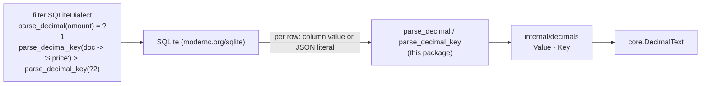

# parse/parsesqlite

Registers the SQL functions parse's SQLite plans compare decimals through, with `modernc.org/sqlite`. SQLite has no exact decimal type: a `NUMERIC` column converts text past 64-bit integers to a double, and `json_extract` reads a JSON number as one. `filter.SQLiteDialect` therefore reads every decimal column and decimal path member through two deterministic functions, so equality, sets, ranges, sorts, keyset seeks and facets on SQLite agree with PostgreSQL's `numeric` and with `filter.Evaluate` to `core.MaxDecimalDigits` (1000) digits.

## Quick Start

```go
func openDB(ctx context.Context, dsn string) (*sql.DB, error) {
	if err := parsesqlite.Register(); err != nil {
		return nil, err
	}
	return sql.Open("sqlite", dsn)
}
```

Register before the database opens its first connection: modernc.org/sqlite installs registered functions on each connection it opens afterwards. Declare decimal columns `TEXT` so they hold every decimal exactly ([decimals](../docs/schema-configuration.md#decimals)). The [example server](../examples/server/main.go) registers in `openDB`.

## Architecture



**Entry points**
- `Register()`: registers both functions with the driver, once per process.
- `Decimal(v)`, `DecimalKey(v)`: the functions over one SQLite value, for registering with another driver.

**Exit points**
- Function results: TEXT, a BLOB or NULL. Nothing is written or logged.

**Failure modes**
- A connection opened before `Register`, or a database whose driver never registered the functions: every statement on a decimal field fails with SQLite's `no such function: parse_decimal` (or `parse_decimal_key`). parse never falls back to a rounded comparison.
- `Register` failing: `parsesqlite: register parse_decimal: a function named "parse_decimal" is already registered` means another package registered that name with modernc.org/sqlite first. `Register` returns its first result on every call.
- A value that holds no decimal (a JSON boolean, a string with an exponent, text that is no number, a BLOB): NULL, so a filter treats it as missing, as `filter.PathValue` does.

**Dependencies**
- *Imports*: `parse/internal/decimals`, `parse/core`, `modernc.org/sqlite`
- *Imported by*: applications running parse plans on SQLite, `parse/internal/dbtest`, the example server
- *Package boundary*: `filter` does not import this package, so the compiler stays driver-free; both read the function names from `internal/decimals`

## Functions

| SQL | Returns | Used for |
|---|---|---|
| `parse_decimal(x)` | `x`'s canonical decimal text (`core.DecimalText`): plain notation, no exponent, no leading or trailing zeros, `0` for either zero; NULL when `x` holds no decimal | equality, `$in` / `$nin` against the set's canonical texts, facet terms |
| `parse_decimal_key(x)` | a BLOB whose bytes order as `x`'s value, equal for equal values; NULL when `x` holds no decimal | ranges, `ORDER BY`, keyset seeks, range facets |

`x` is read as:

| SQLite value | Decimal |
|---|---|
| INTEGER | its digits |
| REAL | its shortest decimal form |
| TEXT holding a JSON number literal (`10.50`, `1.05e1`) | its value: a `TEXT` column's exact decimal, or a document member's number as `->` returns it |
| TEXT holding a JSON string literal (`"9.50"`) | its content, if it is a decimal in plain notation of at most 1000 characters: a document member's string, as `filter.PathValue` reads a decimal member |
| anything else (NULL, a BLOB, JSON `null` / `true` / an object, other text) | none: NULL |

The key is a sign byte (negative, zero, positive), then for a nonzero value `0.d₁…dₙ × 10^e` the exponent `e` biased to two big-endian bytes and the digits; a negative's exponent and digits are complemented and end with `0xFF`, so a greater magnitude orders lower.

## Configuration

None. The functions are pure and deterministic; `Register` takes no options.

## Build and test

From the parse module directory:

```bash
go test -tags=unit -race ./parsesqlite/ ./internal/decimals/
go test -tags=unit -race -run 'TestDecimalMatrix_SQLite|TestEvaluateDecimalConformance' ./ ./filter/
```

`internal/decimals` checks over generated literals that the key orders as `core.CompareDecimals` does. `TestDecimalMatrix_SQLite` runs `filtertest.DecimalCases`, the decimal sorts, keyset walks and facets on SQLite; the PostgreSQL and `filter.Evaluate` runs of the same cases must agree with it.

## Operations

- **Cost**: one Go call per row for each decimal expression a statement evaluates. A key is the value's significant digits plus three bytes.
- **Indexes**: SQLite indexes an expression of deterministic functions. `CREATE INDEX … ON t (parse_decimal_key(amount))` serves decimal ranges, sorts and keyset seeks; `(parse_decimal(amount))` serves equality and sets. An index on them needs the functions on every connection that writes the table, the `sqlite3` shell included, since its maintenance calls them.
- **Health and metrics**: none; a missing registration surfaces as the statement error above.

## Security

The functions read only their argument, allocate at most the value's digits (bounded by `core.MaxDecimalDigits`), and have no side effects. A string member longer than 1000 characters is NULL before it is parsed.

## Code Map

| File | Responsibility |
|---|---|
| [`parsesqlite.go`](parsesqlite.go) | `Register`, `Decimal`, `DecimalKey`, `DecimalFunc`, `DecimalKeyFunc` |
| [`../internal/decimals`](../internal/decimals/decimals.go) | `Value` (a SQLite value as a decimal), `Member` (a document member as a decimal), `Key`, the function names |
