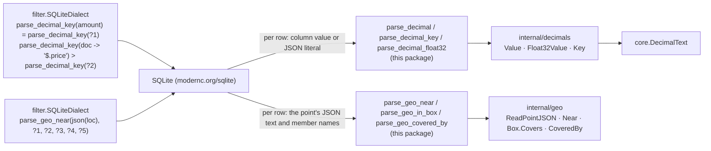

# parse/parsesqlite

Registers the SQL functions parse's SQLite plans compare decimals, key numbers, bound an int or float path's number members and decide geo filters through, with `modernc.org/sqlite`. SQLite has no exact decimal type: a `NUMERIC` column converts text past 64-bit integers to a double, and `json_extract` reads a JSON number as one. `filter.SQLiteDialect` therefore reads every decimal column and decimal path member through deterministic functions, so equality, sets, ranges, sorts, keyset seeks and facets on SQLite agree with PostgreSQL's `numeric` and with `filter.Evaluate` to `core.MaxDecimalDigits` (1000) digits. A numeric facet keys its values through them too, as canonical decimal text. SQLite has no geometry either: geo filters on a JSONB point call functions that decide them as PostGIS does, `$near` by the WGS 84 geodesic distance and `$within` / `$intersects` a box or polygon with its boundary, so SQLite, PostgreSQL with PostGIS and `filter.Evaluate` select the same rows.

## Quick Start

```go
func openDB(ctx context.Context, dsn string) (*sql.DB, error) {
	if err := parsesqlite.Register(); err != nil {
		return nil, err
	}
	return sql.Open("sqlite", dsn)
}
```

Register before the database opens its first connection: modernc.org/sqlite installs registered functions on each connection it opens afterwards. [`parsesql.New`](../parsesql/README.md) then opens the provider on the database and checks the SQLite release it runs ([supported SQLite](../parsesql/README.md#supported-sqlite)); [`parseprovider.Open`](../parseprovider/README.md) registers and opens from configuration. Declare decimal columns `TEXT` so they hold every decimal exactly ([decimals](../docs/schema-configuration.md#decimals)). Timestamp columns need no function: they hold canonical UTC text, which compares and sorts as the instant, and rows the application inserts itself must bind it too ([timestamps](../docs/schema-configuration.md#timestamps)). The [example server](../examples/server/main.go) opens its database through `parseprovider`.

## Architecture



**Entry points**
- `Register()`: registers the six functions with modernc.org/sqlite's `"sqlite"` driver, once per process.
- `RegisterOn(d *sqlite.Driver)`: registers them on a `sqlite.Driver` the caller constructs, which then carries them on its own connections only. Package-level registrations, `Register`'s included, never reach a constructed driver.
- `Functions()`: the table both install, as `Function{Name, NArgs, Call}`, for registering with another SQLite driver ([below](#another-sqlite-driver)).
- `Decimal(v)`, `DecimalKey(v)`, `DecimalFloat32(v)`: the functions over one SQLite value.
- `GeoNear(point, latKey, lonKey, lat, lon, meters)`, `GeoInBox(point, latKey, lonKey, south, north, west, east)`, `GeoCoveredBy(point, latKey, lonKey, polygon)`: the geo functions over a stored point's JSON text, its member names and the bound operands.

**Exit points**
- Function results: TEXT, a BLOB, 1 or 0, or NULL. Nothing is written or logged.

**Failure modes**
- A connection opened before `Register`, or a database whose driver never registered the functions: every statement on a decimal field or an int or float path, and every facet of a number, fails with SQLite's `no such function: parse_decimal` (or `parse_decimal_key`, `parse_decimal_float32`), and every geo filter with `no such function: parse_geo_near` (or `parse_geo_in_box`, `parse_geo_covered_by`). parse never falls back to a rounded comparison or key, or to a spherical distance.
- `Register` failing: `parsesqlite: register parse_decimal: a function named "parse_decimal" is already registered` means another package registered that name with modernc.org/sqlite first. The functions before the taken name in `Functions()` are registered and the rest are not, so fix the conflict rather than retrying: `Register` returns its first result on every call. `RegisterOn` fails the same way on a driver that already has a name, and is not memoized: call it once per driver.
- A value that holds no decimal (a JSON boolean, a string with an exponent, text that is no number, a BLOB): NULL, so a filter treats it as missing, as `filter.PathValue` does.
- A point member that holds no coordinate (missing, JSON `null`, a boolean, an object or array, text float8 rejects such as `1_0`, a value beyond float8's range): the point is NULL, so the geo filter is unknown and `$not` does not select the row. PostgreSQL refuses the query on any of these but a missing or null member; check the stored documents when the two disagree. A member holding `NaN` or `Infinity` is a coordinate on both, and its point is near, in and on nothing.
- `parse_geo_near: geo: decode point: …`: the stored point is not JSON (`json()` in the plan reports malformed JSON first). `want the point's member names as text`, `want the point as JSON text`, `want a number for operand n`, `parse_geo_covered_by: want the polygon as a WKB blob` or `geo: want a little-endian one-ring polygon WKB`: hand-written SQL called a geo function with arguments `filter.SQLiteDialect` never binds. The operands are checked before the point, so the error comes on the first row, a NULL point's included. The dialect passes `json(column)`, the member names as text, numbers, and the polygon `geo.AppendPolygonWKB` writes.

**Dependencies**
- *Imports*: `parse/internal/decimals`, `parse/internal/geo`, `gowalker` (type text in errors), `modernc.org/sqlite`
- *Imported by*: applications running parse on SQLite, `parse/parseprovider`, `parse/internal/dbtest`
- *Package boundary*: `filter` does not import this package, so the compiler stays driver-free; both read the function names from `internal/decimals` and `internal/geo`

## Functions

The constants `DecimalFunc`, `DecimalKeyFunc`, `DecimalFloat32Func`, `GeoNearFunc`, `GeoInBoxFunc` and `GeoCoveredByFunc` hold the SQL names below, as `filter.SQLiteDialect` calls them.

| SQL | Returns | Used for |
|---|---|---|
| `parse_decimal(x)` | `x`'s canonical decimal text (`core.DecimalText`): plain notation, no exponent, no leading or trailing zeros, `0` for either zero; NULL when `x` holds no decimal | facet terms, a decimal field's value as a statement reads it (`filter.FieldExpr`), whether an int or float path's member written with an exponent or more than 1000 characters is a number member |
| `parse_decimal_key(x)` | a BLOB whose bytes order as `x`'s value, equal exactly where the values are; NULL exactly where `parse_decimal(x)` is | equality, `$ne`, `$in` / `$nin` against each member's key, ranges, `ORDER BY`, keyset seeks, range facets |
| `parse_decimal_float32(x)` | the canonical decimal text of `x` rounded to float32 (an INTEGER, a REAL or TEXT holding a JSON number literal); NULL for anything else or a value beyond float32's range | facet terms of a `float32` field, whose REAL column holds the double of the float32 (`0.10000000149011612` for `0.1`) |

`x` is read as:

| SQLite value | Decimal |
|---|---|
| INTEGER | its digits |
| REAL | its shortest decimal form |
| TEXT holding a JSON number literal (`10.50`, `1.05e1`) | its value: a `TEXT` column's exact decimal, or a document member's number as `->` returns it |
| TEXT holding a JSON string literal (`"9.50"`) | its content, if it is a decimal in plain notation of at most 1000 characters: a document member's string, as `filter.PathValue` reads a decimal member |
| anything else (NULL, a BLOB, JSON `null` / `true` / an object, other text) | none: NULL |

The key is a sign byte (negative, zero, positive), then for a nonzero value `0.d₁…dₙ × 10^e` the exponent `e` biased to two big-endian bytes and the digits; a negative's exponent and digits are complemented and end with `0xFF`, so a greater magnitude orders lower.

### Geo functions

| SQL | Returns | Used for |
|---|---|---|
| `parse_geo_near(point, latKey, lonKey, lat, lon, meters)` | 1 when the stored point lies within `meters` of `(lat, lon)` by the geodesic distance on the WGS 84 ellipsoid, as PostGIS's `ST_DWithin` measures geography (Karney's algorithm, to nanometres), else 0; a stored latitude beyond a pole is coerced as geography coerces it; NULL when the point is | `$near` |
| `parse_geo_in_box(point, latKey, lonKey, south, north, west, east)` | 1 when the stored point lies in the box or on its edge, else 0; NULL when the point is | `$within` and `$intersects` a box |
| `parse_geo_covered_by(point, latKey, lonKey, polygon)` | 1 when the stored point lies in the polygon or on its boundary (the ring's winding number, as PostGIS's point-in-polygon test), else 0; NULL when the point is. `polygon` is a little-endian one-ring polygon WKB in lon/lat order | `$within` and `$intersects` a polygon |

`point` is the column's JSON text (`json(column)` in the plan); it is NULL when the column is NULL, is not an object, or lacks a coordinate under `latKey` or `lonKey`. A duplicated member reads its last value, as jsonb keeps it. Each member is read as PostgreSQL reads `(doc->>'lat')::float8`:

| Member | Coordinate |
|---|---|
| a JSON number (`10`, `1e1`) | its value |
| a JSON string float8 accepts: decimal (`"10"`, `" 10 "`, `"1e1"`, `".5"`), hexadecimal (`"0x10"`, `"0x1.8"`, `"0x1p3"`), `"NaN"`, `"Infinity"`, `"-inf"` | its value; a point holding NaN or an infinity is near, in and on nothing |
| missing, JSON `null`, a boolean, an object, an array, a string float8 rejects (`"1_0"`, `"1e"`, `"ten"`), a value beyond float8's range (`1e400`, `"1e-400"`) | none: the point is NULL |

### Another SQLite driver

`Functions()` is the registration contract: each entry's `Name` is what `filter.SQLiteDialect` calls, `NArgs` how many arguments it passes, and `Call` the implementation over the `database/sql/driver` values a scalar function receives. Register every entry, as a deterministic function: SQLite uses an index on an expression only when its functions are deterministic. `parsesql.New` checks the release the database runs ([supported SQLite](../parsesql/README.md#supported-sqlite)).

| Name | Arguments |
|---|---|
| `parse_decimal` | 1 |
| `parse_decimal_key` | 1 |
| `parse_decimal_float32` | 1 |
| `parse_geo_near` | 6 |
| `parse_geo_in_box` | 7 |
| `parse_geo_covered_by` | 4 |

The functions need nothing from modernc.org/sqlite, but this package registers them with it, so a program on another driver that imports it links modernc.org/sqlite too. They are not split into a driver-free package: the exported functions and names would then live in two places.

## Supported SQLite

The SQLite release parse's statements need, and its check, are [`parsesql`'s](../parsesql/README.md#supported-sqlite): the functions here run on any release.

## Configuration

None. The functions are pure and deterministic; `Register` takes no options.

## Build and test

From the parse module directory:

```bash
go test -tags=unit -race ./parsesqlite/ ./internal/decimals/ ./internal/geo/
go test -tags=unit -race -run 'TestEvaluateDecimalConformance|TestEvaluateGeoConformance|TestEvaluateConformance' ./filter/
# The matrices run on SQLite and PostgreSQL in the integration lane. The PostgreSQL runs read
# PARSE_POSTGRES_DSN and PARSE_POSTGIS_DSN (make parse-postgres-up starts a server and prints them)
# and skip when they are unset; -run 'TestDecimalMatrix/sqlite' selects one backend's run.
go test -tags=integration -run 'TestDecimalMatrix|TestNumberKeys|TestGeoMatrix|TestFilterMatrix' ./
go test -tags=integration -run 'MatchesPostGIS' ./internal/geo/
```

`internal/decimals` checks over generated literals that the key orders as `core.CompareDecimals` does. `TestDecimalKey_EqualExactlyWhereTextIsEqual` compares every pair of stored forms in SQL (INTEGER, REAL, TEXT in plain and exponent notation, a member's JSON string, either zero, BLOB, NULL and text that is no number), and each with the canonical text a filter binds: two keys are equal exactly where `parse_decimal`'s texts are, and NULL together; `FuzzDecimalKey_EqualExactlyWhereTextIsEqual` checks the same over generated values. `TestDecimalMatrix/sqlite` runs `filtertest.DecimalCases`, the decimal sorts, keyset walks and facets on SQLite; `TestDecimalMatrix/postgres` and the `filter.Evaluate` run of the same cases must agree with it. `TestNumberKeys/sqlite` counts `filtertest.NumberKeyFacets` (number members written several ways, float64, float32 and int columns) on SQLite; `TestNumberKeys/postgres` and `filter.FacetKeys` must count the same buckets. `internal/geo` checks the distance against GeographicLib's test set to 1e-8 m; with PostGIS (`PARSE_POSTGIS_DSN`) it checks thousands of seeded distances against `ST_Distance` and `ST_DWithin`, and points at polygons' vertices and edges against `ST_CoveredBy` and `ST_Intersects`. `TestGeoMatrix/sqlite` runs `filtertest.GeoCases` (members held as numbers and strings, partial points, latitudes beyond a pole) and `TestFilterMatrix/sqlite` the operator cases' geo filters; their `postgres` runs, on PostGIS, and `filter.Evaluate` run the same cases.

## Operations

- **Cost**: one Go call per row for each decimal expression a statement evaluates, and for each number a facet keys. A key is one byte for zero; otherwise the value's significant digits plus three bytes, and one more for a negative, which ends with a terminator. A geo filter is one call per row, which decodes the point's JSON text: a distance then iterates a handful of times (more near the antipode), a polygon test is linear in its points (at most 100).
- **Indexes**: no index serves a geo filter on SQLite; it reads every row its other predicates leave. SQLite indexes an expression of deterministic functions. `CREATE INDEX … ON t (parse_decimal_key(amount), id)`, the key and then the keyset's tiebreaker, serves decimal equality, sets, ranges, sorts and keyset seeks. An index on them needs the functions on every connection that writes the table, the `sqlite3` shell included, since its maintenance calls them.
- **Stored results**: what `parse_decimal`, `parse_decimal_key` and `parse_decimal_float32` return for a stored value is a persisted format, held by every index on them; the bytes of `parse_decimal_key` are pinned by golden vectors in `internal/decimals`. Any change in what one of them returns for a value already stored is a breaking change, whether it changes a key's bytes or which values have a result at all: 0.15.0 reads a BLOB as no decimal (NULL), where 0.14.0 read the decimal text a BLOB held. SQLite trusts a deterministic function to return what it returned when an index entry was written, so after such a release an index built before it answers equality, ranges, sorts and keyset seeks with other rows than a scan finds, without an error, until it is rebuilt: see [upgrading across a change in results](#upgrading-across-a-change-in-results).
- **Health and metrics**: none; a missing registration surfaces as the statement error above.

### Upgrading across a change in results

Run these on a connection with the functions registered, through the application's driver: maintaining an index on them calls them, and the `sqlite3` shell has none of them. For each table `t` with an index on a decimal function of a column `amount`:

1. Find the values whose result changed; for 0.15.0, BLOBs: `SELECT count(*) FROM t WHERE typeof(amount) = 'blob'`. parse writes a decimal as canonical TEXT, so only rows the application wrote itself, from a Go `[]byte`, hold one.
2. Convert them to TEXT: `UPDATE t SET amount = CAST(amount AS TEXT) WHERE typeof(amount) = 'blob'`.
3. Rebuild the indexes: `REINDEX t`, or each index by name. A value left unconverted is then NULL in the index as in a scan.
4. Check: `PRAGMA integrity_check(t)` returns `ok`. Before the rebuild it names each index that disagrees with its rows: `row 1 missing from index t_amount`.

Converting before the upgrade, on the release that wrote the BLOBs, keeps the indexes consistent throughout, since that release reads the converted text as it read the BLOB; steps 3 and 4 after the upgrade cost a rebuild and confirm it.

## Security

The functions read only their argument, allocate at most the value's digits (bounded by `core.MaxDecimalDigits`), and have no side effects. A decimal string member longer than 1000 characters is NULL before it is parsed. A polygon blob must hold exactly the points its header counts, at least four of them with the last repeating the first, and its points must be finite, before it is read.

## Code Map

| File | Responsibility |
|---|---|
| [`parsesqlite.go`](parsesqlite.go) | `Function` and the `Functions` table, `Register`, `RegisterOn`, `Decimal`, `DecimalKey`, `DecimalFloat32`, `GeoNear`, `GeoInBox`, `GeoCoveredBy` and the function names |
| [`../internal/decimals`](../internal/decimals/decimals.go) | `Value` (a SQLite value as a decimal), `Float32Value` (as a float32), `Member` (a document member as a decimal), `Key`, the function names |
| [`../internal/geo`](../internal/geo/geo.go) | `Distance` (WGS 84 geodesic, ported from GeographicLib), `Geodetic`, `Box`, `CoveredBy`, `Near`, `ReadPoint` / `ReadPointJSON` and `Coordinate` (a stored point, its members read as float8), the polygon WKB, the function names |
